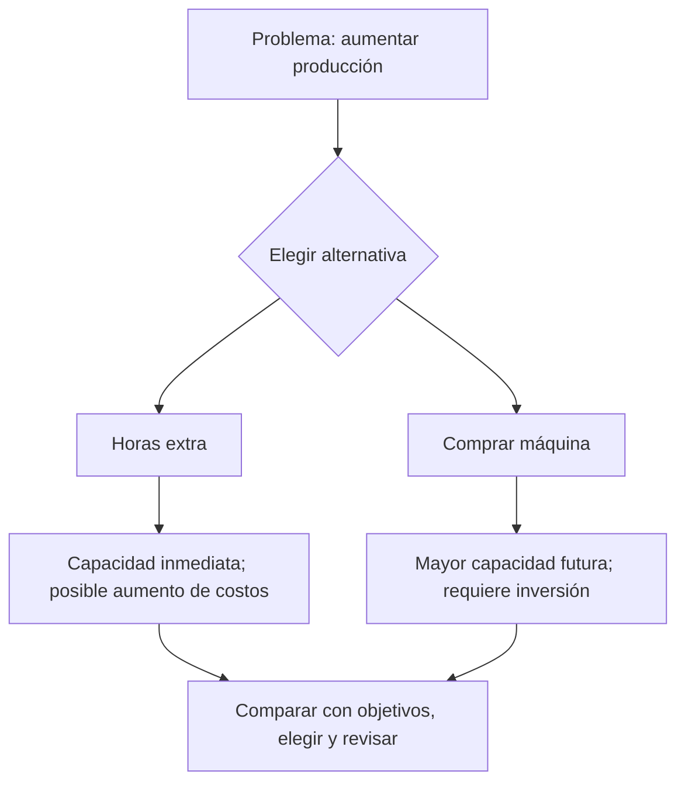
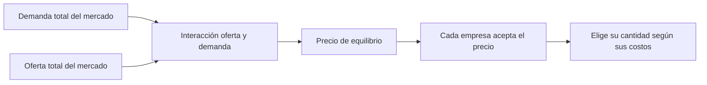
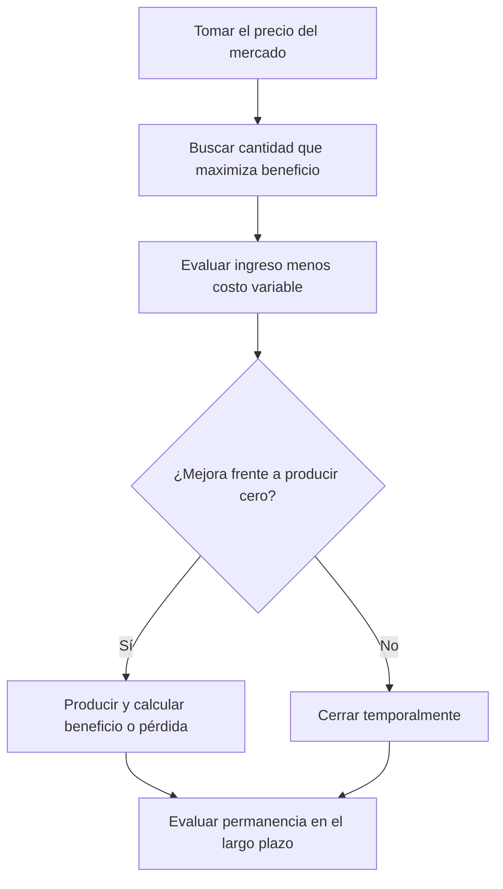
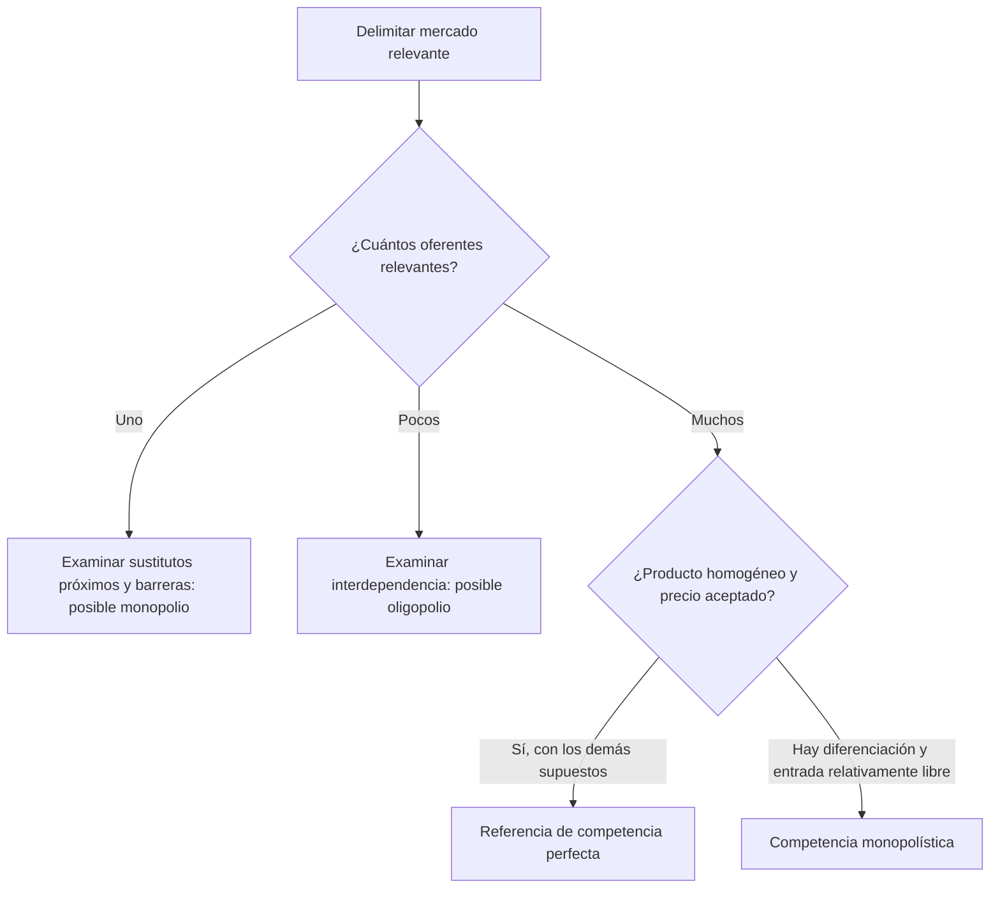
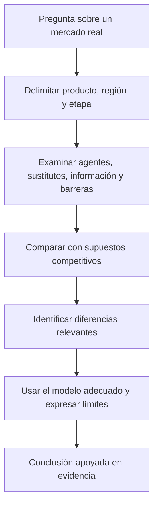

# 📚 GUÍA INTEGRAL DE MICROECONOMÍA — EXAMEN UNIVERSITARIO
## Semanas 9, 10, 14, 16 y 17

> **🎯 Objetivo:** comprender, calcular, explicar y dibujar en bloques de **10–30 minutos**. Incluye **14 temas y 70 ejercicios**, cinco por tema, con **claves desplegables**, definiciones técnicas y Feynman, glosario, fórmulas, gráficas y dos simulacros.
>
> **📎 Material base:** se conserva el desarrollo de semanas 9 y 10 del Markdown proporcionado y se integran las semanas 14, 16 y 17 a partir de sus tres PDF. Las prácticas nuevas y los desarrollos complementarios se identifican como apoyo pedagógico.
>
> **Cómo leer las señales:** 📘 teoría · 🧒 explicación Feynman · ⚠️ concepto difícil · 🎯 importante para examen · 📐 gráfica · ✏️ práctica · 🔑 clave · ⏱️ sesión · ✅ autoevaluación.
>
> **Uso del archivo:** pulsa las claves para abrirlas en un visor Markdown compatible con HTML. Las gráficas SVG están integradas en el propio archivo; los diagramas Mermaid requieren un visor compatible. Cada tema ofrece también instrucciones manuales o esquemas legibles sin imágenes externas.

## 🧭 ÍNDICE GENERAL

- [⏱️ Plan de estudio](#plan)
- [📚 Semanas 9 y 10](#semanas-9-10)
  - [Tema 1 — Oferta, ley de oferta y determinantes](#tema-1)
  - [Tema 2 — Oferta individual, de mercado y función de oferta](#tema-2)
  - [Tema 3 — Variaciones en cantidad ofrecida y en oferta](#tema-3)
  - [Tema 4 — Elasticidad precio de la oferta](#tema-4)
  - [Tema 5 — Producción, tecnología y costos](#tema-5)
  - [Tema 6 — FPP o curva de transformación](#tema-6)
  - [Tema 7 — Tiempo y toma de decisiones](#tema-7)
- [📚 Semana 14](#semana-14)
  - [Tema 8 — Competencia perfecta y equilibrio](#tema-8)
  - [Tema 9 — Ingresos, costos y decisión competitiva](#tema-9)
  - [Tema 10 — Estructuras de mercado](#tema-10)
- [📚 Semana 16](#semana-16)
  - [Tema 11 — Monopolio: demanda, ingresos y decisión](#tema-11)
  - [Tema 12 — Barreras, transporte y recursos](#tema-12)
  - [Tema 13 — Comparación, eficiencia y bienestar](#tema-13)
- [📚 Semana 17](#semana-17)
  - [Tema 14 — Realismo de la competencia perfecta](#tema-14)
- [📐 Manual universal de gráficas](#graficas)
- [📖 Glosario y formulario de todas las semanas](#glosario)
- [📝 Simulacros, claves y listas de control](#simulacros)
- [📎 Notas y referencias](#referencias)

---

<a id="plan"></a>
# 1. ⏱️ PLAN PARA UNA ATENCIÓN DE 10 A 30 MINUTOS

## Regla de oro: recuperación activa antes que relectura

La secuencia por bloque es **recordar sin mirar → aprender → dibujar/calcular → explicar con tus palabras → comprobar**. No tienes que sostener 2 horas de concentración continua. Divide el temario y detente al terminar un objetivo concreto.

| Si tienes | Estructura | Entregable obligatorio |
|---|---|---|
| **10 minutos** | 2 min recordar + 4 min un concepto + 3 min un ejercicio + 1 min Feynman | Una definición propia y un resultado |
| **20 minutos** | 3 min repaso + 7 min teoría + 7 min 2 ejercicios/gráfica + 3 min autocorrección | Una gráfica o dos ejercicios correctos |
| **30 minutos** | 5 min recuperar + 10 min teoría + 10 min tres ejercicios + 5 min revisar errores | Tres aciertos y explicación oral |

**Pausa sugerida:** 5 minutos entre bloques; después de 2–3 bloques, una pausa más amplia. Si pierdes el hilo a los 12 minutos, termina el microobjetivo y descansa: el plan no exige llegar a 30.

## Primera etapa: semanas 9 y 10 — plan de 8 días (ajustable sin fecha de examen)

| Día | Bloques de 10–30 min | Objetivo verificable |
|---|---|---|
| 1 | Tema 1; definiciones; ejercicios 1–5 | Diferenciar oferta, cantidad ofrecida y sus determinantes |
| 2 | Tema 2; tablas; sumas; 5 prácticas | Graficar tabla y sumar ofertas individuales |
| 3 | Tema 3; tres gráficas; 5 prácticas | Explicar movimiento frente a desplazamiento |
| 4 | Tema 4; fórmulas; 5 prácticas | Calcular e interpretar elasticidades |
| 5 | Tema 5; costos y producción; 5 prácticas | Distinguir corto/largo plazo y calcular CT |
| 6 | Tema 6; dibujar las dos FPP originales; 5 prácticas | Clasificar puntos y hallar costo de oportunidad |
| 7 | Tema 7; árbol decisional; 5 prácticas; glosario | Ejecutar los 7 pasos y argumentar una decisión |
| 8 | Simulacro + repaso de errores + gráficas de memoria | ≥80% y explicar cada error sin consultar |

**Repaso urgente de semanas 9 y 10:** cuatro bloques de 20 min: (1) oferta y desplazamientos, (2) elasticidad, (3) FPP y costos, (4) simulacro y glosario. Prioriza cálculos y gráficas.

## Cómo estudiar de verdad cada tema

- **Primera vuelta — Reconocer:** lee las definiciones y la sección Feynman; subraya la diferencia con conceptos parecidos.
- **Segunda vuelta — Producir:** oculta la clave; escribe 3 conceptos, resuelve 2 ejercicios y dibuja la gráfica correspondiente.
- **Tercera vuelta — Transferir:** cambia números/productos, explica la intuición, identifica el error que cometería otra persona.
- **Prueba de dominio:** aciertas 4 de 5 prácticas **sin ver las respuestas** y puedes defender verbalmente la respuesta en un minuto.

---


## Segunda etapa: semanas 14, 16 y 17 — diez días

Las letras A–G de esta agenda corresponden a los temas 8–14, respectivamente.


| Día | Sesiones propuestas | Meta verificable |
|---|---|---|
| 1 | A: 20 + 20 min | Enumerar los supuestos y resolver A1–A3 |
| 2 | A: 10; B: 30 + 20 min | Distinguir demanda del mercado/empresa y resolver B1–B3 |
| 3 | B: 20 + 20 min | Decidir producir/cerrar y resolver B4–B5; repetir un error |
| 4 | C: 20 + 20 min | Clasificar cuatro estructuras; resolver C1–C5 |
| 5 | D: 30 + 20 min | Obtener IMg, cantidad y precio; resolver D1–D3 |
| 6 | D: 20; E: 20 + 20 min | Resolver D4–D5 y E1–E3 |
| 7 | E: 20; F: 30 min | Resolver E4–E5 y calcular excedentes en F1–F2 |
| 8 | F: 20 + 20 min | Resolver F3–F5 y dibujar la pérdida de eficiencia |
| 9 | G: 20 + 20 min | Resolver G1–G5 con evidencia y límites |
| 10 | 30 + 20 + 10 min | Simulacro, corrección y repaso oral del glosario |

**Repaso espaciado:** vuelve a cada tema al día siguiente, tres días después y una semana después, si el calendario lo permite. Dedica primero 3 minutos a recordar sin consultar. Cambia el orden de los problemas para evitar memorizar únicamente la secuencia.

**Criterio de dominio:** al menos cuatro de cinco problemas correctos, una gráfica reconstruida desde cero y una explicación de 60 segundos sin leer. Si fallas, registra «qué pensé / por qué estaba mal / regla correcta / ejemplo nuevo» y repite al día siguiente.


---

<a id="semanas-9-10"></a>
# 📚 SEMANAS 9 Y 10 — CONTENIDO BASE

<a id="tema-1"></a>
# 2. 📘 TEMA 1 — OFERTA, LEY DE OFERTA Y DETERMINANTES

**Base:** *Oferta de mercado*, págs. 2–6 y 10–12; *Semana 9*, págs. 1–2.

### Concepto: oferta
**Definición técnica (material):** cantidad de bienes o servicios que las empresas ponen a disposición de los consumidores a determinados precios, en un mercado y período determinados.  
**🧒 Feynman:** imagina una panadería: no importa cuántos panes quisiera comprar la gente, sino **cuántos panes estaría dispuesta a vender** la panadería a cada precio.

### Concepto: cantidad ofrecida
**Definición técnica:** número específico de unidades que un productor está dispuesto a vender **a un precio particular**, bajo las demás condiciones constantes.  
**🧒 Feynman:** *oferta* es el menú completo de opciones; *cantidad ofrecida* es una sola casilla de ese menú.

### Concepto: ley fundamental oferta-precio
**Definición técnica (material):** la cantidad ofrecida tiende a variar en sentido directo con el precio, **ceteris paribus**.  
**🧒 Feynman:** si vender un pastel deja más dinero, la pastelería normalmente querrá ofrecer más pasteles.

### ⚠️ CONCEPTO DIFÍCIL: *ceteris paribus*
**Definición técnica (ampliación):** supuesto que mantiene constantes otros factores distintos de la variable estudiada. La ley de oferta aísla el efecto del **precio del propio bien**.  
**🧒 Feynman:** para saber qué hace subir un globo, cambia solo una cosa a la vez; de lo contrario no sabes cuál fue la causa.

### Determinantes del material
| Objetivos | Subjetivos | Circunstancias adicionales |
|---|---|---|
| Precio, costos de factores, tamaño de mercado, disponibilidad de factores, competidores, perecibilidad, inventarios, sustitutos y necesidad de liquidez | Expectativa de precio futuro, aspiración de crecimiento social, amor propio y voluntad de vender | Ubicación, transporte, ambiente, tecnología y condiciones sociopolíticas |

**Clave de interpretación:** para un gráfico de oferta, distingue el **precio propio** (movimiento a lo largo) de los **otros determinantes** (potencial desplazamiento). Una subida en los costos normalmente desplaza la oferta a la izquierda; una mejora tecnológica normalmente a la derecha. Las expectativas y otros factores pueden requerir explicar el contexto.

### Prácticas del tema 1 — [PRÁCTICA NUEVA]
1. Una tienda vende 40 cuadernos a Q5 y 75 a Q8, manteniendo iguales las demás condiciones. ¿Qué ley ilustra? ¿Cuánto cambió la cantidad?
2. Un temporal destruye cosechas de tomate. ¿Es cambio de precio propio o determinante distinto? ¿Qué dirección esperas para la oferta?
3. Señala **dos determinantes subjetivos** y **tres objetivos** según las lecturas.
4. Un vendedor guarda maíz porque piensa que mañana pagarán más. ¿Cuál determinante explica su comportamiento? ¿Qué ocurre normalmente con oferta presente?
5. Una empresa baja el precio de Q10 a Q7 y reduce su cantidad ofrecida de 140 a 100. ¿Cuál es la variación porcentual de cantidad usando base inicial?

<details><summary><strong>🔑 Clave razonada — Tema 1</strong></summary>

1. Ley de oferta; ΔQ = 75 − 40 = **35 unidades**; ambos cambios son positivos.
2. **Condiciones medioambientales**; normalmente **disminución de oferta** (desplazamiento a izquierda) a cada precio, no necesariamente movimiento sobre la misma curva.
3. Subjetivos: expectativas y voluntad de vender (también aspiración social o amor propio). Objetivos: precio, costos y número de competidores (entre los listados).
4. Expectativa de precios futuros; puede **reducir la oferta actual** por retención de inventario.
5. (100 − 140) / 140 × 100 = **−28.57%**. La cantidad ofrecida se contrajo.

</details>

---

<a id="tema-2"></a>
# 3. 📘 TEMA 2 — OFERTA INDIVIDUAL, DE MERCADO Y FUNCIÓN DE OFERTA

**Base:** *Oferta de mercado*, págs. 7–13; *Semana 9*, pág. 3.

### Oferta individual
**Definición técnica (material):** cantidades que un productor estaría dispuesto a ofrecer a cada nivel de precio, considerando rentabilidad y costos.  
**🧒 Feynman:** cuántos jugos vendería **una** tienda si cuestan Q4, Q5 o Q6.

### Oferta de mercado
**Definición técnica (material):** suma de las cantidades ofrecidas por los diferentes productores a **cada mismo nivel de precio**.  
**🧒 Feynman:** reúne todas las tiendas y suma sus jugos cuando todos ven el precio Q5; después repite para Q6.

### ⚠️ CONCEPTO DIFÍCIL: suma horizontal
**Definición técnica (ampliación):** para cada precio P, la cantidad total es `Q_mercado(P) = Σ Q_i(P)`. **No sumes precios**.  
**🧒 Feynman:** si Ana ofrece 7 panes a Q2 y Luis ofrece 9 panes a Q2, en ese mismo precio hay **16 panes**.

### Tabla real de las diapositivas

| Precio, Q | Cantidad ofrecida |
|---:|---:|
| 5.00 | 400 |
| 5.50 | 600 |
| 6.00 | 800 |
| 6.50 | 1,200 |
| 7.00 | 2,000 |
| 7.50 | 3,000 |
| 8.00 | 5,000 |

<svg xmlns="http://www.w3.org/2000/svg" viewBox="0 0 680 400" role="img" aria-label="Oferta: datos de las diapositivas">
<rect width="680" height="400" fill="white"/>
<text x="340" y="25" text-anchor="middle" font-family="sans-serif" font-size="17">Oferta: datos de las diapositivas</text>
<path d="M65 55 V335 H630" fill="none" stroke="#18283c" stroke-width="2"/>
<path d="M65.0 335 v5 M60 335.0 h5" stroke="#18283c"/>
<text x="65.0" y="357" text-anchor="middle" font-family="sans-serif" font-size="12">0</text>
<text x="54" y="339.0" text-anchor="end" font-family="sans-serif" font-size="12">0</text>
<path d="M176.0 335 v5 M60 281.0 h5" stroke="#18283c"/>
<text x="176.0" y="357" text-anchor="middle" font-family="sans-serif" font-size="12">1100</text>
<text x="54" y="285.0" text-anchor="end" font-family="sans-serif" font-size="12">1.8</text>
<path d="M287.0 335 v5 M60 227.0 h5" stroke="#18283c"/>
<text x="287.0" y="357" text-anchor="middle" font-family="sans-serif" font-size="12">2200</text>
<text x="54" y="231.0" text-anchor="end" font-family="sans-serif" font-size="12">3.6</text>
<path d="M398.0 335 v5 M60 172.99999999999997 h5" stroke="#18283c"/>
<text x="398.0" y="357" text-anchor="middle" font-family="sans-serif" font-size="12">3300</text>
<text x="54" y="176.99999999999997" text-anchor="end" font-family="sans-serif" font-size="12">5.4</text>
<path d="M509.0 335 v5 M60 119.0 h5" stroke="#18283c"/>
<text x="509.0" y="357" text-anchor="middle" font-family="sans-serif" font-size="12">4400</text>
<text x="54" y="123.0" text-anchor="end" font-family="sans-serif" font-size="12">7.2</text>
<path d="M620.0 335 v5 M60 65.0 h5" stroke="#18283c"/>
<text x="620.0" y="357" text-anchor="middle" font-family="sans-serif" font-size="12">5500</text>
<text x="54" y="69.0" text-anchor="end" font-family="sans-serif" font-size="12">9</text>
<polyline points="105.36,185.00 125.55,170.00 145.73,155.00 186.09,140.00 266.82,125.00 367.73,110.00 569.55,95.00" fill="none" stroke="#2563eb" stroke-width="3"/>
<text x="194.09090909090907" y="131.0" font-family="sans-serif" font-size="14" fill="#2563eb">S</text>
<text x="350" y="389" text-anchor="middle" font-family="sans-serif" font-size="14">Cantidad ofrecida</text>
<text x="68" y="48" font-family="sans-serif" font-size="13">Precio (Q)</text>
</svg>

**Importante para examen:** el gráfico de la diapositiva 11 representa precio horizontal y cantidad vertical, mientras que **la convención habitual en microeconomía es cantidad horizontal (X) y precio vertical (Y)**. Dibuja según la indicación docente; esta guía emplea la convención estándar.

### Función de oferta
**Definición técnica:** relación matemática que asigna a cada precio una cantidad ofrecida cuando el resto de factores se mantiene fijo.  
**🧒 Feynman:** es una máquina: introduces el precio y te dice cuántas unidades quiere vender una empresa.

**Ejemplo literal del material:** `Qx = 45 + 1.5P` con P = Q3, Q4.50 y Q7.

| Precio P | Sustitución | Cantidad ofrecida Qx |
|---:|---|---:|
| 3.00 | 45 + 1.5(3) | **49.5** |
| 4.50 | 45 + 1.5(4.5) | **51.75** |
| 7.00 | 45 + 1.5(7) | **55.5** |

**Advertencia:** puede aparecer cantidad fraccionaria en una función teórica; si el ejercicio habla de artículos indivisibles, explica el redondeo solo si el enunciado lo pide.

### Dibujar a mano una curva de oferta en 7 pasos
1. Lee la tabla y detecta **qué columna es P y cuál Q**.
2. Dibuja un ángulo recto con regla; **X = cantidad, Y = precio**.
3. Escoge escalas proporcionales que contengan el máximo: por ejemplo X de 0 a 5,000 en intervalos de 1,000; Y de Q5 a Q8 en tramos Q0.50.
4. Sitúa puntos como `(400,5)`, `(600,5.5)` y `(5000,8)`; recuerda **(cantidad, precio)**.
5. Marca pequeños puntos, comprueba que corresponden a la tabla.
6. Une siguiendo la tendencia real de los datos, sin inventar que es recta si no lo es.
7. Titula **S** y anota unidades. Debe ser una curva creciente.

### Prácticas del tema 2 — [PRÁCTICA NUEVA salvo 1]
1. **[DEL MATERIAL]** Resuelve `Qx=45+1.5P` para P=3, 4.5 y 7; grafica los tres puntos.
2. A Q6, el productor A ofrece 20 y B 35; a Q8, A ofrece 30 y B 50. Completa la tabla de oferta del mercado y grafica.
3. Si `Qs=12+4P`, calcula Q para P=5 y despeja P cuando Q=52.
4. A P=Q10 tres productores ofrecen 40, 15 y 25; a P=Q12 ofrecen 50, 20 y 35. ¿Qué cantidades ofrece el mercado?
5. La tabla P/Q es (2/10), (3/20), (4/30). ¿Qué relación lineal `Q=a+bP` describe estos puntos?

<details><summary><strong>🔑 Clave razonada — Tema 2</strong></summary>

1. **49.5, 51.75, 55.5**; puntos gráficos (49.5,3), (51.75,4.5), (55.5,7).
2. P=6: 20+35=**55**; P=8: 30+50=**80**. Puntos (55,6) y (80,8).
3. Q=12+4(5)=**32**; 52=12+4P → 40=4P → **P=10**.
4. P=10: **80**; P=12: **105**. Siempre suma cantidades de productores al precio compartido.
5. ΔQ/ΔP=(20−10)/(3−2)=10; a=10−10(2)=−10 → **Q=−10+10P** para los puntos indicados.

</details>

---

<a id="tema-3"></a>
# 4. 📘 TEMA 3 — VARIACIONES EN CANTIDAD OFRECIDA Y EN OFERTA

**Base:** *Oferta de mercado*, pág. 14; *Semana 9*, págs. 3–4.

### Expansión o contracción de cantidad ofrecida
**Definición técnica (material):** cambio en la cantidad que se ofrece ante una variación del precio del propio bien, manteniéndose los demás factores; se representa con **movimiento sobre la curva existente**.  
**🧒 Feynman:** caminas hacia arriba o abajo **por el mismo tobogán**; no construyes otro tobogán.

### Aumento o disminución de la oferta
**Definición técnica (material):** variación de toda la relación precio-cantidad producida por factores diferentes al precio propio, como costos, tecnología, disponibilidad de insumos o competidores.  
**🧒 Feynman:** ahora **mueves el tobogán entero** hacia la derecha o izquierda: para el mismo precio se venderá más o menos.

### ⚠️ EL ERROR MÁS EXAMINABLE
- **Precio propio ↑, otros constantes:** movimiento **arriba y a la derecha** sobre S, expansión de la **cantidad ofrecida**.
- **Precio propio ↓, otros constantes:** movimiento **abajo y a la izquierda** sobre S, contracción de la **cantidad ofrecida**.
- **Mejora tecnológica:** típicamente S → derecha: **aumenta la oferta**.
- **Suben costos de materias primas:** típicamente S → izquierda: **disminuye la oferta**.

<svg xmlns="http://www.w3.org/2000/svg" viewBox="0 0 680 400" role="img" aria-label="Movimiento en S y desplazamiento a S1">
<rect width="680" height="400" fill="white"/>
<text x="340" y="25" text-anchor="middle" font-family="sans-serif" font-size="17">Movimiento en S y desplazamiento a S1</text>
<path d="M65 55 V335 H630" fill="none" stroke="#18283c" stroke-width="2"/>
<path d="M65.0 335 v5 M60 335.0 h5" stroke="#18283c"/>
<text x="65.0" y="357" text-anchor="middle" font-family="sans-serif" font-size="12">0</text>
<text x="54" y="339.0" text-anchor="end" font-family="sans-serif" font-size="12">0</text>
<path d="M176.0 335 v5 M60 281.0 h5" stroke="#18283c"/>
<text x="176.0" y="357" text-anchor="middle" font-family="sans-serif" font-size="12">20</text>
<text x="54" y="285.0" text-anchor="end" font-family="sans-serif" font-size="12">2</text>
<path d="M287.0 335 v5 M60 227.0 h5" stroke="#18283c"/>
<text x="287.0" y="357" text-anchor="middle" font-family="sans-serif" font-size="12">40</text>
<text x="54" y="231.0" text-anchor="end" font-family="sans-serif" font-size="12">4</text>
<path d="M398.0 335 v5 M60 173.0 h5" stroke="#18283c"/>
<text x="398.0" y="357" text-anchor="middle" font-family="sans-serif" font-size="12">60</text>
<text x="54" y="177.0" text-anchor="end" font-family="sans-serif" font-size="12">6</text>
<path d="M509.0 335 v5 M60 119.0 h5" stroke="#18283c"/>
<text x="509.0" y="357" text-anchor="middle" font-family="sans-serif" font-size="12">80</text>
<text x="54" y="123.0" text-anchor="end" font-family="sans-serif" font-size="12">8</text>
<path d="M620.0 335 v5 M60 65.0 h5" stroke="#18283c"/>
<text x="620.0" y="357" text-anchor="middle" font-family="sans-serif" font-size="12">100</text>
<text x="54" y="69.0" text-anchor="end" font-family="sans-serif" font-size="12">10</text>
<polyline points="65.00,308.00 398.00,146.00" fill="none" stroke="#2563eb" stroke-width="3"/>
<text x="406.0" y="137.0" font-family="sans-serif" font-size="14" fill="#2563eb">S</text>
<polyline points="176.00,308.00 509.00,146.00" fill="none" stroke="#15803d" stroke-width="3"/>
<text x="517.0" y="137.0" font-family="sans-serif" font-size="14" fill="#15803d">S1: menor costo</text>
<path d="M65 254.0 H176.0 V335" stroke="#64748b" stroke-dasharray="4 4" fill="none"/>
<circle cx="176.0" cy="254.0" r="4" fill="#0f172a"/>
<text x="183.0" y="271.0" font-family="sans-serif" font-size="13">A</text>
<path d="M65 173.0 H342.5 V335" stroke="#64748b" stroke-dasharray="4 4" fill="none"/>
<circle cx="342.5" cy="173.0" r="4" fill="#0f172a"/>
<text x="349.5" y="190.0" font-family="sans-serif" font-size="13">B</text>
<text x="350" y="389" text-anchor="middle" font-family="sans-serif" font-size="14">Cantidad</text>
<text x="68" y="48" font-family="sans-serif" font-size="13">Precio</text>
</svg>

### Cómo dibujar ambas situaciones a mano
**A. Solo cambia el precio:** traza **una única curva S**; dibuja A=(Q1,P1) y B=(Q2,P2) sobre ella; agrega flecha A→B. No dibujes una segunda curva.  
**B. Cambia otro factor:** traza S0; a la **derecha** dibuja S1 si aumenta la oferta; a la **izquierda** dibuja S2 si disminuye; añade una línea horizontal de **precio constante** para mostrar mayor/menor cantidad a igual P.

### Prácticas del tema 3 — [PRÁCTICA NUEVA]
1. El precio de un café sube de Q12 a Q15 y las cafeterías ofrecen más cafés. ¿Movimiento o desplazamiento? Dibuja.
2. Baja el precio del fertilizante y, a igual precio de tomate, los agricultores ofrecen más. ¿Qué sucede? Dibuja.
3. Una huelga bloquea transporte de mercadería. ¿Qué curva cambia y cómo? Dibuja.
4. En el mismo gráfico, distingue el resultado de (i) aumenta precio de pan y (ii) aparece un horno más eficiente.
5. ¿Por qué es incorrecto decir «sube el precio, por lo tanto aumenta la oferta» cuando se mantiene todo lo demás igual?

<details><summary><strong>🔑 Clave razonada — Tema 3</strong></summary>

1. Movimiento **sobre S**, arriba/derecha; aumenta **cantidad ofrecida**.
2. **Desplazamiento de S a la derecha**, por menor costo de producción.
3. Normalmente **disminuye oferta**, S a la izquierda, por mayor dificultad/costo de distribución.
4. (i) desplazamiento **de punto** sobre S; (ii) desplazamiento **de curva** a la derecha.
5. La frase confunde el cambio de **cantidad ofrecida** con el cambio de **oferta**; el precio propio no desplaza S bajo ceteris paribus.

</details>

---

<a id="tema-4"></a>
# 5. 📘 TEMA 4 — ELASTICIDAD PRECIO DE LA OFERTA

**Base:** *Oferta de mercado*, págs. 15–17; *Semana 9*, págs. 4–5.

### Elasticidad de oferta-precio
**Definición técnica:** medida de la respuesta porcentual de la cantidad ofrecida ante una variación porcentual del precio propio.  
**🧒 Feynman:** no basta saber que el panadero vende más si sube el precio: queremos saber **qué tan fuerte** reacciona.

### ⚠️ CÁLCULO: DOS FORMAS QUE PUEDEN PRODUCIR RESPUESTAS DIFERENTES

**Método con base inicial (ampliación didáctica):**

\[
E_s=\frac{(Q_2-Q_1)/Q_1}{(P_2-P_1)/P_1}=\frac{Q_2-Q_1}{P_2-P_1}\frac{P_1}{Q_1}
\]

**Método del punto medio / elasticidad arco (ampliación didáctica):**

\[
E_{s,arco}=\frac{(Q_2-Q_1)/[(Q_1+Q_2)/2]}{(P_2-P_1)/[(P_1+P_2)/2]}
\]

**Precaución:** la diapositiva presenta las variables Qx1/Qx2/Px1/Px2 y categorías, pero la **expresión de la ecuación no aparece legible en el texto extraído**. En el examen usa **la fórmula indicada por tu catedrática** si difiere de la elegida en estas prácticas. En los 5 ejercicios siguientes usaremos **base inicial**, excepto cuando se solicite expresamente arco.

### Clasificación del material

| Elasticidad | Condición | Interpretación de respuesta porcentual | Gráfica límite |
|---|---|---|---|
| Perfectamente inelástica | `Es = 0` | La Q no cambia aunque cambie P | Vertical |
| Inelástica | `0 < Es < 1` | %ΔQ menor que %ΔP | Creciente; sensibilidad baja |
| Unitaria | `Es = 1` | %ΔQ igual a %ΔP | No necesariamente recta 45° |
| Elástica | `Es > 1` | %ΔQ mayor que %ΔP | Creciente; sensibilidad alta |
| Perfectamente elástica | `Es → ∞` | Oferta horizontal al precio dado | Horizontal |

**Trampa:** la inclinación geométrica de una curva no equivale automáticamente a su elasticidad: **la escala y el punto específico importan**. Una recta creciente puede tener elasticidad diferente a lo largo de ella.

<svg xmlns="http://www.w3.org/2000/svg" viewBox="0 0 680 400" role="img" aria-label="Casos límite de elasticidad de oferta">
<rect width="680" height="400" fill="white"/>
<text x="340" y="25" text-anchor="middle" font-family="sans-serif" font-size="17">Casos límite de elasticidad de oferta</text>
<path d="M65 55 V335 H630" fill="none" stroke="#18283c" stroke-width="2"/>
<path d="M65.0 335 v5 M60 335.0 h5" stroke="#18283c"/>
<text x="65.0" y="357" text-anchor="middle" font-family="sans-serif" font-size="12">0</text>
<text x="54" y="339.0" text-anchor="end" font-family="sans-serif" font-size="12">0</text>
<path d="M176.0 335 v5 M60 281.0 h5" stroke="#18283c"/>
<text x="176.0" y="357" text-anchor="middle" font-family="sans-serif" font-size="12">20</text>
<text x="54" y="285.0" text-anchor="end" font-family="sans-serif" font-size="12">2</text>
<path d="M287.0 335 v5 M60 227.0 h5" stroke="#18283c"/>
<text x="287.0" y="357" text-anchor="middle" font-family="sans-serif" font-size="12">40</text>
<text x="54" y="231.0" text-anchor="end" font-family="sans-serif" font-size="12">4</text>
<path d="M398.0 335 v5 M60 173.0 h5" stroke="#18283c"/>
<text x="398.0" y="357" text-anchor="middle" font-family="sans-serif" font-size="12">60</text>
<text x="54" y="177.0" text-anchor="end" font-family="sans-serif" font-size="12">6</text>
<path d="M509.0 335 v5 M60 119.0 h5" stroke="#18283c"/>
<text x="509.0" y="357" text-anchor="middle" font-family="sans-serif" font-size="12">80</text>
<text x="54" y="123.0" text-anchor="end" font-family="sans-serif" font-size="12">8</text>
<path d="M620.0 335 v5 M60 65.0 h5" stroke="#18283c"/>
<text x="620.0" y="357" text-anchor="middle" font-family="sans-serif" font-size="12">100</text>
<text x="54" y="69.0" text-anchor="end" font-family="sans-serif" font-size="12">10</text>
<polyline points="231.50,335.00 231.50,65.00" fill="none" stroke="#2563eb" stroke-width="3"/>
<text x="239.5" y="56.0" font-family="sans-serif" font-size="14" fill="#2563eb">Perfectamente inelástica</text>
<polyline points="65.00,200.00 620.00,200.00" fill="none" stroke="#dc2626" stroke-width="3"/>
<text x="628.0" y="191.0" font-family="sans-serif" font-size="14" fill="#dc2626">Perfectamente elástica</text>
<text x="350" y="389" text-anchor="middle" font-family="sans-serif" font-size="14">Cantidad</text>
<text x="68" y="48" font-family="sans-serif" font-size="13">Precio</text>
</svg>

### Resolver elasticidad paso a paso a mano
1. Copia los cuatro datos, con subíndices iniciales `P1,Q1` y finales `P2,Q2`.
2. Calcula `ΔQ = Q2 − Q1` y `ΔP = P2 − P1`.
3. Calcula `%ΔQ = ΔQ/Q1 × 100` y `%ΔP = ΔP/P1 × 100`.
4. Divide `%ΔQ / %ΔP`; **no dividas ΔQ/ΔP sin normalizar**.
5. Clasifica Es y escribe una frase: «Si P cambió x%, Q cambió y%; por tanto…».
6. Si P no varía (`ΔP=0`), evita división por cero; examina si la situación corresponde a una oferta perfectamente elástica bajo el modelo ideal.

### Ejemplo detallado
P1=Q4, P2=Q5, Q1=100, Q2=125.  
`ΔP=1`; `%ΔP=1/4×100=25%`.  
`ΔQ=25`; `%ΔQ=25/100×100=25%`.  
**Es=25%/25%=1 (unitaria)**.

### Prácticas del tema 4 — tomadas de la tabla de cinco ejercicios de la diapositiva 17

| Práctica | P1 | P2 | Q1 | Q2 | Qué se pide |
|---|---:|---:|---:|---:|---|
| 1 | 5 | 4 | 100 | 100 | Es y clase |
| 2 | 4 | 5 | 100 | 110 | Es y clase |
| 3 | 4 | 5 | 100 | 125 | Es y clase |
| 4 | 4 | 5 | 100 | 200 | Es y clase |
| 5 | 5 | 5 | 20 | 25 | Interpretar el caso límite |

**Nota:** cambiaremos de forma explícita el orden P/Q de las columnas originales para presentar todos los casos uniformemente. **Usa base inicial**, no punto medio, para comparar la clave.

<details><summary><strong>Clave completa — Tema 4</strong></summary>

1. `%ΔP=(4−5)/5=−20%`, `%ΔQ=0%`; **Es=0**, perfectamente inelástica (aunque P baje, Q es constante).
2. `%ΔP=(5−4)/4=25%`, `%ΔQ=(110−100)/100=10%`; **Es=0.10/0.25=0.40**, inelástica.
3. `%ΔP=25%`, `%ΔQ=25%`; **Es=1.00**, unitaria.
4. `%ΔP=25%`, `%ΔQ=100%`; **Es=4.00**, elástica.
5. `%ΔP=0%`, `%ΔQ=25%`; **no puede calcularse un cociente numérico finito**, porque se divide entre cero. Es la representación de un **caso perfectamente elástico (infinito)** si ambas observaciones pertenecen a la misma curva de oferta horizontal idealizada; sin ese supuesto, dos observaciones aisladas no bastan para concluirlo.

**Comprobación extra con arco:** la práctica 2 da `[(10/105)/(1/4.5)]≈0.4286`, diferente de `0.40`; por eso es importante aclarar el método.

</details>

---

<a id="tema-5"></a>
# 6. 📘 TEMA 5 — PRODUCCIÓN, LARGO PLAZO, TECNOLOGÍA Y COSTOS

**Base:** *Semana 9*, págs. 1–3; *Semana 10*, págs. 2–3; diapositivas de FPP, págs. 3 y 5.

### Producción en corto plazo
**Definición técnica (ampliación del texto):** horizonte en que al menos un factor productivo permanece fijo; para expandir producción se usan intensivamente factores disponibles y factores variables.  
**🧒 Feynman:** con **el mismo horno**, una panadería puede comprar más harina y contratar turnos extra, pero todavía no ha construido otro horno.

### Producción en largo plazo
**Definición técnica:** horizonte suficiente para ajustar todos los insumos, capacidades e instalaciones. El texto de Semana 9 señala la posibilidad de producir más a menor costo mediante ajustes productivos.  
**🧒 Feynman:** ahora la panadería puede **construir otro horno y agrandar el local**. *Largo plazo* no significa exactamente «más de un año», sino tiempo para cambiar todo lo necesario.

### Restricción tecnológica
**Definición técnica (Semana 10):** límites sobre combinaciones de insumos y productos derivados de las tecnologías y procesos disponibles.  
**🧒 Feynman:** una máquina solo puede hacer tantas tortillas por hora; querer más no basta si no cambias la máquina o la forma de usarla.

### ⚠️ Costos de producción, costos de venta, directos e indirectos
**Definición técnica (material):** costos de producción son desembolsos para fabricar el bien o prestar el servicio; costos de venta son los vinculados a comercializarlo. El texto clasifica **directos** (materia prima, mano de obra, supervisión, mantenimiento, servicios, envases) e **indirectos** (depreciación, impuestos, seguros, I+D y distribución).  
**🧒 Feynman:** para hacer galletas pagas harina, energía y cocinero; para venderlas quizá pagas publicidad y entrega. No es lo mismo **fabricarlas** que **ponerlas en manos del comprador**.

**Aclaración académica importante:** el material aproxima «directo = proporcional a producción» e «indirecto = fijo». **No son equivalentes exactos**: *directo/indirecto* describe si el costo puede asociarse al producto; *fijo/variable* describe cómo cambia con el volumen. Una mano de obra directa podría tener pagos fijos; electricidad indirecta podría variar con producción.

### Fórmulas didácticas complementarias
`CT = CF + CV` · `Costo medio total (CMeT) = CT/Q` · `Costo variable medio (CVMe) = CV/Q` · `Costo fijo medio (CFMe) = CF/Q` · `Costo marginal (CMg) = ΔCT/ΔQ` · `Beneficio = Ingreso total − Costo total` · `Ingreso total = P×Q`.

<svg xmlns="http://www.w3.org/2000/svg" viewBox="0 0 680 400" role="img" aria-label="Costos totales: ejemplo CF=20, CV=3q">
<rect width="680" height="400" fill="white"/>
<text x="340" y="25" text-anchor="middle" font-family="sans-serif" font-size="17">Costos totales: ejemplo CF=20, CV=3q</text>
<path d="M65 55 V335 H630" fill="none" stroke="#18283c" stroke-width="2"/>
<path d="M65.0 335 v5 M60 335.0 h5" stroke="#18283c"/>
<text x="65.0" y="357" text-anchor="middle" font-family="sans-serif" font-size="12">0</text>
<text x="54" y="339.0" text-anchor="end" font-family="sans-serif" font-size="12">0</text>
<path d="M176.0 335 v5 M60 281.0 h5" stroke="#18283c"/>
<text x="176.0" y="357" text-anchor="middle" font-family="sans-serif" font-size="12">4</text>
<text x="54" y="285.0" text-anchor="end" font-family="sans-serif" font-size="12">20</text>
<path d="M287.0 335 v5 M60 227.0 h5" stroke="#18283c"/>
<text x="287.0" y="357" text-anchor="middle" font-family="sans-serif" font-size="12">8</text>
<text x="54" y="231.0" text-anchor="end" font-family="sans-serif" font-size="12">40</text>
<path d="M398.0 335 v5 M60 173.0 h5" stroke="#18283c"/>
<text x="398.0" y="357" text-anchor="middle" font-family="sans-serif" font-size="12">12</text>
<text x="54" y="177.0" text-anchor="end" font-family="sans-serif" font-size="12">60</text>
<path d="M509.0 335 v5 M60 119.0 h5" stroke="#18283c"/>
<text x="509.0" y="357" text-anchor="middle" font-family="sans-serif" font-size="12">16</text>
<text x="54" y="123.0" text-anchor="end" font-family="sans-serif" font-size="12">80</text>
<path d="M620.0 335 v5 M60 65.0 h5" stroke="#18283c"/>
<text x="620.0" y="357" text-anchor="middle" font-family="sans-serif" font-size="12">20</text>
<text x="54" y="69.0" text-anchor="end" font-family="sans-serif" font-size="12">100</text>
<polyline points="65.00,281.00 620.00,281.00" fill="none" stroke="#15803d" stroke-width="3"/>
<text x="628.0" y="272.0" font-family="sans-serif" font-size="14" fill="#15803d">CF</text>
<polyline points="65.00,335.00 620.00,173.00" fill="none" stroke="#2563eb" stroke-width="3"/>
<text x="628.0" y="164.0" font-family="sans-serif" font-size="14" fill="#2563eb">CV</text>
<polyline points="65.00,281.00 620.00,119.00" fill="none" stroke="#dc2626" stroke-width="3"/>
<text x="628.0" y="110.0" font-family="sans-serif" font-size="14" fill="#dc2626">CT</text>
<text x="350" y="389" text-anchor="middle" font-family="sans-serif" font-size="14">Cantidad</text>
<text x="68" y="48" font-family="sans-serif" font-size="13">Costo total (Q)</text>
</svg>

### Guía para graficar costos a mano
1. Eje X: unidades producidas; eje Y: Q de costo.
2. Elige un CF constante, ejemplo Q200: traza una línea horizontal a esa altura.
3. Si CV=35Q, calcula Q=0, 2, 4, 6, 8, 10 y dibuja la recta desde el origen.
4. Para cada Q suma `CT=200+35Q`: la curva CT está **Q200 arriba** de CV.
5. Identifica que al producir cero `CV(0)=0` y `CT(0)=CF=200` en este caso.

### Prácticas del tema 5 — [PRÁCTICA NUEVA]
1. Fabrica 10 mesas: CF=Q500 y costo variable por mesa=Q70. Calcula CV, CT y costo medio total.
2. Una empresa pasa de 20 a 25 unidades; CT sube de Q1,100 a Q1,250. Calcula costo marginal promedio del tramo.
3. Clasifica por **trazabilidad**, no por volumen: harina usada específicamente para un pan; seguro general de la fábrica; empaque de cada producto.
4. Una empresa aumenta turnos sobre su maquinaria actual. ¿Corto o largo plazo? ¿Qué cambio concreto sugeriría pasar a largo plazo?
5. Una mejora tecnológica permite 120 unidades con los mismos insumos que antes daban 80. ¿Qué ocurre con la capacidad productiva? Calcula el aumento porcentual.

<details><summary><strong>🔑 Clave razonada — Tema 5</strong></summary>

1. CV=10×70=**Q700**; CT=500+700=**Q1,200**; CMeT=1,200/10=**Q120/mesa**.
2. CMg promedio=(1,250−1,100)/(25−20)=150/5=**Q30 por unidad adicional**.
3. Harina **directo**; seguro general **indirecto**; empaque individual **directo** en este ejemplo.
4. **Corto plazo** si la maquinaria sigue fija; aumentar tamaño de planta o comprar nuevas máquinas ajustando todos los factores sugiere **largo plazo**.
5. Mayor productividad/capacidad; `(120−80)/80×100=50%` más producción con los mismos insumos.

</details>

---

<a id="tema-6"></a>
# 7. 📘 TEMA 6 — FPP O CURVA DE TRANSFORMACIÓN

**Base:** *Semana 10*, págs. 1–3; *Curva de transformación/FPP*, págs. 2 y 6–7.

### Frontera de posibilidades de producción (FPP)
**Definición técnica (material):** conjunto de combinaciones **máximas** de dos bienes que una economía puede producir con factores y tecnología dados en un período.  
**🧒 Feynman:** tienes una tarde para cocinar **pan o tortillas** con una sola cocina. Si dedicas más tiempo a uno, normalmente queda menos tiempo para el otro.

### ⚠️ Aclaración sobre un texto contradictorio
La definición reproducida en *Semana 10* y las diapositivas dice «factores y tecnología **ilimitados**», pero la misma lectura **establece factores dados y tecnología dada** y afirma que la FPP representa la **escasez**. Para comprender el modelo económico estándar debe interpretarse con **recursos limitados y tecnología dada**. Si aparece una pregunta literal del documento, distingue lo que **dice la diapositiva** de lo que **requiere el modelo**.

### Supuestos del modelo (del material)
1. Producción de **dos bienes** o dos canastas.
2. Se trabaja por **unidad de tiempo**.
3. **Tecnología dada** y mejor disponible.
4. **Factores de producción dados**.

### Puntos eficientes, ineficientes e inalcanzables
**Definición técnica:** **sobre** la frontera: máximo factible con los recursos y tecnología; **dentro**: factible pero ineficiente o con recursos ociosos; **fuera**: no alcanzable bajo las condiciones actuales.  
**🧒 Feynman:** sobre la raya usas toda la cocina; dentro de la raya la cocina tiene ratos sin trabajar; fuera de la raya necesitarías una cocina mejor o más recursos.

### Costo de oportunidad
**Definición técnica:** valor de la mejor alternativa sacrificada al elegir otra opción. En FPP se mide como unidades de un bien **dejadas de producir** para producir más del otro.  
**🧒 Feynman:** si por hacer una camisa adicional dejas de producir dos sacos de café, **esa camisa te costó la oportunidad de hacer dos sacos de café**.

### Datos originales — café y camisas (miles por mes)

| Alternativa | Café X | Camisas Y | Café sacrificado al pasar al siguiente nivel de camisas |
|---|---:|---:|---:|
| A | 15 | 0 | — |
| B | 14 | 1 | 1 |
| C | 12 | 2 | 2 |
| D | 9 | 3 | 3 |
| E | 5 | 4 | 4 |
| F | 0 | 5 | 5 |

<svg xmlns="http://www.w3.org/2000/svg" viewBox="0 0 680 400" role="img" aria-label="FPP: café y camisas">
<rect width="680" height="400" fill="white"/>
<text x="340" y="25" text-anchor="middle" font-family="sans-serif" font-size="17">FPP: café y camisas</text>
<path d="M65 55 V335 H630" fill="none" stroke="#18283c" stroke-width="2"/>
<path d="M65.0 335 v5 M60 335.0 h5" stroke="#18283c"/>
<text x="65.0" y="357" text-anchor="middle" font-family="sans-serif" font-size="12">0</text>
<text x="54" y="339.0" text-anchor="end" font-family="sans-serif" font-size="12">0</text>
<path d="M176.0 335 v5 M60 281.0 h5" stroke="#18283c"/>
<text x="176.0" y="357" text-anchor="middle" font-family="sans-serif" font-size="12">3</text>
<text x="54" y="285.0" text-anchor="end" font-family="sans-serif" font-size="12">1</text>
<path d="M287.0 335 v5 M60 227.0 h5" stroke="#18283c"/>
<text x="287.0" y="357" text-anchor="middle" font-family="sans-serif" font-size="12">6</text>
<text x="54" y="231.0" text-anchor="end" font-family="sans-serif" font-size="12">2</text>
<path d="M398.0 335 v5 M60 173.0 h5" stroke="#18283c"/>
<text x="398.0" y="357" text-anchor="middle" font-family="sans-serif" font-size="12">9</text>
<text x="54" y="177.0" text-anchor="end" font-family="sans-serif" font-size="12">3</text>
<path d="M509.0 335 v5 M60 119.0 h5" stroke="#18283c"/>
<text x="509.0" y="357" text-anchor="middle" font-family="sans-serif" font-size="12">12</text>
<text x="54" y="123.0" text-anchor="end" font-family="sans-serif" font-size="12">4</text>
<path d="M620.0 335 v5 M60 65.0 h5" stroke="#18283c"/>
<text x="620.0" y="357" text-anchor="middle" font-family="sans-serif" font-size="12">15</text>
<text x="54" y="69.0" text-anchor="end" font-family="sans-serif" font-size="12">5</text>
<polyline points="620.00,335.00 583.00,281.00 509.00,227.00 398.00,173.00 250.00,119.00 65.00,65.00" fill="none" stroke="#2563eb" stroke-width="3"/>
<text x="406.0" y="164.0" font-family="sans-serif" font-size="14" fill="#2563eb">FPP</text>
<path d="M65 227.0 H250.0 V335" stroke="#64748b" stroke-dasharray="4 4" fill="none"/>
<circle cx="250.0" cy="227.0" r="4" fill="#0f172a"/>
<text x="257.0" y="244.0" font-family="sans-serif" font-size="13">Interior</text>
<path d="M65 65.0 H620.0 V335" stroke="#64748b" stroke-dasharray="4 4" fill="none"/>
<circle cx="620.0" cy="65.0" r="4" fill="#0f172a"/>
<text x="627.0" y="82.0" font-family="sans-serif" font-size="13">Exterior</text>
<text x="350" y="389" text-anchor="middle" font-family="sans-serif" font-size="14">Café (miles por mes)</text>
<text x="68" y="48" font-family="sans-serif" font-size="13">Camisas (miles por mes)</text>
</svg>

**Cálculo paso a paso:** de B(14,1) a C(12,2), se gana `ΔY=+1` mil camisas, se pierden `ΔX=−2` mil sacos de café; costo de oportunidad por mil camisas adicional = `|−2|/1=2` miles de sacos de café por cada mil camisas (equivale a 2 sacos por camisa en términos proporcionales). La secuencia de costos **1,2,3,4,5** ilustra costo de oportunidad creciente.

### Datos originales — pan y tortillas (miles por mes)

| Pan X | Tortillas Y | Sacrificio de pan por cada +2 de tortillas |
|---:|---:|---:|
| 15 | 0 | — |
| 14 | 2 | 1 |
| 12 | 4 | 2 |
| 9 | 6 | 3 |
| 5 | 8 | 4 |
| 0 | 10 | 5 |

### Cómo dibujar FPP a mano (y conseguir puntos en examen)
1. Dibuja los ejes: X=café (o pan), Y=camisas (o tortillas).
2. Elige escala: para café 0–15, cada cuadro grande 1 o 3; para camisas 0–5, cada cuadro grande 1.
3. Coloca `A=(15,0)`, `B=(14,1)`, `C=(12,2)`, `D=(9,3)`, `E=(5,4)`, `F=(0,5)`.
4. Une los puntos **en orden** con trazos suaves o segmentos; la curva es descendente y arqueada hacia el origen según orientación usual.
5. Coloca un punto claramente **dentro** como (5,2) y otro **fuera** como (15,5); etiqueta «ineficiente» e «inalcanzable».
6. Para costo de oportunidad B→C traza un segmento horizontal de 2 a la izquierda y vertical de 1 arriba; anota **renuncio a 2 de café por 1 de camisas**.
7. Identifica si hay movimiento sobre la frontera (reasignación) o desplazamiento de toda la frontera (más recursos o mejor tecnología).

### ⚠️ Diferencia crítica: movimiento y desplazamiento de FPP
**Sobre una misma FPP:** cambias la combinación de bienes pero **no** los recursos ni la tecnología.  
**FPP hacia afuera:** tecnología mejor, más factores o productividad; existen nuevas combinaciones máximas. Puede expandirse **asimétricamente** si solo mejora la tecnología de un sector.  
**FPP hacia adentro:** menor capacidad productiva por pérdida duradera de recursos o infraestructura.

### Prácticas del tema 6 — [PRÁCTICA NUEVA usando datos del material donde se indica]
1. **[DATOS DEL MATERIAL]** Calcula los 5 costos marginales de oportunidad en café al avanzar A→F. ¿Qué patrón observas?
2. **[DATOS DEL MATERIAL]** Para pan/tortilla, calcula cuánto pan se sacrifica al pasar de (12,4) a (9,6), y el costo de oportunidad por **1,000 tortillas** extra.
3. **[DATOS DEL MATERIAL]** Clasifica (9,3), (5,2) y (15,5) para FPP café/camisas: sobre, dentro o fuera. Justifica.
4. En una economía con FPP lineal entre (20,0) y (0,10), calcula costo de oportunidad de una unidad de Y en X. Dibuja la recta.
5. Nueva maquinaria mejora solo la producción de camisas. Dibuja cómo cambia la FPP si el máximo de café permanece en 15 y el máximo de camisas pasa de 5 a 8.

<details><summary><strong>🔑 Clave razonada — Tema 6</strong></summary>

1. **1, 2, 3, 4 y 5** (miles de café perdidos por mil de camisas ganadas). **Crece** el costo de oportunidad marginal.
2. Se sacrifican **3 mil panes** para obtener **2 mil tortillas** más: costo = `3/2=1.5` miles de pan por mil tortillas.
3. (9,3) **sobre** (punto D); (5,2) **dentro** porque con Y=2 se puede producir X=12; (15,5) **fuera** porque excede la frontera.
4. De Y=0 a Y=10 se pierden 20 de X: `20/10=2` unidades X por cada Y adicional; segmentos rectos con costo constante.
5. Nueva frontera mantiene intercepto de X en **(15,0)**, pero intercepto de Y se desplaza a **(0,8)**; expansión orientada a camisas, no paralela necesariamente.

</details>

---

<a id="tema-7"></a>
# 8. 📘 TEMA 7 — TIEMPO Y TOMA DE DECISIONES

**Base:** *Semana 10*, págs. 2–3; diapositivas de FPP, pág. 4.

### Toma de decisiones
**Definición técnica (material):** proceso de seleccionar una alternativa entre varias, o actuar ante una situación de incertidumbre, evaluando contexto, objetivos, información, consecuencias y tiempo disponible.  
**🧒 Feynman:** quieres llegar a la universidad: puedes tomar bus, caminar o compartir un vehículo. Comparas qué opción tarda menos, cuesta menos y es más segura.

### Los 7 pasos EXACTOS del material, en orden
1. **Identificar la decisión** y objetivo.
2. **Reunir información relevante**.
3. **Identificar soluciones alternativas** (incluido árbol de decisiones).
4. **Sopesar las soluciones** (ventajas, desventajas, FODA).
5. **Elegir una alternativa** o combinación.
6. **Poner en acción** el plan.
7. **Revisar la decisión** y su impacto mediante métricas.

### ⚠️ Árbol de decisiones
**Definición técnica (ampliación):** representación de opciones, escenarios y resultados que permite comparar cursos de acción de manera estructurada.  
**🧒 Feynman:** dibujas un camino que se divide en otros caminos, cada uno con un «¿qué podría pasar si elijo esto?».



### FODA
**Definición técnica (mencionada en el material):** análisis de **Fortalezas**, **Oportunidades**, **Debilidades** y **Amenazas** para comparar alternativas.  
**🧒 Feynman:** preguntas «¿qué hacemos bien?, ¿qué oportunidad hay?, ¿qué nos falta?, ¿qué peligro viene?».

### Prácticas del tema 7 — [PRÁCTICA NUEVA]
1. Escribe los siete pasos en orden **sin consultar**, indicando qué ocurre después de elegir.
2. Una panadería necesita producir 30% más en un mes. Propón dos alternativas y **dos datos** que reunirías antes de decidir.
3. Se decide aumentar el número de repartidores. Indica **una métrica** para revisar el éxito y qué se hace si el objetivo no se cumple.
4. Clasifica: maquinaria moderna propia; nueva demanda del barrio; falta de efectivo; posible cierre de la carretera. ¿F, O, D o A?
5. Construye un mini árbol con «seguir con horno» o «adquirir nuevo horno», y escribe una ventaja y una desventaja de cada opción.

<details><summary><strong>🔑 Clave razonada — Tema 7</strong></summary>

1. Identificar → reunir información → alternativas → sopesar → elegir → **poner en acción** → **revisar impacto**.
2. Horas extra y nuevo equipo (u otra opción viable). Datos: capacidad actual, presupuesto, costo, plazo de entrega o demanda esperada.
3. Porcentaje de entregas a tiempo o costo por pedido; comparar con meta y **corregir/reevaluar** si no se alcanza.
4. Maquinaria propia = **F**; demanda externa creciente = **O**; falta de efectivo = **D**; cierre de carretera = **A**.
5. Ejemplo válido: continuar = menor inversión inmediata, límite de capacidad; adquirir = mayor capacidad, desembolso alto. Se acepta respuesta coherente y razonada.

</details>

---

<a id="semana-14"></a>
# 📚 SEMANA 14

<a id="tema-8"></a>
# 9. 📘 TEMA 8 — COMPETENCIA PERFECTA Y EQUILIBRIO

### ⏱️ Bloques de atención

| 10 minutos | 20 minutos | 30 minutos |
|---|---|---|
| Una definición técnica y Feynman + un ejercicio | Teoría + dos ejercicios y corrección | Teoría + gráfica o esquema + tres ejercicios |

**✅ Meta:** resolver cuatro de cinco ejercicios sin ver la clave y explicar un concepto difícil en un minuto.


**Base del curso:** semana 14, pp. 1–2. Objetivo: explicar cómo se determina el precio y por qué una empresa individual lo acepta.

### Definiciones técnicas y Feynman

### 📘 Concepto: Competencia perfecta

**Definición técnica:** Modelo de mercado con numerosos compradores y vendedores pequeños respecto al total, producto homogéneo, información suficiente y libre entrada y salida; cada participante toma el precio como dado.

**🧒 Feynman:** imagina muchísimos puestos vendiendo exactamente el mismo arroz. Un puesto pequeño no puede cobrar mucho más porque puedes comprar lo mismo al lado.

### 📘 Concepto: Precio-aceptante

**Definición técnica:** Agente cuyas decisiones individuales no modifican apreciablemente el precio de mercado.

**🧒 Feynman:** puedes elegir cuántas bolsas vender, pero tu puesto es demasiado pequeño para decidir cuánto cuesta el arroz en toda la ciudad.

### 📘 Concepto: Producto homogéneo

**Definición técnica:** Bien que los compradores consideran equivalente entre oferentes para una calidad y condiciones dadas.

**🧒 Feynman:** para ti, una bolsa y otra sirven igual; no pagarías más solo por el nombre del vendedor.

### 📘 Concepto: Información perfecta

**Definición técnica:** Supuesto de conocimiento de las condiciones relevantes, como precios y calidad, sin ventajas informativas importantes.

**🧒 Feynman:** todos pueden saber cuánto cuesta y qué están comprando antes de elegir.

### 📘 Concepto: Libre entrada y salida

**Definición técnica:** Ausencia de restricciones significativas que impidan comenzar o abandonar una actividad en el horizonte pertinente.

**🧒 Feynman:** si vender conviene, otros pueden abrir un puesto; si deja de convenir, pueden dejarlo.

### 📘 Concepto: Equilibrio competitivo

**Definición técnica:** Precio y cantidad para los cuales la cantidad demandada del mercado coincide con la cantidad ofrecida.

**🧒 Feynman:** al precio de equilibrio, la cantidad que todos quieren comprar coincide con la que todos quieren vender.

### ⚠️ CONCEPTO DIFÍCIL: dos demandas distintas

> **NO confundas la demanda del mercado con la demanda que enfrenta una empresa competitiva.** La primera normalmente es decreciente; la segunda es horizontal al precio de mercado, dentro del modelo. La mención de demanda perfectamente elástica en el PDF se aplica a la empresa individual.

La demanda de la empresa es horizontal porque, siendo pequeña, puede colocar su producción al precio vigente sin alterarlo. Esto no significa que pueda vender una cantidad infinita físicamente ni que toda la demanda del mercado sea infinita.

Mercado: Qd = a − bP y Qs = c + dP, con b,d > 0. En equilibrio:

**P* = (a − c)/(b + d)** y **Qm* = a − bP***. Comprueba que precio y cantidades sean económicamente admisibles.

Ejemplo: Qd = 100 − 2P y Qs = 10 + P. Entonces 100 − 2P = 10 + P; P* = 30 y Qm* = 40. Una empresa pequeña enfrenta P = 30, pero no vende automáticamente las 40 unidades del mercado.



### 📐 Dibujar a mano: mercado y empresa

1. Traza dos paneles separados. En ambos coloca precio en el eje vertical; en el izquierdo Qm y en el derecho q, en el horizontal.
2. En el mercado del ejemplo marca D con (Qm,P) = (100,0), (40,30) y (0,50).
3. Marca S con (10,0), (40,30) y (60,50). Une cada serie con regla.
4. Rodea la intersección (40,30). Proyecta líneas punteadas a ambos ejes.
5. En el panel de la empresa dibuja una horizontal a P = 30, etiquetada **d = P = IMe = IMg**.
6. No copies Qm = 40 como cantidad de la empresa: esta se determinará con sus costos en el tema B.
7. Si aumenta la demanda del mercado, desplaza D a la derecha: sube el precio de equilibrio si S es creciente. La horizontal de la empresa sube; no gira.

### ✏️ Prácticas del tema 8 — cinco ejercicios [PRÁCTICA NUEVA]

### 📘 Concepto: A1

**Definición técnica:** Explica cuatro supuestos del modelo y qué sucede si un vendedor pequeño intenta cobrar más por un bien idéntico, con compradores informados.

### 📘 Concepto: A2

**Definición técnica:** Qd = 180 − 3P y Qs = 20 + P. Encuentra el equilibrio e interpreta sus unidades.

### 📘 Concepto: A3

**Definición técnica:** En A2, la demanda pasa a Qd = 220 − 3P. Calcula el nuevo equilibrio e indica qué dibujarías en ambos paneles.

### 📘 Concepto: A4

**Definición técnica:** A P = 30, usa las funciones iniciales de A2: calcula exceso de demanda u oferta y explica la presión sobre el precio.

### 📘 Concepto: A5

**Definición técnica:** Hay 100 empresas idénticas que producen 8 unidades cada una a P = 12. Calcula la producción total. Un estudiante dibuja la demanda de una empresa decreciente porque «la demanda siempre baja». Corrige su argumento.

<details>
<summary><strong>🔑 Clave razonada — Tema 8 (abrir después de resolver)</strong></summary>

1. Muchos agentes pequeños, homogeneidad, información y libre entrada/salida. En el modelo, cobrar más desvía compradores a los demás; no permite imponer unilateralmente un precio superior.
2. 180 − 3P = 20 + P ⇒ P* = **40 quetzales por unidad**; Qm* = **60 unidades por período**.
3. 220 − 3P = 20 + P ⇒ P* = **50**, Qm* = **70**. D se desplaza a la derecha en el mercado; la horizontal de la empresa sube de 40 a 50.
4. Qd = 90 y Qs = 50: **exceso de demanda de 40 unidades**, con presión al alza sobre el precio, manteniendo las demás condiciones.
5. Qm = 100 × 8 = **800**. La demanda total puede ser decreciente; la demanda residual de una empresa precio-aceptante es horizontal a P = 12 en el modelo.

</details>

### 🎯 Puntos frecuentes de examen

**IMPORTANTE:** distinguir movimientos y desplazamientos; enumerar los supuestos completos; no afirmar que arroz, café o agricultura son perfectamente competitivos en toda calidad, región y etapa de comercialización.


---

<svg xmlns="http://www.w3.org/2000/svg" viewBox="0 0 680 400" role="img" aria-label="Equilibrio de mercado: Qd=100−2P; Qs=10+P">
<rect width="680" height="400" fill="white"/>
<text x="340" y="25" text-anchor="middle" font-family="sans-serif" font-size="17">Equilibrio de mercado: Qd=100−2P; Qs=10+P</text>
<path d="M65 55 V335 H630" fill="none" stroke="#18283c" stroke-width="2"/>
<path d="M65.0 335 v5 M60 335.0 h5" stroke="#18283c"/>
<text x="65.0" y="357" text-anchor="middle" font-family="sans-serif" font-size="12">0</text>
<text x="54" y="339.0" text-anchor="end" font-family="sans-serif" font-size="12">0</text>
<path d="M176.0 335 v5 M60 281.0 h5" stroke="#18283c"/>
<text x="176.0" y="357" text-anchor="middle" font-family="sans-serif" font-size="12">20</text>
<text x="54" y="285.0" text-anchor="end" font-family="sans-serif" font-size="12">10</text>
<path d="M287.0 335 v5 M60 227.0 h5" stroke="#18283c"/>
<text x="287.0" y="357" text-anchor="middle" font-family="sans-serif" font-size="12">40</text>
<text x="54" y="231.0" text-anchor="end" font-family="sans-serif" font-size="12">20</text>
<path d="M398.0 335 v5 M60 173.0 h5" stroke="#18283c"/>
<text x="398.0" y="357" text-anchor="middle" font-family="sans-serif" font-size="12">60</text>
<text x="54" y="177.0" text-anchor="end" font-family="sans-serif" font-size="12">30</text>
<path d="M509.0 335 v5 M60 119.0 h5" stroke="#18283c"/>
<text x="509.0" y="357" text-anchor="middle" font-family="sans-serif" font-size="12">80</text>
<text x="54" y="123.0" text-anchor="end" font-family="sans-serif" font-size="12">40</text>
<path d="M620.0 335 v5 M60 65.0 h5" stroke="#18283c"/>
<text x="620.0" y="357" text-anchor="middle" font-family="sans-serif" font-size="12">100</text>
<text x="54" y="69.0" text-anchor="end" font-family="sans-serif" font-size="12">50</text>
<polyline points="65.00,65.00 620.00,335.00" fill="none" stroke="#2563eb" stroke-width="3"/>
<text x="628.0" y="326.0" font-family="sans-serif" font-size="14" fill="#2563eb">D</text>
<polyline points="120.50,335.00 398.00,65.00" fill="none" stroke="#dc2626" stroke-width="3"/>
<text x="406.0" y="56.0" font-family="sans-serif" font-size="14" fill="#dc2626">S</text>
<path d="M65 173.0 H287.0 V335" stroke="#64748b" stroke-dasharray="4 4" fill="none"/>
<circle cx="287.0" cy="173.0" r="4" fill="#0f172a"/>
<text x="294.0" y="190.0" font-family="sans-serif" font-size="13">E (40,30)</text>
<text x="350" y="389" text-anchor="middle" font-family="sans-serif" font-size="14">Cantidad del mercado</text>
<text x="68" y="48" font-family="sans-serif" font-size="13">Precio (Q)</text>
</svg>

<svg xmlns="http://www.w3.org/2000/svg" viewBox="0 0 680 400" role="img" aria-label="Demanda de una empresa competitiva">
<rect width="680" height="400" fill="white"/>
<text x="340" y="25" text-anchor="middle" font-family="sans-serif" font-size="17">Demanda de una empresa competitiva</text>
<path d="M65 55 V335 H630" fill="none" stroke="#18283c" stroke-width="2"/>
<path d="M65.0 335 v5 M60 335.0 h5" stroke="#18283c"/>
<text x="65.0" y="357" text-anchor="middle" font-family="sans-serif" font-size="12">0</text>
<text x="54" y="339.0" text-anchor="end" font-family="sans-serif" font-size="12">0</text>
<path d="M176.0 335 v5 M60 281.0 h5" stroke="#18283c"/>
<text x="176.0" y="357" text-anchor="middle" font-family="sans-serif" font-size="12">2</text>
<text x="54" y="285.0" text-anchor="end" font-family="sans-serif" font-size="12">10</text>
<path d="M287.0 335 v5 M60 227.0 h5" stroke="#18283c"/>
<text x="287.0" y="357" text-anchor="middle" font-family="sans-serif" font-size="12">4</text>
<text x="54" y="231.0" text-anchor="end" font-family="sans-serif" font-size="12">20</text>
<path d="M398.0 335 v5 M60 173.0 h5" stroke="#18283c"/>
<text x="398.0" y="357" text-anchor="middle" font-family="sans-serif" font-size="12">6</text>
<text x="54" y="177.0" text-anchor="end" font-family="sans-serif" font-size="12">30</text>
<path d="M509.0 335 v5 M60 119.0 h5" stroke="#18283c"/>
<text x="509.0" y="357" text-anchor="middle" font-family="sans-serif" font-size="12">8</text>
<text x="54" y="123.0" text-anchor="end" font-family="sans-serif" font-size="12">40</text>
<path d="M620.0 335 v5 M60 65.0 h5" stroke="#18283c"/>
<text x="620.0" y="357" text-anchor="middle" font-family="sans-serif" font-size="12">10</text>
<text x="54" y="69.0" text-anchor="end" font-family="sans-serif" font-size="12">50</text>
<polyline points="65.00,173.00 620.00,173.00" fill="none" stroke="#2563eb" stroke-width="3"/>
<text x="628.0" y="164.0" font-family="sans-serif" font-size="14" fill="#2563eb">d = P = IMe = IMg</text>
<text x="350" y="389" text-anchor="middle" font-family="sans-serif" font-size="14">Cantidad de la empresa</text>
<text x="68" y="48" font-family="sans-serif" font-size="13">Precio (Q)</text>
</svg>

---

<a id="tema-9"></a>
# 10. 📘 TEMA 9 — INGRESOS, COSTOS Y DECISIÓN COMPETITIVA

### ⏱️ Bloques de atención

| 10 minutos | 20 minutos | 30 minutos |
|---|---|---|
| Una definición técnica y Feynman + un ejercicio | Teoría + dos ejercicios y corrección | Teoría + gráfica o esquema + tres ejercicios |

**✅ Meta:** resolver cuatro de cinco ejercicios sin ver la clave y explicar un concepto difícil en un minuto.


### 📘 Concepto: Ampliación analítica del modelo de la semana 14

**Definición técnica:** Objetivo: elegir producción, medir beneficio y distinguir cierre temporal de salida de la industria.

### Definiciones técnicas y Feynman

### 📘 Concepto: Ingreso total (IT)

**Definición técnica:** Valor de las ventas: IT = Pq cuando todas las unidades se venden al mismo precio.

**🧒 Feynman:** si vendes cinco panes a Q2, entra Q10 en la caja.

### 📘 Concepto: Ingreso medio (IMe)

**Definición técnica:** Ingreso por unidad vendida: IT/q, para q > 0.

**🧒 Feynman:** cuánto dinero recibes, en promedio, por cada pan.

### 📘 Concepto: Ingreso marginal (IMg)

**Definición técnica:** Variación del ingreso total por una unidad adicional; en cálculo continuo, dIT/dq.

**🧒 Feynman:** cuánto dinero extra entra al vender un pan más.

### 📘 Concepto: Costo marginal (CMg)

**Definición técnica:** Incremento del costo total al producir una unidad adicional; en cálculo continuo, dCT/dq.

**🧒 Feynman:** cuánto cuesta hacer el siguiente pan, además de los que ya hiciste.

### 📘 Concepto: Beneficio económico (π)

**Definición técnica:** IT menos costos económicos totales, incluidos costos explícitos e implícitos de oportunidad.

**🧒 Feynman:** lo que queda después de pagar y contar también lo que sacrificaste por usar tu tiempo y tus recursos aquí.

### 📘 Concepto: Beneficio normal

**Definición técnica:** Remuneración de oportunidad de los recursos empresariales, incluida en el costo económico. Beneficio económico cero puede coexistir con beneficio contable positivo.

**🧒 Feynman:** el negocio deja lo suficiente para compensar lo que podrías ganar usando tus recursos de otra manera.

### 📘 Concepto: Cierre temporal

**Definición técnica:** Decisión de producir cero en el corto plazo, manteniendo los costos fijos inevitables de ese período.

**🧒 Feynman:** hoy no enciendes el horno, pero el alquiler ya comprometido sigue llegando.

### 📘 Concepto: Salida

**Definición técnica:** Abandono de la industria en un horizonte en el que se pueden evitar o reasignar los compromisos pertinentes.

**🧒 Feynman:** dejas ese negocio y decides qué hacer con tus recursos después.

### Reglas de decisión y conceptos difíciles

En competencia perfecta, **P = IMe = IMg**. Elige una cantidad que maximice π(q) = Pq − CT(q), comparando también con q = 0. En un óptimo interior diferenciable, **P = CMg**, con cruce de abajo hacia arriba o condición de máximo equivalente. La igualdad sola no garantiza máximo global.

Para q > 0:

- CFT = costo fijo total; CVT = costo variable total; CT = CFT + CVT.
- CMeT = CT/q; CVMe = CVT/q; CFMe = CFT/q.
- π = (P − CMeT)q.
- En el modelo usual, producir si P > mínimo CVMe; cerrar si P < mínimo CVMe. En igualdad hay indiferencia entre cerrar y producir en el mínimo CVMe, bajo los supuestos del modelo.

> **Pérdidas no significan cierre automático.** Si CVMe ≤ P < CMeT, producir puede cubrir los costos variables y parte de los fijos, reduciendo la pérdida frente al cierre. La comparación relevante es entre alternativas futuras; los costos hundidos no se recuperan por seguir produciendo.

> **Corto y largo plazo no son números fijos de meses.** Se distinguen por qué factores y compromisos pueden ajustarse. En el equilibrio de largo plazo del modelo estándar con libre entrada, empresas idénticas y sin rentas persistentes: P = CMg = mínimo CMeT y π económico = 0. No es una identidad aplicable a cualquier mercado real.

La oferta de corto plazo de una empresa competitiva corresponde al tramo pertinente del CMg creciente por encima del mínimo CVMe. La oferta de mercado suma horizontalmente cantidades de las empresas a cada precio. El monopolio no tiene una curva de oferta independiente de la demanda equivalente a esta.

### Tabla y gráfica manual

Modelo para dibujar: CT = 16 + 4q + q²; CVT = 4q + q²; CMg = 4 + 2q; CMeT = 16/q + 4 + q; CVMe = 4 + q. A P = 12, q* = 4 y π = 0.

| q | CVMe | CMeT | CMg |
|---|---|---|---|
| 1 | 5 | 21 | 6 |
| 2 | 6 | 14 | 8 |
| 4 | 8 | 12 | 12 |
| 6 | 10 | 12,67 | 16 |
| 8 | 12 | 14 | 20 |

1. Eje vertical: precio y costo por unidad; eje horizontal: q. Usa escalas uniformes.
2. Coloca los puntos de las tres curvas. CMeT baja hasta q = 4 y después sube; CVMe y CMg son crecientes en este ejemplo particular.
3. Agrega la horizontal P = 12; marca su cruce con CMg en q = 4.
4. En q = 4, CMeT = 12: el beneficio es cero. Repite con P = 16: q = 6, CMeT = 12,67 y beneficio = 20.
5. Para P = 16, dibuja el rectángulo con base 6 y altura 16 − 12,67. Su área representa beneficio, usando los valores exactos para el cálculo.
6. Repite con P = 10: q = 3, CMeT = 37/3 y pérdida = 7. CVMe = 7 < 10; producir pierde menos que cerrar y pagar 16.

**Precisión del ejemplo:** CVMe = 4 + q tiene ínfimo 4 cuando q se aproxima a cero; no tiene mínimo a una cantidad positiva. La producción óptima es q = (P − 4)/2 si P > 4 y q = 0 si P ≤ 4. Otros modelos presentan CVMe en U y un umbral de cierre con producción positiva.



### ✏️ Prácticas del tema 9 — cinco ejercicios [PRÁCTICA NUEVA]

### 📘 Concepto: B1

**Definición técnica:** Una empresa competitiva vende 12 unidades a P = 25. Calcula IT, IMe e IMg si el precio permanece fijo.

### 📘 Concepto: B2

**Definición técnica:** CT = 50 + 2q + q² y P = 18. Encuentra q óptima, IT, CT y beneficio; compara con cerrar.

### 📘 Concepto: B3

**Definición técnica:** En una cantidad candidata que maximiza el beneficio se conocen q = 10, P = 8, CVMe = 6 y CMeT = 11. Decide producir o cerrar y cuantifica ambas pérdidas. Los costos fijos son inevitables en el período.

### 📘 Concepto: B4

**Definición técnica:** Una empresa tiene CVMe mínimo = 7 a q = 5. Al precio 6, cualquier cantidad positiva genera ingreso menor que costo variable. ¿Qué decide? ¿Y a precio 7, si q = 5 es la mejor alternativa positiva?

### 📘 Concepto: B5

**Definición técnica:** En una industria estándar con libre entrada hay beneficios económicos positivos. Describe el ajuste de entrada y precio. Si al final q = 20 y CMeT mínimo = 15, determina P, IT y beneficio de cada empresa.

<details>
<summary><strong>🔑 Clave razonada — Tema 9 (abrir después de resolver)</strong></summary>

1. IT = 25 × 12 = **300**; IMe = **25**; IMg = **25**, porque vender otra unidad añade 25 sin cambiar el precio de las anteriores.
2. CMg = 2 + 2q. 18 = 2 + 2q ⇒ **q = 8**. IT = 144; CT = 50 + 16 + 64 = 130; π = **14**. Cerrar produce π = −50; producir es mejor. La segunda derivada de π es −2: máximo único en q ≥ 0.
3. π = (8 − 11)10 = **−30**. CFT = (11 − 6)10 = 50, por lo que cerrar pierde 50. Producir deja una contribución de (8 − 6)10 = 20 a los fijos y reduce la pérdida en 20.
4. A P = 6, **cerrar**. A P = 7 hay **indiferencia**: IT = CVT = 35 a q = 5 y ambas alternativas pierden CFT.
5. La entrada aumenta la oferta de mercado y presiona el precio a la baja, manteniendo la demanda y los supuestos pertinentes. En el equilibrio indicado, **P = 15**, IT = 300, CT económico = 300 y π = **0**. No significa que el empresario trabaje gratis: su costo de oportunidad está incluido.

</details>

### 🎯 Puntos frecuentes de examen

**IMPORTANTE:** confundir ingreso con beneficio, usar costo medio para decidir cada unidad adicional, ignorar costos implícitos o aplicar P = CMg sin comprobar cierre y máximo.


---

<svg xmlns="http://www.w3.org/2000/svg" viewBox="0 0 680 400" role="img" aria-label="Empresa: CT=16+4q+q², P=12">
<rect width="680" height="400" fill="white"/>
<text x="340" y="25" text-anchor="middle" font-family="sans-serif" font-size="17">Empresa: CT=16+4q+q², P=12</text>
<path d="M65 55 V335 H630" fill="none" stroke="#18283c" stroke-width="2"/>
<path d="M65.0 335 v5 M60 335.0 h5" stroke="#18283c"/>
<text x="65.0" y="357" text-anchor="middle" font-family="sans-serif" font-size="12">0</text>
<text x="54" y="339.0" text-anchor="end" font-family="sans-serif" font-size="12">0</text>
<path d="M176.0 335 v5 M60 281.0 h5" stroke="#18283c"/>
<text x="176.0" y="357" text-anchor="middle" font-family="sans-serif" font-size="12">1.6</text>
<text x="54" y="285.0" text-anchor="end" font-family="sans-serif" font-size="12">4.8</text>
<path d="M287.0 335 v5 M60 227.0 h5" stroke="#18283c"/>
<text x="287.0" y="357" text-anchor="middle" font-family="sans-serif" font-size="12">3.2</text>
<text x="54" y="231.0" text-anchor="end" font-family="sans-serif" font-size="12">9.6</text>
<path d="M398.0 335 v5 M60 173.0 h5" stroke="#18283c"/>
<text x="398.0" y="357" text-anchor="middle" font-family="sans-serif" font-size="12">4.8</text>
<text x="54" y="177.0" text-anchor="end" font-family="sans-serif" font-size="12">14.4</text>
<path d="M509.0 335 v5 M60 119.00000000000003 h5" stroke="#18283c"/>
<text x="509.0" y="357" text-anchor="middle" font-family="sans-serif" font-size="12">6.4</text>
<text x="54" y="123.00000000000003" text-anchor="end" font-family="sans-serif" font-size="12">19.2</text>
<path d="M620.0 335 v5 M60 65.0 h5" stroke="#18283c"/>
<text x="620.0" y="357" text-anchor="middle" font-family="sans-serif" font-size="12">8</text>
<text x="54" y="69.0" text-anchor="end" font-family="sans-serif" font-size="12">24</text>
<polyline points="134.38,267.50 203.75,245.00 273.12,222.50 342.50,200.00 411.88,177.50 481.25,155.00 550.62,132.50 620.00,110.00" fill="none" stroke="#dc2626" stroke-width="3"/>
<text x="419.875" y="168.5" font-family="sans-serif" font-size="14" fill="#dc2626">CMg</text>
<polyline points="134.38,278.75 203.75,267.50 273.12,256.25 342.50,245.00 411.88,233.75 481.25,222.50 550.62,211.25 620.00,200.00" fill="none" stroke="#15803d" stroke-width="3"/>
<text x="419.875" y="224.75" font-family="sans-serif" font-size="14" fill="#15803d">CVMe</text>
<polyline points="134.38,98.75 169.06,153.13 203.75,177.50 273.12,196.25 342.50,200.00 411.88,197.75 481.25,192.50 550.62,185.54 620.00,177.50" fill="none" stroke="#2563eb" stroke-width="3"/>
<text x="350.5" y="191.0" font-family="sans-serif" font-size="14" fill="#2563eb">CMeT</text>
<polyline points="65.00,200.00 620.00,200.00" fill="none" stroke="#7c3aed" stroke-width="3"/>
<text x="628.0" y="191.0" font-family="sans-serif" font-size="14" fill="#7c3aed">P</text>
<path d="M65 200.0 H342.5 V335" stroke="#64748b" stroke-dasharray="4 4" fill="none"/>
<circle cx="342.5" cy="200.0" r="4" fill="#0f172a"/>
<text x="349.5" y="217.0" font-family="sans-serif" font-size="13">q*=4</text>
<text x="350" y="389" text-anchor="middle" font-family="sans-serif" font-size="14">Cantidad de la empresa</text>
<text x="68" y="48" font-family="sans-serif" font-size="13">Costo / precio por unidad (Q)</text>
</svg>

---

<a id="tema-10"></a>
# 11. 📘 TEMA 10 — ESTRUCTURAS DE MERCADO

### ⏱️ Bloques de atención

| 10 minutos | 20 minutos | 30 minutos |
|---|---|---|
| Una definición técnica y Feynman + un ejercicio | Teoría + dos ejercicios y corrección | Teoría + gráfica o esquema + tres ejercicios |

**✅ Meta:** resolver cuatro de cinco ejercicios sin ver la clave y explicar un concepto difícil en un minuto.


**Base del curso:** semana 14, pp. 2–3. Objetivo: distinguir competencia perfecta, competencia monopolística, oligopolio y monopolio con criterios económicos.

### Definiciones técnicas y Feynman

### 📘 Concepto: Competencia imperfecta

**Definición técnica:** Situación en la que alguna empresa enfrenta una demanda propia decreciente y posee cierto poder sobre el precio. Incluye distintas estructuras.

**🧒 Feynman:** algunos vendedores pueden cobrar algo distinto sin que todos sus clientes se vayan de inmediato.

### 📘 Concepto: Competencia monopolística

**Definición técnica:** Muchos oferentes con productos diferenciados y entrada relativamente libre; cada empresa tiene poder limitado sobre su variedad.

**🧒 Feynman:** hay muchas panaderías, pero una te gusta por su receta y otra por su ubicación.

### 📘 Concepto: Oligopolio

**Definición técnica:** Mercado con pocos oferentes relevantes cuyas decisiones son estratégicamente interdependientes; puede haber productos homogéneos o diferenciados.

**🧒 Feynman:** si una de las pocas empresas baja el precio, las demás piensan cómo responder.

### 📘 Concepto: Monopolio

**Definición técnica:** Un único oferente en un mercado relevante, sin sustitutos próximos y con barreras que dificultan la entrada.

**🧒 Feynman:** para ese servicio y en ese lugar hay un solo vendedor al que realmente puedes acudir.

### 📘 Concepto: Diferenciación

**Definición técnica:** Características reales o percibidas que hacen que los compradores no consideren perfectamente intercambiables las ofertas.

**🧒 Feynman:** dos helados no te parecen iguales porque cambia su sabor, atención o cercanía.

### 📘 Concepto: Interdependencia estratégica

**Definición técnica:** La mejor decisión de una empresa depende de lo que hagan o se espere que hagan sus rivales.

**🧒 Feynman:** eliges tu jugada pensando también en la jugada del otro.

| Estructura | Oferentes | Producto | Entrada | Demanda de la empresa |
|---|---|---|---|---|
| Competencia perfecta | Muchos pequeños | Homogéneo | Libre en el modelo | Horizontal al precio dado |
| Competencia monopolística | Muchos | Diferenciado | Relativamente libre | Decreciente |
| Oligopolio | Pocos relevantes | Homogéneo o diferenciado | Barreras relevantes frecuentes | Depende también de las reacciones rivales |
| Monopolio | Uno | Sin sustitutos próximos | Barreras persistentes | Demanda del mercado relevante |

> **⚠️ CONCEPTO DIFÍCIL: mercado relevante.** Debes delimitar producto, sustitutos, área geográfica y período. Ser el único vendedor de una marca no demuestra monopolio si hay alternativas próximas. Tener muchos negocios registrados tampoco demuestra competencia efectiva si pocos concentran la actividad.

**Precisión frente al material:** el oligopolio no exige producto homogéneo. La libertad de elección del consumidor no distingue por sí sola una estructura; depende de las alternativas efectivas. La ausencia de un bien idéntico no basta para establecer monopolio.

### 📐 Construcción manual de un mapa comparativo

1. Dibuja una tabla de cuatro columnas, una por estructura.
2. Bajo cada nombre representa muchos puntos pequeños, muchos puntos de colores, tres círculos grandes y un círculo, respectivamente.
3. Añade tres filas: sustitución entre productos, barreras y capacidad de influir en el precio.
4. Bajo oligopolio dibuja flechas de doble sentido entre empresas para indicar respuesta estratégica.
5. Escribe «esquema conceptual, no curva cuantitativa». El número de círculos ilustra el modelo, no una frontera legal universal.



### ✏️ Prácticas del tema 10 — cinco ejercicios [PRÁCTICA NUEVA]

### 📘 Concepto: C1

**Definición técnica:** Clasifica: a) numerosos productores pequeños de un grano estandarizado con información y libre entrada; b) muchas cafeterías con recetas distintas; c) tres operadores que reaccionan a sus tarifas; d) un proveedor local exclusivo sin alternativa próxima.

### 📘 Concepto: C2

**Definición técnica:** Dos cementeras venden un producto estandarizado y cada una vigila los precios de la otra. ¿Es competencia perfecta por ser homogéneo? Justifica.

### 📘 Concepto: C3

**Definición técnica:** Una empresa es la única que vende «Pan Sol», pero hay veinte panes similares disponibles. ¿Se demuestra monopolio? ¿Qué falta analizar?

### 📘 Concepto: C4

**Definición técnica:** Una cafetería sube el precio 5 % y conserva la mayoría de sus clientes por su ubicación. ¿Qué supuesto competitivo se debilita? ¿Qué estructura sería compatible si existen muchas cafeterías y entrada relativamente libre?

### 📘 Concepto: C5

**Definición técnica:** En un mercado las participaciones son 70 %, 10 %, 10 % y 10 %. Calcula el índice HHI como suma de cuadrados usando porcentajes enteros. ¿El resultado prueba por sí solo un monopolio?

<details>
<summary><strong>🔑 Clave razonada — Tema 10 (abrir después de resolver)</strong></summary>

1. a) Competencia perfecta bajo esos supuestos; b) competencia monopolística; c) oligopolio; d) monopolio en el mercado definido.
2. **No**: pocos oferentes e interdependencia describen un oligopolio homogéneo. La homogeneidad es solo uno de varios supuestos competitivos.
3. No. Hay que estudiar **sustitutos próximos, geografía, posibilidades de entrada y conducta**. Una marca exclusiva puede competir con otras marcas.
4. Se debilitan homogeneidad y aceptación estricta del precio por diferenciación de ubicación. Es compatible con **competencia monopolística**, sin que el dato aislado sea prueba suficiente.
5. HHI = 70² + 10² + 10² + 10² = **5 200** en la escala 0–10 000. Describe concentración; **no prueba monopolio**. Hay cuatro oferentes y falta analizar sustitución y entrada. No se aplica aquí ningún umbral legal.

</details>

### 🎯 Puntos frecuentes de examen

**IMPORTANTE:** diferenciar «monopolio» de «competencia monopolística»; reconocer oligopolio diferenciado; justificar la clasificación con más de una característica. El HHI es una extensión analítica, no contenido literal de los PDF.


---

<a id="semana-16"></a>
# 📚 SEMANA 16

<a id="tema-11"></a>
# 12. 📘 TEMA 11 — MONOPOLIO: DEMANDA, INGRESOS Y DECISIÓN

### ⏱️ Bloques de atención

| 10 minutos | 20 minutos | 30 minutos |
|---|---|---|
| Una definición técnica y Feynman + un ejercicio | Teoría + dos ejercicios y corrección | Teoría + gráfica o esquema + tres ejercicios |

**✅ Meta:** resolver cuatro de cinco ejercicios sin ver la clave y explicar un concepto difícil en un minuto.


**Base del curso:** semana 16, pp. 1–3. La matemática siguiente amplía la comparación cualitativa del PDF. Objetivo: obtener cantidad y precio sin confundir poder de mercado con libertad ilimitada.

### Definiciones técnicas y Feynman

### 📘 Concepto: Poder de mercado

**Definición técnica:** Capacidad de mantener un precio por encima del costo marginal en condiciones económicamente relevantes.

**🧒 Feynman:** puedes cobrar más que lo que cuesta hacer una unidad adicional porque tus clientes no tienen una alternativa igual de conveniente.

### 📘 Concepto: Demanda inversa

**Definición técnica:** Relación P(q) que indica el precio compatible con vender cada cantidad.

**🧒 Feynman:** una lista que dice cuánto están dispuestos a pagar los compradores si quieres vender pocas o muchas unidades.

### 📘 Concepto: Monopolio de precio único

**Definición técnica:** Vendedor que cobra el mismo precio por todas las unidades del bien a todos los compradores en el modelo considerado.

**🧒 Feynman:** cada botella se vende al mismo precio; no se cambia el precio según quién la compre.

### 📘 Concepto: Margen precio-costo

**Definición técnica:** Diferencia P − CMg. Su versión relativa es (P − CMg)/P cuando P > 0.

**🧒 Feynman:** cuánto supera el precio al costo de fabricar la siguiente unidad. Ese espacio todavía no es todo ganancia, porque puede haber gastos fijos.

### ⚠️ CONCEPTO DIFÍCIL: el monopolista no elige libremente precio y cantidad

La empresa enfrenta la demanda del mercado relevante. Puede escoger un precio y aceptar la cantidad que compran a ese precio, o escoger una cantidad y cobrar el precio compatible con la demanda. No puede imponer simultáneamente cualquier par de precio y cantidad.

Para P(q) = a − bq, con a,b > 0:

**IT = aq − bq²**, **IMg = a − 2bq**.

IMg < P para q > 0 porque vender más exige reducir el precio de las unidades anteriores bajo precio único. Si CT = F + cq y la solución es interior:

**qM = (a − c)/(2b)**, **PM = (a + c)/2**, **πM = (PM − c)qM − F**.

Se requiere a > c para una cantidad positiva en esta solución; además hay que comparar con no producir según qué costos sean evitables. Si a ≤ c, no resulta una solución positiva rentable por margen operativo en este modelo.

> **IMg = CMg determina cantidad; la demanda determina precio.** Cobrar el valor de IMg en el punto óptimo confunde dos curvas distintas.

Ejemplo: P = 100 − 2q y CT = 100 + 20q. IMg = 100 − 4q. Igualando 100 − 4q = 20 resulta qM = 20; PM = 60; IT = 1 200; CT = 500; π = 700.

### 📐 Dibujar a mano el monopolio

1. Eje horizontal q; vertical precio, ingreso marginal y costo marginal.
2. Dibuja D: P = 100 − 2q con interceptos (0,100) y (50,0).
3. Dibuja IMg = 100 − 4q: mismo intercepto vertical y corte horizontal en q = 25.
4. Traza CMg horizontal a 20. Su cruce con IMg da qM = 20.
5. Sube verticalmente desde q = 20 hasta D: allí PM = 60. Proyecta al eje de precios.
6. Si agregas CMeT = 100/q + 20, a q = 20 vale 25. El rectángulo de beneficio tiene base 20 y altura 60 − 25 = 35.
7. Etiqueta cada curva: D no es IMg. La pendiente de IMg es doble solo para demanda inversa lineal con precio único.

<svg xmlns="http://www.w3.org/2000/svg" viewBox="0 0 680 400" role="img" aria-label="Monopolio: P=100−2q; CMg=20">
<rect width="680" height="400" fill="white"/>
<text x="340" y="25" text-anchor="middle" font-family="sans-serif" font-size="17">Monopolio: P=100−2q; CMg=20</text>
<path d="M65 55 V335 H630" fill="none" stroke="#18283c" stroke-width="2"/>
<path d="M65.0 335 v5 M60 335.0 h5" stroke="#18283c"/>
<text x="65.0" y="357" text-anchor="middle" font-family="sans-serif" font-size="12">0</text>
<text x="54" y="339.0" text-anchor="end" font-family="sans-serif" font-size="12">0</text>
<path d="M176.0 335 v5 M60 281.0 h5" stroke="#18283c"/>
<text x="176.0" y="357" text-anchor="middle" font-family="sans-serif" font-size="12">10</text>
<text x="54" y="285.0" text-anchor="end" font-family="sans-serif" font-size="12">20</text>
<path d="M287.0 335 v5 M60 227.0 h5" stroke="#18283c"/>
<text x="287.0" y="357" text-anchor="middle" font-family="sans-serif" font-size="12">20</text>
<text x="54" y="231.0" text-anchor="end" font-family="sans-serif" font-size="12">40</text>
<path d="M398.0 335 v5 M60 173.0 h5" stroke="#18283c"/>
<text x="398.0" y="357" text-anchor="middle" font-family="sans-serif" font-size="12">30</text>
<text x="54" y="177.0" text-anchor="end" font-family="sans-serif" font-size="12">60</text>
<path d="M509.0 335 v5 M60 119.0 h5" stroke="#18283c"/>
<text x="509.0" y="357" text-anchor="middle" font-family="sans-serif" font-size="12">40</text>
<text x="54" y="123.0" text-anchor="end" font-family="sans-serif" font-size="12">80</text>
<path d="M620.0 335 v5 M60 65.0 h5" stroke="#18283c"/>
<text x="620.0" y="357" text-anchor="middle" font-family="sans-serif" font-size="12">50</text>
<text x="54" y="69.0" text-anchor="end" font-family="sans-serif" font-size="12">100</text>
<polyline points="65.00,65.00 620.00,335.00" fill="none" stroke="#2563eb" stroke-width="3"/>
<text x="628.0" y="326.0" font-family="sans-serif" font-size="14" fill="#2563eb">D</text>
<polyline points="65.00,65.00 342.50,335.00" fill="none" stroke="#dc2626" stroke-width="3"/>
<text x="350.5" y="326.0" font-family="sans-serif" font-size="14" fill="#dc2626">IMg</text>
<polyline points="65.00,281.00 620.00,281.00" fill="none" stroke="#15803d" stroke-width="3"/>
<text x="628.0" y="272.0" font-family="sans-serif" font-size="14" fill="#15803d">CMg</text>
<path d="M65 173.0 H287.0 V335" stroke="#64748b" stroke-dasharray="4 4" fill="none"/>
<circle cx="287.0" cy="173.0" r="4" fill="#0f172a"/>
<text x="294.0" y="190.0" font-family="sans-serif" font-size="13">Precio: (20,60)</text>
<path d="M65 281.0 H287.0 V335" stroke="#64748b" stroke-dasharray="4 4" fill="none"/>
<circle cx="287.0" cy="281.0" r="4" fill="#0f172a"/>
<text x="294.0" y="298.0" font-family="sans-serif" font-size="13">IMg=CMg</text>
<text x="350" y="389" text-anchor="middle" font-family="sans-serif" font-size="14">Cantidad</text>
<text x="68" y="48" font-family="sans-serif" font-size="13">Precio / ingreso / costo marginal (Q)</text>
</svg>

### ✏️ Prácticas del tema 11 — cinco ejercicios [PRÁCTICA NUEVA]

### 📘 Concepto: D1

**Definición técnica:** Si P = 80 − q, deriva IT e IMg. Calcula ambos en q = 10 e interpreta por qué IMg no es el precio.

### 📘 Concepto: D2

**Definición técnica:** P = 80 − q y CT = 100 + 20q. Encuentra qM, PM, IT, CT y beneficio.

### 📘 Concepto: D3

**Definición técnica:** En D2, un estudiante anuncia P = 70 y q = 30. ¿Es compatible con la demanda? Calcula la cantidad demandada a 70 y el precio compatible con vender 30.

### 📘 Concepto: D4

**Definición técnica:** En D2 el costo fijo inevitable aumenta de 100 a 250 sin cambiar CMg. Encuentra cantidad, precio y beneficio de corto plazo. Explica el límite de la conclusión.

### 📘 Concepto: D5

**Definición técnica:** Para P = 80 − q, en q = 30 y P = 50, calcula la elasticidad puntual de demanda y el índice (P − CMg)/P si CMg = 20. Verifica la relación de Lerner del modelo interior.

<details>
<summary><strong>🔑 Clave razonada — Tema 11 (abrir después de resolver)</strong></summary>

1. IT = 80q − q²; IMg = 80 − 2q. En q = 10: **IT = 700**, IMg = **60**, P = **70**. El ingreso marginal es una tasa de cambio: al vender más también baja el precio de las unidades anteriores. Si la cantidad es estrictamente discreta, el ingreso de pasar de 10 a 11 es 759 − 700 = **59**, distinto de la derivada puntual 60.
2. 80 − 2q = 20 ⇒ **qM = 30**, PM = **50**. IT = 1 500; CT = 700; π = **800**. El máximo es único pues la segunda derivada del beneficio es −2.
3. No. A P = 70 se demandan **10** unidades; para q = 30, el precio de demanda es **50**.
4. qM = **30**, PM = **50**, CT = 250 + 600 = 850, π = **650**. Un aumento puramente fijo e inevitable no cambia la condición marginal de corto plazo; sí reduce beneficio y puede afectar entrada, permanencia o viabilidad si los costos son evitables en otro horizonte.
5. q = 80 − P, por lo que dq/dP = −1. εd = −1 × 50/30 = **−5/3**. Índice = (50 − 20)/50 = **0,6** = 1/|εd|. La relación requiere un óptimo interior diferenciable de precio único y los supuestos correspondientes; no se impone a cualquier observación real.

</details>

### 🎯 Puntos frecuentes de examen

**IMPORTANTE:** monopolio no implica beneficio seguro; los sustitutos lejanos y el presupuesto limitan la demanda; precio mayor no garantiza mayor beneficio; IMg = CMg también se usa en competencia, pero allí IMg = P.


---

<a id="tema-12"></a>
# 13. 📘 TEMA 12 — BARRERAS, TRANSPORTE Y RECURSOS

### ⏱️ Bloques de atención

| 10 minutos | 20 minutos | 30 minutos |
|---|---|---|
| Una definición técnica y Feynman + un ejercicio | Teoría + dos ejercicios y corrección | Teoría + gráfica o esquema + tres ejercicios |

**✅ Meta:** resolver cuatro de cinco ejercicios sin ver la clave y explicar un concepto difícil en un minuto.


**Base del curso:** semana 16, pp. 2–3. Objetivo: explicar por qué puede persistir un único proveedor y qué limita la transferencia de costos al consumidor.

### Definiciones técnicas y Feynman

### 📘 Concepto: Barrera de entrada

**Definición técnica:** Condición que dificulta o encarece la entrada y limita la disciplina competitiva potencial. Su evaluación requiere analizar ventajas, costos y restricciones concretas.

**🧒 Feynman:** querer abrir otro negocio no basta si no consigues el permiso, la red o el recurso necesario.

### 📘 Concepto: Barrera legal

**Definición técnica:** Restricción o derecho de exclusividad establecido por una norma, patente o concesión en su ámbito y vigencia.

**🧒 Feynman:** hay una regla que reserva cierta actividad o invención durante determinadas condiciones.

### 📘 Concepto: Barrera estructural

**Definición técnica:** Dificultad asociada a tecnología, escala, red, recursos esenciales u otras condiciones de la actividad.

**🧒 Feynman:** puede ser tan caro construir otra red de tuberías que casi nadie logra competir con la existente.

### 📘 Concepto: Monopolio natural

**Definición técnica:** Situación en la que una sola empresa puede abastecer la demanda relevante a menor costo total que varias empresas, asociada a subaditividad de costos.

**🧒 Feynman:** construir una sola red para todos puede costar menos que construir varias redes que hacen lo mismo.

### 📘 Concepto: Costo hundido

**Definición técnica:** Gasto ya realizado que no puede recuperarse al cambiar la decisión actual.

**🧒 Feynman:** pagaste un anuncio que ya salió: vender más o cerrar hoy no devuelve ese dinero.

### 📘 Concepto: Costo de oportunidad

**Definición técnica:** Valor de la mejor alternativa sacrificada al usar un recurso.

**🧒 Feynman:** si usas tu local para tu tienda, renuncias al alquiler que alguien podría pagarte por él.

### 📘 Concepto: Incidencia de un costo

**Definición técnica:** Distribución del efecto económico de un cambio de costos entre compradores y vendedores, determinada por las condiciones de mercado.

**🧒 Feynman:** si sube el reparto, a veces paga más el cliente, a veces gana menos el vendedor y a veces ambos comparten el cambio.

### Precisiones académicas sobre el PDF

- El monopolio proviene de raíces asociadas con **uno** y **vender**; no de «uno y muchos». Un comprador único es **monopsonio**, una estructura diferente del monopolio vendedor.
- Tener costos de transporte no demuestra monopolio. Pueden existir en muchas estructuras; el modelo básico competitivo suele abstraer de ellos o incorporarlos al costo del bien entregado.
- Un monopolista **no siempre puede trasladar íntegramente** todo aumento de costos: la demanda y su forma, la tecnología y las restricciones relevantes determinan el ajuste óptimo.
- La intervención pública puede restringir entrada mediante exclusividad, pero también puede promover competencia o regular precios. No toda actividad de utilidad pública constituye automáticamente monopolio ni toda regulación tiene el mismo efecto.
- Conocer el propio proceso no equivale a conocer perfectamente a todos los consumidores. La información imperfecta no desaparece por existir un único oferente.
- Grandes inversiones pueden contribuir a una barrera, pero la financiación elevada por sí sola no prueba que sea imposible competir. Hay que evaluar escala, recuperación de inversión, acceso a capital y condiciones de entrada.

Estas precisiones se añaden aquí y no sustituyen ninguna frase de la guía previa.

### Ejemplo: traslado de un costo de transporte

Con P = a − bq y CMg constante c, PM = (a + c)/2. Si un costo por unidad eleva c en 10 y todo lo demás permanece igual, PM sube **5**, no 10, en este modelo. La cantidad cae 10/(2b). No es una regla universal: depende de la demanda lineal y del costo marginal constante.

### 📐 Gráfica manual de monopolio natural

Usa CT(q) = 120 + 2q para q > 0: CMeT = 120/q + 2 y CMg = 2.

1. Eje horizontal q; vertical costo por unidad.
2. Marca CMeT en (10,14), (20,8), (40,5), (60,4), (120,3).
3. Une con curva decreciente que se acerca a 2 sin cruzarlo. Traza CMg horizontal a 2.
4. Anota que atender 60 unidades con una empresa cuesta 240, mientras dos empresas de 30 cuestan 2 × 180 = 360: se duplica el costo fijo de la red.
5. No concluyas que toda curva de costo medio decreciente en cualquier intervalo prueba monopolio natural para toda demanda. Hay que comparar costos en el rango relevante.
6. Si se exige P = CMg = 2, la empresa recupera el costo variable pero no los 120 fijos; bajo estas hipótesis necesita otra forma de financiación para cubrir el costo total.

### ✏️ Prácticas del tema 12 — cinco ejercicios [PRÁCTICA NUEVA]

### 📘 Concepto: E1

**Definición técnica:** Clasifica: a) patente exclusiva vigente; b) acceso exclusivo a un insumo indispensable; c) una red cuyo costo medio cae en el rango de demanda; d) campaña publicitaria ya pagada y sin reembolso. Indica cuál caso describe directamente costo hundido.

### 📘 Concepto: E2

**Definición técnica:** CT = 200 + 3q por empresa activa. Para una demanda total de 100 unidades, compara el costo de una empresa con el de dos que producen 50 cada una.

### 📘 Concepto: E3

**Definición técnica:** P = 100 − q y CMg = 20. Un costo de reparto aumenta CMg a 30. Calcula precio y cantidad antes y después; determina qué fracción del aumento de costo pasa al precio.

### 📘 Concepto: E4

**Definición técnica:** Un empresario usa un local propio que podría alquilar en Q2 000 mensuales. Tiene IT = 12 000 y costos explícitos = 9 000; no hay otros costos implícitos. Calcula beneficio contable y económico.

### 📘 Concepto: E5

**Definición técnica:** El costo del anuncio ya pagado es Q5 000. Producir hoy genera IT = 1 200 y costos evitables adicionales = 900; cerrar no genera esos ingresos ni costos adicionales. ¿Qué alternativa mejora el resultado de hoy? ¿Cuánto?

<details>
<summary><strong>🔑 Clave razonada — Tema 12 (abrir después de resolver)</strong></summary>

1. a) Legal; b) control estructural de recurso esencial, sujeto a investigar alternativas; c) indicio tecnológico de economías de escala y posible monopolio natural; d) **costo hundido**. Un gasto hundido no constituye automáticamente una barrera, aunque grandes inversiones irrecuperables pueden desalentar entrada en ciertas condiciones.
2. Una: 200 + 3(100) = **500**. Dos: 2[200 + 3(50)] = **700**. Una ahorra **200** al evitar duplicar el fijo, bajo la tecnología indicada.
3. Antes: qM = (100 − 20)/2 = **40**, P = **60**. Después: qM = **35**, P = **65**. Traslado al precio = 5/10 = **50 %**. La cantidad cae cinco unidades.
4. Contable = 12 000 − 9 000 = **3 000**. Económico = 3 000 − 2 000 = **1 000**. El alquiler sacrificado cuenta aunque no salga dinero de caja.
5. **Producir** mejora el resultado en 1 200 − 900 = **300**. Con el anuncio incluido, producir da −4 700 y cerrar −5 000. Los 5 000 no deben decidir la alternativa actual porque son iguales e irrecuperables en ambas.

</details>

### 🎯 Puntos frecuentes de examen

**IMPORTANTE:** no confundir fijo con hundido; un alquiler futuro cancelable puede ser evitable. Distinguir monopolio natural, exclusividad legal y control de recursos. No afirmar traslado automático de todos los costos al consumidor.


---

<svg xmlns="http://www.w3.org/2000/svg" viewBox="0 0 680 400" role="img" aria-label="Monopolio natural: CT=120+2q">
<rect width="680" height="400" fill="white"/>
<text x="340" y="25" text-anchor="middle" font-family="sans-serif" font-size="17">Monopolio natural: CT=120+2q</text>
<path d="M65 55 V335 H630" fill="none" stroke="#18283c" stroke-width="2"/>
<path d="M65.0 335 v5 M60 335.0 h5" stroke="#18283c"/>
<text x="65.0" y="357" text-anchor="middle" font-family="sans-serif" font-size="12">0</text>
<text x="54" y="339.0" text-anchor="end" font-family="sans-serif" font-size="12">0</text>
<path d="M176.0 335 v5 M60 281.0 h5" stroke="#18283c"/>
<text x="176.0" y="357" text-anchor="middle" font-family="sans-serif" font-size="12">24</text>
<text x="54" y="285.0" text-anchor="end" font-family="sans-serif" font-size="12">3</text>
<path d="M287.0 335 v5 M60 227.0 h5" stroke="#18283c"/>
<text x="287.0" y="357" text-anchor="middle" font-family="sans-serif" font-size="12">48</text>
<text x="54" y="231.0" text-anchor="end" font-family="sans-serif" font-size="12">6</text>
<path d="M398.0 335 v5 M60 173.0 h5" stroke="#18283c"/>
<text x="398.0" y="357" text-anchor="middle" font-family="sans-serif" font-size="12">72</text>
<text x="54" y="177.0" text-anchor="end" font-family="sans-serif" font-size="12">9</text>
<path d="M509.0 335 v5 M60 119.0 h5" stroke="#18283c"/>
<text x="509.0" y="357" text-anchor="middle" font-family="sans-serif" font-size="12">96</text>
<text x="54" y="123.0" text-anchor="end" font-family="sans-serif" font-size="12">12</text>
<path d="M620.0 335 v5 M60 65.0 h5" stroke="#18283c"/>
<text x="620.0" y="357" text-anchor="middle" font-family="sans-serif" font-size="12">120</text>
<text x="54" y="69.0" text-anchor="end" font-family="sans-serif" font-size="12">15</text>
<polyline points="111.25,83.00 120.50,119.00 129.75,144.71 139.00,164.00 148.25,179.00 157.50,191.00 166.75,200.82 176.00,209.00 185.25,215.92 194.50,221.86 203.75,227.00 213.00,231.50 222.25,235.47 231.50,239.00 240.75,242.16 250.00,245.00 259.25,247.57 268.50,249.91 277.75,252.04 287.00,254.00 296.25,255.80 305.50,257.46 314.75,259.00 324.00,260.43 333.25,261.76 342.50,263.00 351.75,264.16 361.00,265.25 370.25,266.27 379.50,267.24 388.75,268.14 398.00,269.00 407.25,269.81 416.50,270.58 425.75,271.31 435.00,272.00 444.25,272.66 453.50,273.29 462.75,273.88 472.00,274.45 481.25,275.00 490.50,275.52 499.75,276.02 509.00,276.50 518.25,276.96 527.50,277.40 536.75,277.82 546.00,278.23 555.25,278.62 564.50,279.00 573.75,279.36 583.00,279.71 592.25,280.05 601.50,280.38 610.75,280.69 620.00,281.00" fill="none" stroke="#2563eb" stroke-width="3"/>
<text x="378.25" y="257.27272727272725" font-family="sans-serif" font-size="14" fill="#2563eb">CMeT</text>
<polyline points="65.00,299.00 620.00,299.00" fill="none" stroke="#dc2626" stroke-width="3"/>
<text x="628.0" y="290.0" font-family="sans-serif" font-size="14" fill="#dc2626">CMg</text>
<text x="350" y="389" text-anchor="middle" font-family="sans-serif" font-size="14">Cantidad</text>
<text x="68" y="48" font-family="sans-serif" font-size="13">Costo por unidad (Q)</text>
</svg>

---

<a id="tema-13"></a>
# 14. 📘 TEMA 13 — COMPARACIÓN, EFICIENCIA Y BIENESTAR

### ⏱️ Bloques de atención

| 10 minutos | 20 minutos | 30 minutos |
|---|---|---|
| Una definición técnica y Feynman + un ejercicio | Teoría + dos ejercicios y corrección | Teoría + gráfica o esquema + tres ejercicios |

**✅ Meta:** resolver cuatro de cinco ejercicios sin ver la clave y explicar un concepto difícil en un minuto.


### 📘 Concepto: Ampliación para profundizar la comparación de la semana 16

**Definición técnica:** Objetivo: identificar cuándo cambia el bienestar total y separar transferencia de excedente de pérdida de eficiencia.

### Definiciones técnicas y Feynman

### 📘 Concepto: Excedente del consumidor (EC)

**Definición técnica:** Diferencia entre disposición a pagar y pago efectivo, agregada sobre las unidades compradas; gráficamente, área bajo la demanda y sobre el precio.

**🧒 Feynman:** pagarías hasta Q10 por algo y cuesta Q7: recibes una ventaja de Q3.

### 📘 Concepto: Excedente del productor (EP)

**Definición técnica:** Ingreso por encima del costo variable o de oportunidad marginal pertinente; en el modelo estándar es el área sobre la oferta/CMg y bajo el precio.

**🧒 Feynman:** después de cubrir lo que cuesta producir esas unidades, queda una contribución para gastos fijos y ganancia.

### 📘 Concepto: Eficiencia asignativa

**Definición técnica:** Situación en la que no quedan intercambios factibles con beneficio marginal social superior al costo marginal social. En el modelo sin fallas adicionales se representa por P = CMg.

**🧒 Feynman:** se hacen las unidades que valen para la gente al menos lo que cuesta producirlas, hasta llegar al límite en que ambas cosas se igualan.

### 📘 Concepto: Eficiencia productiva

**Definición técnica:** Obtención de una producción con el menor costo factible. En el equilibrio competitivo estándar de largo plazo se relaciona con operar en el mínimo CMeT.

**🧒 Feynman:** fabricar lo que se necesita sin gastar recursos de más.

### 📘 Concepto: Pérdida irrecuperable de eficiencia (PIE)

**Definición técnica:** Reducción del excedente total debido a intercambios mutuamente beneficiosos que dejan de realizarse u otras distorsiones respecto al referente eficiente.

**🧒 Feynman:** algunas compras habrían ayudado tanto al comprador como al vendedor, pero no ocurren y esa ventaja se pierde para todos.

### Comparación controlada

Supón idéntica demanda P = a − bq e idéntico CMg = c para comparar un referente competitivo de costos agregados y un monopolio de precio único. Sin externalidades ni otras fallas y con solución interior:

- Competencia: qC = (a − c)/b; PC = c.
- Monopolio: qM = (a − c)/(2b); PM = (a + c)/2.
- EC con demanda lineal = ½(a − P)q.
- EP con CMg constante = (P − c)q.
- PIE = ½(qC − qM)(PM − c).

Si existen costos fijos, **beneficio = EP − costos fijos pertinentes**. Para comparar bienestar neto entre tecnologías con distintos costos fijos deben restarse esos costos reales; no basta con comparar triángulos.

> **⚠️ CONCEPTO DIFÍCIL: transferencia no equivale a destrucción.** Parte de la caída del EC pasa al productor mediante un precio mayor; otra parte es PIE. La transferencia cambia quién obtiene el excedente; la PIE reduce el total. Tampoco toda regulación mejora automáticamente el bienestar: el diseño, los costos y las restricciones importan.

La eficiencia del modelo competitivo requiere, entre otros supuestos, ausencia de externalidades, información problemática y otras fallas relevantes. «Competencia perfecta maximiza bienestar» es una conclusión condicionada, no garantía universal ni juicio sobre justicia distributiva.

### 📐 Dibujar y sombrear a mano

Usa P = 80 − q y CMg = 20, sin costos fijos para esta comparación.

1. Dibuja D de (0,80) a (80,0); CMg horizontal a 20; IMg de (0,80) a (40,0).
2. Marca qM = 30 y PM = 50. Marca qC = 60 y PC = 20.
3. EC monopolista: triángulo de altura 80 − 50 = 30 y base 30, área 450.
4. EP monopolista: rectángulo de altura 50 − 20 = 30 y base 30, área 900.
5. PIE: triángulo entre q = 30 y q = 60, bajo D y sobre CMg; base 30 y altura 30, área 450.
6. EC competitivo: triángulo de base 60 y altura 60, área 1 800. EP = 0 en este ejemplo especial de CMg constante y sin fijos; no es un resultado general para toda oferta competitiva.
7. Comprueba: excedente total monopolista = 450 + 900 = 1 350; competitivo = 1 800. Diferencia = 450.

### ✏️ Prácticas del tema 13 — cinco ejercicios [PRÁCTICA NUEVA]

### 📘 Concepto: F1

**Definición técnica:** P = 120 − 2q y CMg = 20, sin costos fijos. Obtén los resultados competitivo y monopolista.

### 📘 Concepto: F2

**Definición técnica:** Con F1, calcula EC y EP de ambas estructuras y la PIE del monopolio.

### 📘 Concepto: F3

**Definición técnica:** Con F1, calcula cuánto cae EC al pasar al monopolio y descompón esa caída en transferencia al productor y PIE.

### 📘 Concepto: F4

**Definición técnica:** Una empresa con CT = 120 + 2q abastece q = 60 bajo precio regulado P = CMg. Calcula ingreso, costo y beneficio. ¿Qué precio cubriría costo medio si q permaneciera en 60? Explica por qué no puedes asegurar que q se mantenga sin conocer demanda.

### 📘 Concepto: F5

**Definición técnica:** Una actividad competitiva tiene P = CMg privado = 10, pero causa daño marginal externo de 4 por unidad. ¿Es suficiente P = CMg privado para afirmar eficiencia social? Identifica el costo marginal social en ese punto.

<details>
<summary><strong>🔑 Clave razonada — Tema 13 (abrir después de resolver)</strong></summary>

1. Competencia: 120 − 2q = 20 ⇒ **qC = 50**, PC = **20**. Monopolio: IMg = 120 − 4q = 20 ⇒ **qM = 25**, PM = **70**.
2. Competencia: EC = ½(120 − 20)50 = **2 500**, EP = **0**. Monopolio: EC = ½(120 − 70)25 = **625**; EP = (70 − 20)25 = **1 250**. PIE = ½(50 − 25)(70 − 20) = **625**. Totales: 2 500 y 1 875.
3. EC cae 2 500 − 625 = **1 875**: **1 250** se transfieren al productor y **625** se pierden como excedente total. La transferencia es un rectángulo sobre las 25 unidades vendidas; la PIE corresponde a las unidades que dejan de venderse.
4. IT = 2 × 60 = **120**; CT = 120 + 120 = **240**; π = **−120**. CMeT a 60 = **4**. Un precio de 4 cubriría costos a esa cantidad, pero la cantidad demandada puede cambiar al cambiar el precio: hace falta la función de demanda y resolver la consistencia del resultado.
5. **No**. CMg social = 10 + 4 = **14**, superior al precio en ese punto. El criterio social compara beneficio marginal social y costo marginal social, no únicamente costos privados. Sin demanda y funciones de costos no puede calcularse la cantidad social óptima.

</details>

### 🎯 Puntos frecuentes de examen

**IMPORTANTE:** sombrear bien las áreas; no sumar PIE al bienestar; no llamar beneficio al EP sin descontar fijos; no confundir eficiencia con igualdad distributiva.


---

<a id="semana-17"></a>
# 📚 SEMANA 17

<a id="tema-14"></a>
# 15. 📘 TEMA 14 — REALISMO DE LA COMPETENCIA PERFECTA

### ⏱️ Bloques de atención

| 10 minutos | 20 minutos | 30 minutos |
|---|---|---|
| Una definición técnica y Feynman + un ejercicio | Teoría + dos ejercicios y corrección | Teoría + gráfica o esquema + tres ejercicios |

**✅ Meta:** resolver cuatro de cinco ejercicios sin ver la clave y explicar un concepto difícil en un minuto.


**Base del curso:** semana 17, pp. 1–2. Objetivo: explicar por qué un modelo idealizado puede ser útil y cómo evaluar sus límites con evidencia.

### Definiciones técnicas y Feynman

### 📘 Concepto: Modelo económico

**Definición técnica:** Representación simplificada que explicita supuestos para estudiar relaciones y consecuencias.

**🧒 Feynman:** un mapa deja fuera árboles y ventanas para ayudarte a entender el camino; sirve aunque no sea una copia exacta del mundo.

### 📘 Concepto: Criterio de referencia competitivo

**Definición técnica:** Uso del modelo de competencia perfecta para comparar resultados de mercados observados y detectar desviaciones relevantes.

**🧒 Feynman:** tienes una regla con la cual comparas qué tan cerca está un mercado de tener muchas alternativas y pocos obstáculos.

### 📘 Concepto: Racionalidad limitada

**Definición técnica:** Toma de decisiones condicionada por información, atención, tiempo y capacidad de procesamiento limitados.

**🧒 Feynman:** nadie puede leer todos los precios y pensar en todas las opciones para cada compra; decidimos con lo que alcanzamos a conocer.

### 📘 Concepto: Sesgo cognitivo

**Definición técnica:** Patrón de juicio que puede desviarse sistemáticamente de un referente de decisión bajo determinadas condiciones.

**🧒 Feynman:** a veces una etiqueta o el primer número que ves hace que elijas distinto aunque el producto casi no cambie.

### 📘 Concepto: Asimetría de información

**Definición técnica:** Situación en que una parte dispone de información relevante que otra no tiene.

**🧒 Feynman:** quien vende una bicicleta usada sabe algo de sus fallas que tú todavía no sabes.

### 📘 Concepto: Costo de búsqueda y de cambio

**Definición técnica:** Recursos necesarios para encontrar alternativas o trasladarse de un proveedor a otro.

**🧒 Feynman:** comparar toma tiempo, y cambiar puede exigir viajar, aprender o pagar una instalación.

### Por qué se estudia un modelo poco literal

La semana 17 destaca dos utilidades: ciertos mercados primarios presentan varios rasgos competitivos y el modelo ayuda a evaluar competencia en otras actividades. En café o té puede haber muchos productores pequeños con poca influencia individual sobre un precio de referencia. Sin embargo, calidad, certificación, transporte, intermediación, marcas y compradores concentrados pueden cambiar la estructura según el eslabón estudiado.

> **⚠️ CONCEPTO DIFÍCIL: útil no significa exacto.** Un supuesto debe evaluarse según la pregunta. Para estudiar la decisión de un agricultor pequeño, un precio dado puede ser una aproximación útil; para estudiar el poder de un comprador dominante de esa cosecha, hace falta otro análisis.

La afirmación del PDF sobre decisiones sesgadas sirve para reconocer límites. No implica que toda decisión observada sea irracional ni que un error aislado identifique un sesgo específico. Las preferencias pueden variar; hacen falta comparaciones y datos para atribuir una conducta a un sesgo.

### Protocolo para responder un caso universitario

1. **Delimita:** ¿qué producto, calidad, región, etapa de venta y período?
2. **Cuenta y pondera:** ¿hay muchos agentes pequeños o pocos dominantes? Observa participaciones, no solo el número de licencias.
3. **Examina sustitución:** ¿qué ocurre si sube el precio? ¿Hay alternativas cercanas, accesibles y comparables?
4. **Revisa información y movilidad:** ¿se conocen precios y calidad? ¿Cuánto cuesta buscar o cambiar?
5. **Investiga entrada:** permisos, redes, escala, insumos, financiación y costos irrecuperables.
6. **Formula una conclusión condicionada:** describe qué rasgos se aproximan al modelo, cuáles se apartan y qué evidencia falta.

### 📐 Diagrama autocontenido y construcción manual



Para dibujarlo a mano, coloca siete rectángulos verticales unidos por flechas. Al lado de «supuestos», dibuja cuatro casillas: muchos agentes, homogeneidad, información, entrada. Marca cada una como **sí / parcialmente / no / falta evidencia**. Es un diagnóstico conceptual, no un índice numérico de bienestar.

### ✏️ Prácticas del tema 14 — cinco ejercicios [PRÁCTICA NUEVA]

### 📘 Concepto: G1

**Definición técnica:** Hay miles de caficultores pequeños que aceptan un precio de referencia, pero tres compradores adquieren casi toda la cosecha regional. Identifica un rasgo competitivo y una razón para no clasificar todo el mercado como competencia perfecta.

### 📘 Concepto: G2

**Definición técnica:** Dos productos químicamente idénticos se venden en distintas tiendas. En una región, llegar a la alternativa cuesta Q25 de transporte. ¿La identidad física basta para asegurar una demanda horizontal para cada tienda?

### 📘 Concepto: G3

**Definición técnica:** Una persona compra siempre la primera oferta que observa porque dispone de cinco minutos para elegir. Distingue racionalidad limitada de información perfecta. ¿Puedes concluir que la compra fue necesariamente perjudicial?

### 📘 Concepto: G4

**Definición técnica:** Un restaurante muestra «antes Q100, ahora Q70». Otro ofrece la misma comida a Q65. El primer precio llama más la atención. Formula una hipótesis de sesgo y una forma de investigarla sin asumir que ya quedó demostrada.

### 📘 Concepto: G5

**Definición técnica:** Evalúa este argumento: «La competencia perfecta casi no existe; por eso no sirve para analizar mercados». Escribe una respuesta de seis líneas como máximo que incluya utilidad, límites y un ejemplo.

<details>
<summary><strong>🔑 Clave razonada — Tema 14 (abrir después de resolver)</strong></summary>

1. Muchos productores pequeños y aceptación individual del precio aproximan un rasgo competitivo del lado vendedor. La concentración compradora sugiere analizar **oligopsonio** y poder de compra; también faltan datos de calidad, entrada y alternativas geográficas. Oligopsonio significa pocos compradores, no pocos vendedores.
2. **No**. La distancia y el transporte pueden diferenciar las opciones efectivas y reducir la sustitución. Se requiere definir el mercado geográfico y considerar el precio entregado, no solo el precio anunciado.
3. Hay una limitación de atención y tiempo compatible con racionalidad limitada; no se ha acreditado conocimiento perfecto de alternativas. No sabemos si salió perjudicada: podría haber elegido una buena opción o valorado mucho ahorrar tiempo.
4. Hipótesis: **anclaje** en Q100 o efecto del encuadre de descuento. Investigación: comparar elecciones de grupos con ofertas equivalentes presentadas con y sin el precio anterior, controlando calidad, ubicación y demás atributos. La observación sola no prueba causalidad.
5. Respuesta modelo: «El modelo simplifica supuestos para aislar relaciones. Sirve de referencia para estudiar formación de precios y evaluar competencia. Un caficultor pequeño puede aproximarse a un precio-aceptante. Sin embargo, calidad, intermediarios y barreras pueden apartar al mercado del modelo. Debe delimitarse el mercado y contrastar sus supuestos con evidencia. Sus conclusiones se aplican de manera condicionada».

</details>

### 🎯 Puntos frecuentes de examen

**IMPORTANTE:** no confundir modelo con descripción literal; analizar producto y geografía; no trasladar automáticamente la estructura de una etapa de la cadena a otra; no diagnosticar sesgos solo porque una elección no coincide con la propia.


---

<a id="graficas"></a>
# 16. 📐 MANUAL UNIVERSAL DE GRÁFICAS A MANO

## Checklist previo (memorízalo)

1. **¿Qué variables?** Oferta: eje Y precio, eje X cantidad. FPP: un bien en cada eje. Costos: costo en Y, producción en X.
2. **¿Qué unidades?** Quetzales, panes, toneladas, miles por mes, etc.
3. **¿Qué escala?** Intervalos uniformes; evita colocar 5, 10 y 100 a igual distancia.
4. **¿Qué puntos?** Haz tabla (X,Y) antes de dibujar.
5. **¿Una curva o dos?** Precio propio = misma S; costos/tecnología = nueva S.
6. **¿Pendiente?** Oferta usual hacia arriba; FPP hacia abajo; CF horizontal.
7. **¿Etiquetas?** S0/S1, A/B, Q1/Q2, P1/P2, dirección de flechas.
8. **¿Interpretación?** Una frase con «debido a» y «manteniendo constantes».

## Plantillas ASCII para copiar al cuaderno

**Oferta creciente**
```text
Precio (P)
  ^
  |              S
P2|----------● B
  |         /
P1|----● A /
  |   /    |
  +-------------------> Cantidad (Q)
      Q1      Q2
```

**Oferta que aumenta por tecnología/costos menores**
```text
Precio (P)
  ^
  |      S0      S1
  |     /       /
P*|----●-------●--------  mismo precio
  |   /       /
  +-------------------> Cantidad (Q)
      Q0      Q1
```

**FPP**
```text
Bien Y
  ^
  | ● F
  |    ● E
  |        ● D        × fuera
  |           ● C
  |   ○ dentro    ● B
  |                  ● A
  +------------------------> Bien X
```

**OJO:** los diagramas ASCII son esquemas; al graficar ejercicios con números hay que respetar las escalas reales y las coordenadas de la tabla.

## Ejercicio de entrenamiento gráfico de 10 minutos

En papel cuadriculado, sin mirar imágenes: (1) dibuja una oferta creciente con dos precios, (2) desplázala hacia la derecha por tecnología, (3) dibuja FPP café/camisas con seis puntos, (4) marca punto eficiente y punto inalcanzable. **Autocorrección:** ejes bien titulados, escalas correctas, puntos acordes y flechas en dirección correcta.

---

<a id="glosario"></a>
# 17. 📖 GLOSARIO TÉCNICO + FEYNMAN + FORMULARIO

| Concepto | Definición técnica para examen | 🧒 Feynman |
|---|---|---|
| Oferta | Cantidades que productores venderían a diversos precios | Todas las opciones de venta de una tienda |
| Cantidad ofrecida | Unidades a un precio específico | Una opción del menú de ventas |
| Oferente | Productor/intermediario que pone un bien en venta | Quien ofrece el producto |
| Demanda | Cantidades que consumidores desean y pueden comprar según precios (ampliación) | Lo que la gente está dispuesta a comprar |
| Ley de oferta | Relación directa P–Q ofrecida, ceteris paribus | Mayor premio suele animar a producir más |
| Ceteris paribus | Otros factores constantes | Cambiar una sola cosa |
| Oferta individual | Oferta de una empresa | Una panadería |
| Oferta de mercado | Suma de cantidades individuales a cada P | Todas las panaderías juntas |
| Tabla de oferta | Correspondencias entre P y Qs | Lista de precios y cantidades |
| Función de oferta | Qs expresada según P y otros determinantes | Fórmula-máquina que recibe P |
| Expansión | Más cantidad ofrecida al subir el precio propio | Subir por la misma curva |
| Contracción | Menos cantidad ofrecida al caer precio propio | Bajar por la misma curva |
| Aumento de oferta | Más Q a cada P por otro determinante | Toda la curva va a la derecha |
| Disminución de oferta | Menos Q a cada P por otro determinante | Toda la curva va a la izquierda |
| Elasticidad precio oferta | %ΔQs relativo a %ΔP | Cuánto reacciona quien vende |
| Oferta elástica | Es > 1 | Cantidad responde mucho |
| Oferta inelástica | 0 < Es < 1 | Cantidad responde poco |
| Oferta unitaria | Es = 1 | Ambos porcentajes iguales |
| Perfectamente inelástica | Es = 0 | Vende igual aunque cambie P |
| Perfectamente elástica | Es infinita en caso límite ideal | A precio fijo puede cambiar Q |
| Producción | Transformación de insumos en bienes/servicios | Convertir harina en pan |
| Factor de producción | Recurso empleado al producir | Horno, trabajador, harina |
| Corto plazo | Existe algún insumo fijo | El horno no puede cambiar todavía |
| Largo plazo | Todos los factores pueden ajustarse | Ya puedes comprar otro horno |
| Restricción tecnológica | Límites por métodos y tecnología disponibles | La máquina tiene su límite |
| Costo directo | Atribuible al objeto de costo | Harina de ese pan |
| Costo indirecto | No atribuible directamente sin reparto | Seguro global del local |
| Costo fijo | No cambia con volumen en rango relevante | Alquiler mensual acordado |
| Costo variable | Cambia con volumen de producción | Harina por pan |
| Costo total | Suma de costos fijos y variables | Todo lo que cuesta producir |
| Costo marginal | Variación del CT por unidad adicional | Precio de fabricar uno más |
| FPP | Combinaciones máximas de dos bienes con recursos/tecnología dados | Todas las combinaciones que puedes alcanzar |
| Escasez | Recursos insuficientes para satisfacer todos los deseos | No alcanza el tiempo para hacer todo |
| Eficiencia productiva | Producir sobre FPP con recursos disponibles | Ningún recurso desperdiciado |
| Ineficiencia | Producir por debajo de FPP | Máquina parada innecesariamente |
| Inalcanzable | Punto fuera de la FPP actual | No puedes producir tanto todavía |
| Costo de oportunidad | Mejor alternativa sacrificada | Lo que dejas de hacer al elegir |
| Cambio tecnológico | Mejoras de procesos/productos | Máquina que hace más con lo mismo |
| Árbol de decisiones | Alternativas y consecuencias ramificadas | Caminos que se dividen |
| FODA | Fortalezas, Oportunidades, Debilidades, Amenazas | Bien, oportunidad, problema, peligro |
| Rentabilidad | Relación de beneficio con recursos invertidos (ampliación) | Si valió la pena el negocio |

## Formulario de examen (cópialo en una tarjeta)

| Qué calcular | Fórmula | No confundas |
|---|---|---|
| Cambio absoluto | `ΔX = X2 − X1` | Puede ser negativo |
| Variación porcentual base inicial | `%ΔX = (X2 − X1)/X1 × 100` | División por **inicial** |
| Oferta de mercado | `Qs_mercado(P)=Σ Qs_i(P)` | Suma **cantidades** al mismo P |
| Función lineal oferta | `Qs = a+bP` | Usualmente b>0 en el ejemplo normal |
| Despejar precio | `P=(Qs−a)/b` (si b≠0) | Respeta signos |
| Elasticidad base inicial | `Es=[(Q2−Q1)/Q1]/[(P2−P1)/P1]` | Razón de porcentajes, no diferencias absolutas |
| Elasticidad arco | `Es=[ΔQ/Qprom]/[ΔP/Pprom]` | `Qprom=(Q1+Q2)/2`, `Pprom=(P1+P2)/2` |
| Costo total | `CT=CF+CV` | No mezclar categorías directo/indirecto |
| Costo medio | `CMeT=CT/Q` | Requiere Q>0 |
| Costo marginal tramo | `CMg=ΔCT/ΔQ` | No es costo medio |
| Ingreso total | `IT=P×Q` | Solo si P común a todas las unidades |
| Beneficio | `π=IT−CT` | Puede ser pérdida |
| Costo oportunidad FPP | `CO(Y en X)=|ΔX/ΔY|` | Explica **qué bien sacrificas** |
| Productividad (tasa de aumento) | `(nuevo−viejo)/viejo×100` | Usar misma unidad |

---


## 📖 Conceptos y fórmulas de semanas 14, 16 y 17


Las definiciones técnicas y Feynman completas están dentro de cada tema. Esta tabla permite recuperarlas rápidamente; intenta explicar cada término antes de mirar la columna derecha.

| Concepto | Recordatorio técnico | En palabras de niño |
|---|---|---|
| Competencia perfecta | Agentes precio-aceptantes bajo supuestos específicos | Un puesto pequeño acepta el precio que surge del mercado |
| Homogeneidad | Ofertas perfectamente sustituibles para el comprador | Da igual cuál bolsa equivalente compres |
| Equilibrio | Qd = Qs | Lo que quieren comprar coincide con lo que quieren vender |
| Demanda de empresa competitiva | Horizontal al precio dado | Su pequeño puesto no cambia el precio de todos |
| IMg | Cambio de IT por unidad adicional | Dinero extra por vender una más |
| CMg | Cambio de CT por unidad adicional | Costo extra de hacer una más |
| CMeT | CT dividido entre cantidad | Todo el gasto repartido por unidad |
| CVMe | CVT dividido entre cantidad | Gasto variable repartido por unidad |
| Beneficio económico | IT menos costos explícitos e implícitos | Lo que queda contando también lo que sacrificaste |
| Beneficio normal | Costo de oportunidad empresarial cubierto | El negocio compensa tu mejor alternativa |
| Cierre temporal | q = 0 en corto plazo | Hoy no produces, aunque algunos pagos siguen |
| Salida | Abandono de la industria | Dejas el negocio y reasignas recursos |
| Competencia monopolística | Muchos oferentes diferenciados | Muchas tiendas con algo distinto |
| Oligopolio | Pocos vendedores interdependientes | Cada empresa mira la jugada de las otras |
| Monopolio | Un vendedor sin sustitutos próximos | Solo una alternativa real para ese servicio |
| Monopsonio | Un comprador en el mercado relevante | Muchos quieren vender y solo uno compra |
| Oligopsonio | Pocos compradores relevantes | Unos pocos compran casi todo |
| Mercado relevante | Ámbito de producto y geografía para evaluar sustitución | Qué alternativas puedes usar de verdad |
| Barrera de entrada | Condición que dificulta competencia potencial | Obstáculo para abrir otro negocio |
| Monopolio natural | Un proveedor atiende a menor costo total que varios | Una red compartida cuesta menos que duplicarla |
| Costo hundido | Gasto irrecuperable | Dinero que esa decisión ya no puede devolver |
| Costo de oportunidad | Mejor alternativa sacrificada | Lo mejor a lo que renuncias |
| EC | Disposición a pagar menos pago | Ventaja que recibe quien compra |
| EP | Ingreso menos costo variable pertinente | Contribución que queda antes de fijos |
| PIE | Excedente total perdido frente al referente | Ventaja que nadie recibe porque faltaron intercambios |
| Racionalidad limitada | Decisión con restricciones cognitivas e informativas | Elegir sin poder revisar todo |
| Información asimétrica | Diferencia de información relevante entre partes | Uno sabe algo importante que el otro no |

## Formulario con condiciones de uso

| Fórmula | Uso y condición |
|---|---|
| Qd(P*) = Qs(P*) | Equilibrio de mercado |
| P* = (a − c)/(b + d) | Solo si Qd = a − bP y Qs = c + dP, con solución admisible |
| IT = Pq | Ventas al mismo precio |
| IMe = IT/q | q > 0 |
| IMg = dIT/dq; CMg = dCT/dq | Cambios marginales continuos; en tablas usa diferencias |
| CT = CFT + CVT | Descomposición de costos para un horizonte dado |
| CMeT = CT/q = CFMe + CVMe | q > 0 |
| π = IT − CT = (P − CMeT)q | CT económico si buscas beneficio económico |
| P = IMe = IMg | Empresa precio-aceptante |
| IMg = CMg | Condición interior; verificar máximo, límites y no producción |
| P < mínimo CVMe ⇒ cierre | Modelo estándar de corto plazo, fijos inevitables |
| P = CMg = mínimo CMeT | Equilibrio competitivo estándar de largo plazo bajo los supuestos indicados |
| P = a − bq ⇒ IMg = a − 2bq | Demanda lineal y monopolio de precio único |
| qM = (a − c)/(2b); PM = (a + c)/2 | CMg constante c, a > c; verificar decisión de operar |
| qC = (a − c)/b; PC = c | Referente competitivo con mismo CMg constante y sin otras fallas |
| εd = (dq/dP)(P/q) | Elasticidad puntual de demanda; suele ser negativa |
| (P − CMg)/P = 1/\|εd\| | Monopolio de precio único, óptimo interior diferenciable |
| EC = ½(precio de reserva máximo − P)q | Triángulo con demanda lineal |
| EP = (P − c)q | CMg constante c; descontar fijos para beneficio |
| PIE = ½(qC − qM)(PM − c) | Comparación lineal anterior sin otras distorsiones |
| HHI = Σ participación² | Usar porcentajes enteros para escala 0–10 000 o fracciones para 0–1; no mezclarlas |

**Unidades:** IT, CT y π son dinero por período; P, IMe, IMg, CMeT y CMg son dinero por unidad; q y Qm son unidades por período; elasticidad y márgenes relativos no tienen unidades. En una gráfica de precio contra cantidad, un área tiene unidades monetarias por período.

---

<a id="simulacros"></a>
# 18. 📝 SIMULACROS EXPRESS (30 MINUTOS)

**Instrucciones:** 20 minutos de respuesta, 10 de autocorrección. No mires las claves. Anota también **por qué**.

1. Define oferta en una oración y da un ejemplo con dos precios.
2. Menciona dos determinantes subjetivos de la oferta.
3. ¿Qué cambia si sube el precio propio de un producto, ceteris paribus: la oferta o la cantidad ofrecida?
4. Si la tecnología abarata producción, ¿a dónde se desplaza la oferta?
5. Dos empresas ofrecen 13 y 17 unidades a Q4, respectivamente. ¿Cuánto ofrece el mercado a Q4?
6. `Qs=20+5P`. ¿Cuánto es Qs cuando P=6?
7. P: 10→12; Q: 50→55. Calcula Es por base inicial y clasifica.
8. Dibuja cómo se ve una oferta perfectamente inelástica.
9. Nombra los cuatro supuestos de FPP de Semana 10.
10. En la FPP café/camisas, ¿cuántos miles de café sacrificas al ir de D(9,3) a E(5,4)?
11. ¿Un punto dentro de la FPP es inalcanzable, eficiente o ineficiente?
12. ¿Qué diferencia un cambio de combinación sobre una FPP de un desplazamiento hacia afuera?
13. CF=Q300, CV=Q900, Q=20. Halla CT y CMeT.
14. Diferencia «costos directos» de «costos fijos».
15. Escribe los siete pasos de decisión, en orden.

<details><summary><strong>CLAVE DEL SIMULACRO — abrir solo al terminar</strong></summary>

1. Cantidades ofrecidas a distintos precios en mercado/período; ejemplo 10 a Q3, 15 a Q4.
2. Expectativas de precio y voluntad de vender (o aspiración social y amor propio).
3. **Cantidad ofrecida**; movimiento sobre S.
4. **Derecha**; oferta mayor a cada P.
5. **30**.
6. 20+5(6)=**50**.
7. `%ΔQ=5/50=10%`; `%ΔP=2/10=20%`; **Es=0.5**, inelástica.
8. **Línea vertical** en ejes convencionales X=Q, Y=P.
9. Dos bienes, tiempo fijado, tecnología dada y factores dados.
10. **4 miles de café** por **1 mil de camisas**.
11. **Ineficiente** (factible, interior).
12. Movimiento = reasignación con misma capacidad; desplazamiento exterior = mayor capacidad por recursos/tecnología.
13. CT=300+900=**Q1,200**; CMeT=1,200/20=**Q60**.
14. Directo = trazable a producto; fijo = insensible al volumen dentro de rango relevante.
15. Identificar; recopilar información; alternativas; sopesar; elegir; ejecutar; revisar.

**Puntaje orientativo:** 13–15: muy buen dominio; 10–12: repasar fallos y dibujar nuevamente; ≤9: repetir los bloques 2–6 antes de nuevo simulacro.

</details>

## Diez trampas frecuentes del examen

1. **Oferta** no es sinónimo de **demanda**.
2. **Oferta** no es sinónimo de **cantidad ofrecida**.
3. Cambio del **precio propio** normalmente **no desplaza** la curva S.
4. Cambio de **costos** sí puede desplazar S aun con mismo precio.
5. Oferta de mercado **suma cantidades a un precio fijo**, no precios.
6. En elasticidad **debe calcularse porcentaje**, no `ΔQ/ΔP` directamente.
7. Si `ΔP=0`, revisa el **caso límite** y nunca divides entre cero.
8. La FPP describe **combinaciones máximas**, no «lo que se quiere producir».
9. Un punto **dentro** de la FPP es **posible pero ineficiente**; **fuera** es imposible bajo recursos/tecnología actuales.
10. *Corto plazo* y *largo plazo* dependen de **ajustabilidad de factores**, no necesariamente meses o años.

## Tarjetas de recuperación activa (hazlas sin ver respuesta)

- ¿En qué eje va P en oferta convencional? → **Vertical**.
- ¿Cómo se llama el movimiento al subir P? → **Expansión de cantidad ofrecida**.
- Si baja el costo de producción, ¿qué ocurre con S? → **Derecha**.
- ¿Cómo identifico oferta unitaria? → **Es=1**.
- ¿Cómo identifico oferta perfectamente inelástica? → **Es=0, curva vertical**.
- ¿Qué significa FPP? → **Frontera de posibilidades de producción**.
- ¿Cuántos bienes considera el modelo presentado? → **Dos**.
- ¿Costo de oportunidad creciente en café/camisas? → **1,2,3,4,5**.
- ¿Qué acción sigue a elegir una alternativa? → **Ponerla en acción**.
- ¿Qué haces después de ejecutar? → **Revisar la decisión y su impacto**.

## Lista de control antes de entrar al examen

- [ ] Puedo definir cada concepto técnico y explicarlo como si tuviera 10 años.
- [ ] Puedo convertir tablas P/Q en coordenadas sin intercambiar ejes.
- [ ] Puedo dibujar oferta, desplazamiento, límites de elasticidad y FPP sin imagen.
- [ ] Puedo sumar dos ofertas individuales a precios compartidos.
- [ ] Puedo despejar `Qs=a+bP`.
- [ ] Puedo calcular elasticidad con porcentajes y clasificarla.
- [ ] Puedo explicar la diferencia entre base inicial y punto medio.
- [ ] Puedo calcular costo total, medio y marginal.
- [ ] Puedo hallar costos de oportunidad en FPP.
- [ ] Recuerdo los 7 pasos de decisión en orden.
- [ ] Identifico las dos aclaraciones sobre «ilimitados» e «isocuantas» que aparecen en materiales.

---


## 📝 Simulacro de semanas 14, 16 y 17


Trabaja sin consultar. Son diez preguntas de un punto cada una. En las numéricas asigna medio punto al procedimiento y medio al resultado; en las conceptuales, medio al concepto y medio a su justificación.

1. Enuncia cuatro supuestos de competencia perfecta.
2. Con Qd = 150 − 2P y Qs = 30 + P, encuentra P* y Qm*.
3. ¿Qué forma tiene la demanda de una empresa precio-aceptante y por qué?
4. Con CT = 25 + q² y P = 12, calcula q y beneficio competitivo.
5. Si a la cantidad óptima P = 9, CVMe = 7 y CMeT = 12, ¿produces o cierras en el corto plazo? Justifica con los fijos inevitables.
6. Con P = 60 − q y CMg = 10, calcula qM y PM.
7. Con los datos de 6, calcula qC y la PIE, sin fijos ni externalidades.
8. Distingue monopolio y competencia monopolística con dos criterios.
9. Explica por qué un costo hundido no debe decidir entre dos alternativas futuras.
10. Da una razón por la que el café puede aproximarse al modelo y una limitación de esa afirmación.


<details>
<summary><strong>🔑 Clave del simulacro de semanas 14, 16 y 17</strong></summary>


1. Muchos compradores/vendedores pequeños, producto homogéneo, información y libre entrada/salida.
2. 150 − 2P = 30 + P ⇒ **P* = 40; Qm* = 70**.
3. Horizontal al precio de mercado; su escala individual no modifica ese precio en el modelo.
4. CMg = 2q = 12 ⇒ **q = 6**. IT = 72, CT = 61, π = **11**; cerrar da −25.
5. **Producir**, si esa cantidad maximiza beneficio: el margen sobre CVMe de 2 por unidad contribuye a los fijos. La pérdida es menor que al cerrar.
6. IMg = 60 − 2q = 10 ⇒ **qM = 25; PM = 35**.
7. qC = **50**. PIE = ½(50 − 25)(35 − 10) = **312,5**.
8. Monopolio: un proveedor sin sustitutos próximos y barreras persistentes; competencia monopolística: muchos proveedores diferenciados y entrada relativamente libre.
9. Ya es irrecuperable y se mantiene igual entre las alternativas; decide por ingresos y costos que sí cambian.
10. Muchos agricultores pequeños pueden aceptar un precio de referencia; calidad diferenciada, compradores concentrados, transporte o intermediación pueden impedir competencia perfecta en el mercado definido.


</details>

**Interpretación del resultado:** 9–10, repasa los errores y practica una gráfica; 7–8, repite los temas fallados; 0–6, retoma sesiones cortas con un ejercicio y explicación Feynman por bloque. No memorices solo las cifras: cambia un parámetro y reconstruye el procedimiento.

## Lista final para una gráfica de examen

- [ ] Título, ejes, variables, unidades y escalas legibles.
- [ ] Distinguir cantidad de empresa y cantidad de mercado.
- [ ] Etiquetar D, IMg y CMg según corresponda.
- [ ] Encontrar cantidad antes de leer el precio monopolista.
- [ ] Proyectar puntos a los ejes con líneas auxiliares.
- [ ] Identificar qué área representa beneficio, excedente o PIE.
- [ ] Comprobar máximo y cierre cuando corresponda.
- [ ] Escribir una oración económica que interprete el dibujo.

<a id="referencias"></a>
# 19. 📎 NOTAS DE FIDELIDAD AL MATERIAL Y REFERENCIAS

**Referencia 1.** *Semana 9 Microeconomía — Teoría de la Producción (parte II)*, 5 págs.: determinantes; oferta individual y de mercado; variaciones de oferta/cantidad; elasticidad y sus categorías.

**Referencia 2.** *Oferta de mercado*, Licda. Astrid Cayax, 17 diapositivas: tabla de oferta de P5 a P8 (pág. 9), gráfica (pág. 11), función `Qx=45+1.5P` (pág. 13), desplazamientos (pág. 14), cinco ejercicios de elasticidad (pág. 17).

**Referencia 3.** *Semana 10 Microeconomía — Curva de Transformación/FPP*, 3 págs.: supuestos, escasez, costos directos/indirectos, siete pasos decisionales, restricción tecnológica.

**Referencia 4.** *Curva de transformación o FPP*, Licda. Astrid Cayax, 7 diapositivas: FPP café/camisas (pág. 6) y pan/tortillas (pág. 7).

**Aclaración adicional sobre «isocuantas»:** Semana 9 utiliza una frase que parece equiparar «curvas de oferta» e «isocuantas». **Académicamente son conceptos diferentes**: una curva de oferta vincula precio y cantidad vendida; una isocuanta representa combinaciones de insumos que generan el mismo nivel de producción. Las gráficas de precio/cantidad vistas en este temario son **curvas de oferta**, no isocuantas. Esta precisión es una ampliación conceptual para evitar una confusión al resolver problemas.

**Sobre los ejercicios:** las 5 prácticas de elasticidad se basan directamente en los valores de la diapositiva 17; los datos de FPP y tabla de oferta se reproducen de las diapositivas; el resto son casos **nuevos para practicar**. Los archivos gráficos PNG incluidos son recreaciones pedagógicas, no fotografías de las diapositivas. No se garantiza que el examen oficial incluya exactamente estas preguntas; son escenarios de preparación según los temas entregados.

**Referencias añadidas.** Semana 14 Competencia perfecta, 3 pp.; Semana 16 Análisis competencia perfecta, 3 pp.; Semana 17 Microeconomía, 2 pp. Se analizaron los tres PDF de Descargas. Los temas 8, 10, 11, 12 y 14 desarrollan su contenido; los temas 9 y 13 son apoyo analítico complementario. En el tema 11 también se amplían las herramientas matemáticas. Las precisiones académicas se distinguen del contenido del curso.

**Fin de la guía.** Consejo final: no cuentes cuántas páginas leíste; cuenta cuántos problemas pudiste **resolver y explicar sin ayuda**.
