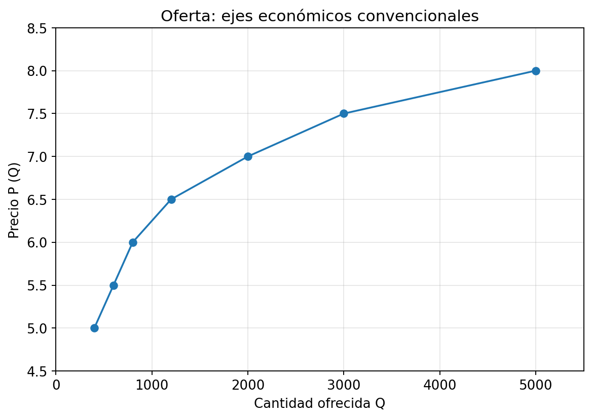
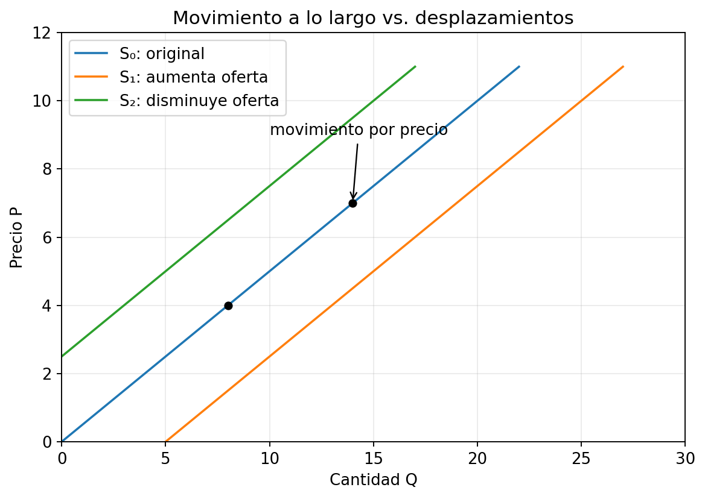
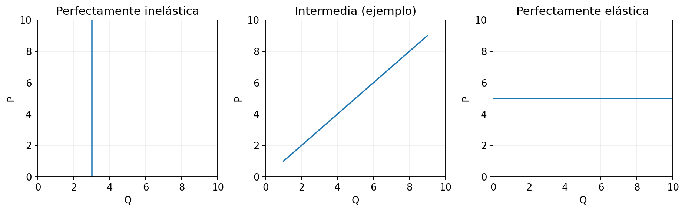
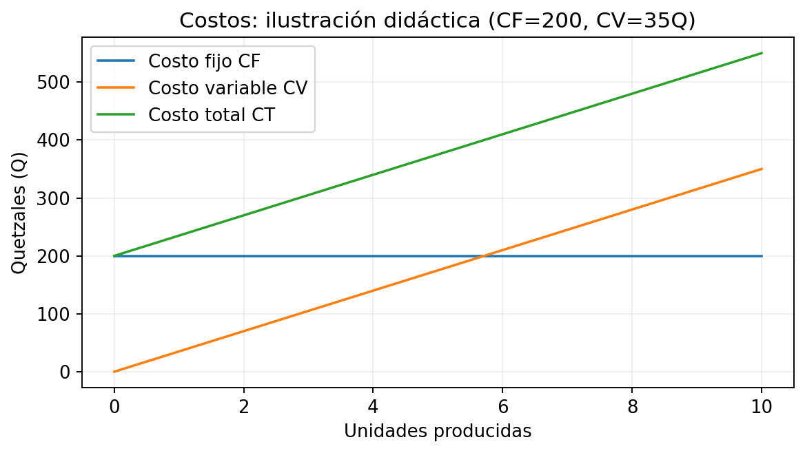
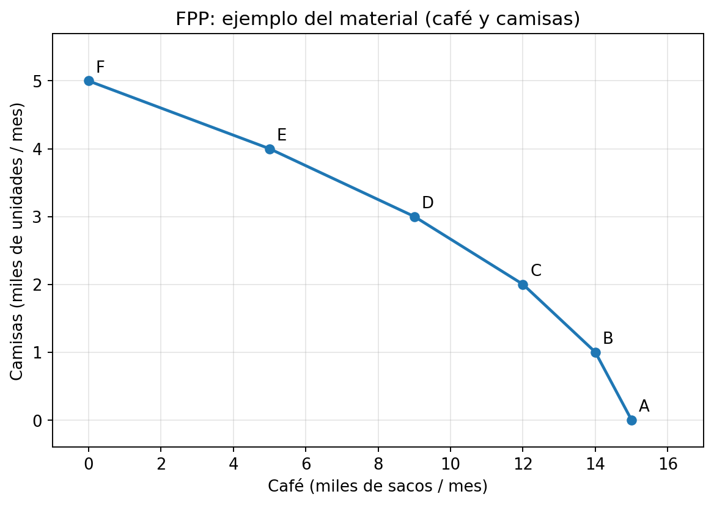
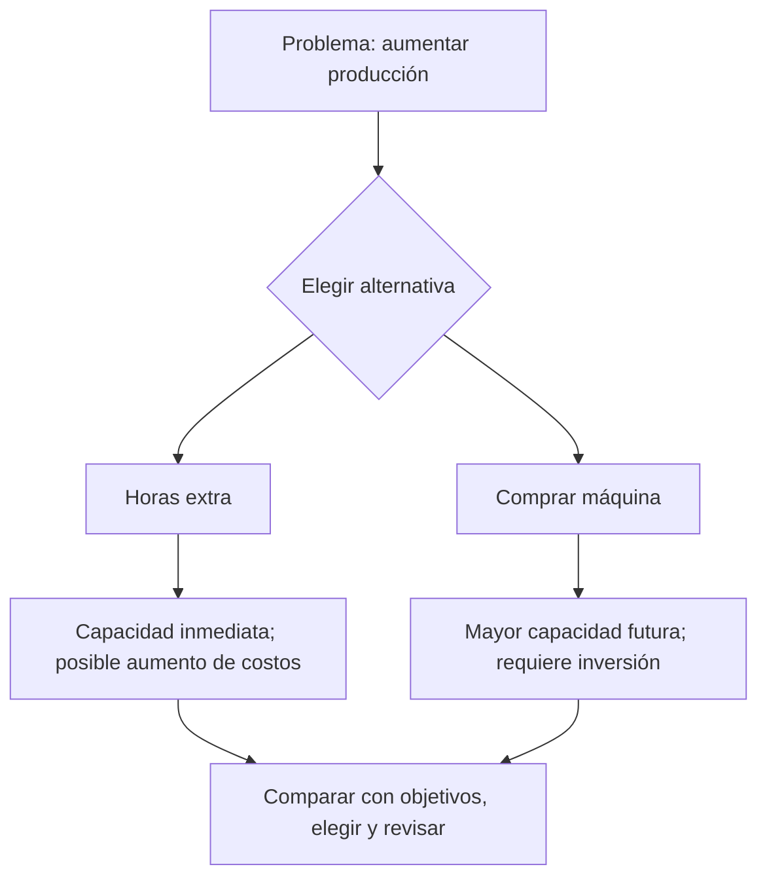

# GUÍA INTEGRAL DE MICROECONOMÍA — EXAMEN UNIVERSITARIO
## Semanas 9 y 10 · Oferta de mercado · Elasticidad · Producción · Frontera de posibilidades de producción

> **Objetivo:** dominar definiciones, interpretar situaciones, resolver operaciones **y dibujar gráficas a mano** en sesiones de concentración de **10 a 30 minutos**. Incluye **35 prácticas** (5 por cada uno de 7 bloques temáticos), respuestas, fórmulas, explicación Feynman y gráficos.  
> **Material base:** *Semana 9 Microeconomía*, *Semana 10 Microeconomía*, *Oferta de mercado* y *Curva de transformación/FPP*, Licda. Astrid Cayax. Los problemas marcados **[PRÁCTICA NUEVA]**, las fórmulas ampliadas y las aclaraciones académicas son material pedagógico adicional, no citas literales de las diapositivas.

---

## ÍNDICE
1. Método de estudio y agenda por sesiones
2. Tema 1 — Oferta, ley de oferta y determinantes
3. Tema 2 — Oferta individual, oferta de mercado y función de oferta
4. Tema 3 — Movimiento sobre la curva y desplazamiento de oferta
5. Tema 4 — Elasticidad precio de la oferta
6. Tema 5 — Producción a corto y largo plazo, tecnología y costos
7. Tema 6 — Frontera de posibilidades de producción (FPP)
8. Tema 7 — Tiempo y toma de decisiones
9. Manual universal para hacer gráficas a mano
10. Glosario y formulario
11. Simulacro, claves, trampas y lista de control
12. Referencias internas a materiales

---

# 1. PLAN PARA UNA ATENCIÓN DE 10 A 30 MINUTOS

## Regla de oro: recuperación activa antes que relectura

La secuencia por bloque es **recordar sin mirar → aprender → dibujar/calcular → explicar con tus palabras → comprobar**. No tienes que sostener 2 horas de concentración continua. Divide el temario y detente al terminar un objetivo concreto.

| Si tienes | Estructura | Entregable obligatorio |
|---|---|---|
| **10 minutos** | 2 min recordar + 4 min un concepto + 3 min un ejercicio + 1 min Feynman | Una definición propia y un resultado |
| **20 minutos** | 3 min repaso + 7 min teoría + 7 min 2 ejercicios/gráfica + 3 min autocorrección | Una gráfica o dos ejercicios correctos |
| **30 minutos** | 5 min recuperar + 10 min teoría + 10 min tres ejercicios + 5 min revisar errores | Tres aciertos y explicación oral |

**Pausa sugerida:** 5 minutos entre bloques; después de 2–3 bloques, una pausa más amplia. Si pierdes el hilo a los 12 minutos, termina el microobjetivo y descansa: el plan no exige llegar a 30.

## Plan de 8 días (ajustable sin fecha de examen)

| Día | Bloques de 10–30 min | Objetivo verificable |
|---|---|---|
| 1 | Tema 1; definiciones; ejercicios 1–5 | Diferenciar oferta, cantidad ofrecida y sus determinantes |
| 2 | Tema 2; tablas; sumas; 5 prácticas | Graficar tabla y sumar ofertas individuales |
| 3 | Tema 3; tres gráficas; 5 prácticas | Explicar movimiento frente a desplazamiento |
| 4 | Tema 4; fórmulas; 5 prácticas | Calcular e interpretar elasticidades |
| 5 | Tema 5; costos y producción; 5 prácticas | Distinguir corto/largo plazo y calcular CT |
| 6 | Tema 6; dibujar las dos FPP originales; 5 prácticas | Clasificar puntos y hallar costo de oportunidad |
| 7 | Tema 7; árbol decisional; 5 prácticas; glosario | Ejecutar los 7 pasos y argumentar una decisión |
| 8 | Simulacro + repaso de errores + gráficas de memoria | ≥80% y explicar cada error sin consultar |

**Si el examen es mañana:** cuatro bloques de 20 min: (1) oferta y desplazamientos, (2) elasticidad, (3) FPP y costos, (4) simulacro y glosario. Prioriza cálculos y gráficas.

## Cómo estudiar de verdad cada tema

- **Primera vuelta — Reconocer:** lee las definiciones y la sección Feynman; subraya la diferencia con conceptos parecidos.
- **Segunda vuelta — Producir:** oculta la clave; escribe 3 conceptos, resuelve 2 ejercicios y dibuja la gráfica correspondiente.
- **Tercera vuelta — Transferir:** cambia números/productos, explica la intuición, identifica el error que cometería otra persona.
- **Prueba de dominio:** aciertas 4 de 5 prácticas **sin ver las respuestas** y puedes defender verbalmente la respuesta en un minuto.

---

# 2. TEMA 1 — OFERTA, LEY DE OFERTA Y DETERMINANTES

**Base:** *Oferta de mercado*, págs. 2–6 y 10–12; *Semana 9*, págs. 1–2.

### Concepto: oferta
**Definición técnica (material):** cantidad de bienes o servicios que las empresas ponen a disposición de los consumidores a determinados precios, en un mercado y período determinados.  
**🧒 Feynman:** imagina una panadería: no importa cuántos panes quisiera comprar la gente, sino **cuántos panes estaría dispuesta a vender** la panadería a cada precio.

### Concepto: cantidad ofrecida
**Definición técnica:** número específico de unidades que un productor está dispuesto a vender **a un precio particular**, bajo las demás condiciones constantes.  
**🧒 Feynman:** *oferta* es el menú completo de opciones; *cantidad ofrecida* es una sola casilla de ese menú.

### Concepto: ley fundamental oferta-precio
**Definición técnica (material):** la cantidad ofrecida tiende a variar en sentido directo con el precio, **ceteris paribus**.  
**🧒 Feynman:** si vender un pastel deja más dinero, la pastelería normalmente querrá ofrecer más pasteles.

### ⚠️ CONCEPTO DIFÍCIL: *ceteris paribus*
**Definición técnica (ampliación):** supuesto que mantiene constantes otros factores distintos de la variable estudiada. La ley de oferta aísla el efecto del **precio del propio bien**.  
**🧒 Feynman:** para saber qué hace subir un globo, cambia solo una cosa a la vez; de lo contrario no sabes cuál fue la causa.

### Determinantes del material
| Objetivos | Subjetivos | Circunstancias adicionales |
|---|---|---|
| Precio, costos de factores, tamaño de mercado, disponibilidad de factores, competidores, perecibilidad, inventarios, sustitutos y necesidad de liquidez | Expectativa de precio futuro, aspiración de crecimiento social, amor propio y voluntad de vender | Ubicación, transporte, ambiente, tecnología y condiciones sociopolíticas |

**Clave de interpretación:** para un gráfico de oferta, distingue el **precio propio** (movimiento a lo largo) de los **otros determinantes** (potencial desplazamiento). Una subida en los costos normalmente desplaza la oferta a la izquierda; una mejora tecnológica normalmente a la derecha. Las expectativas y otros factores pueden requerir explicar el contexto.

### Prácticas del tema 1 — [PRÁCTICA NUEVA]
1. Una tienda vende 40 cuadernos a Q5 y 75 a Q8, manteniendo iguales las demás condiciones. ¿Qué ley ilustra? ¿Cuánto cambió la cantidad?
2. Un temporal destruye cosechas de tomate. ¿Es cambio de precio propio o determinante distinto? ¿Qué dirección esperas para la oferta?
3. Señala **dos determinantes subjetivos** y **tres objetivos** según las lecturas.
4. Un vendedor guarda maíz porque piensa que mañana pagarán más. ¿Cuál determinante explica su comportamiento? ¿Qué ocurre normalmente con oferta presente?
5. Una empresa baja el precio de Q10 a Q7 y reduce su cantidad ofrecida de 140 a 100. ¿Cuál es la variación porcentual de cantidad usando base inicial?

<details><summary><strong>Clave razonada — Tema 1</strong></summary>

1. Ley de oferta; ΔQ = 75 − 40 = **35 unidades**; ambos cambios son positivos.
2. **Condiciones medioambientales**; normalmente **disminución de oferta** (desplazamiento a izquierda) a cada precio, no necesariamente movimiento sobre la misma curva.
3. Subjetivos: expectativas y voluntad de vender (también aspiración social o amor propio). Objetivos: precio, costos y número de competidores (entre los listados).
4. Expectativa de precios futuros; puede **reducir la oferta actual** por retención de inventario.
5. (100 − 140) / 140 × 100 = **−28.57%**. La cantidad ofrecida se contrajo.

</details>

---

# 3. TEMA 2 — OFERTA INDIVIDUAL, DE MERCADO Y FUNCIÓN DE OFERTA

**Base:** *Oferta de mercado*, págs. 7–13; *Semana 9*, pág. 3.

### Oferta individual
**Definición técnica (material):** cantidades que un productor estaría dispuesto a ofrecer a cada nivel de precio, considerando rentabilidad y costos.  
**🧒 Feynman:** cuántos jugos vendería **una** tienda si cuestan Q4, Q5 o Q6.

### Oferta de mercado
**Definición técnica (material):** suma de las cantidades ofrecidas por los diferentes productores a **cada mismo nivel de precio**.  
**🧒 Feynman:** reúne todas las tiendas y suma sus jugos cuando todos ven el precio Q5; después repite para Q6.

### ⚠️ CONCEPTO DIFÍCIL: suma horizontal
**Definición técnica (ampliación):** para cada precio P, la cantidad total es `Q_mercado(P) = Σ Q_i(P)`. **No sumes precios**.  
**🧒 Feynman:** si Ana ofrece 7 panes a Q2 y Luis ofrece 9 panes a Q2, en ese mismo precio hay **16 panes**.

### Tabla real de las diapositivas

| Precio, Q | Cantidad ofrecida |
|---:|---:|
| 5.00 | 400 |
| 5.50 | 600 |
| 6.00 | 800 |
| 6.50 | 1,200 |
| 7.00 | 2,000 |
| 7.50 | 3,000 |
| 8.00 | 5,000 |



**Importante para examen:** el gráfico de la diapositiva 11 representa precio horizontal y cantidad vertical, mientras que **la convención habitual en microeconomía es cantidad horizontal (X) y precio vertical (Y)**. Dibuja según la indicación docente; esta guía emplea la convención estándar.

### Función de oferta
**Definición técnica:** relación matemática que asigna a cada precio una cantidad ofrecida cuando el resto de factores se mantiene fijo.  
**🧒 Feynman:** es una máquina: introduces el precio y te dice cuántas unidades quiere vender una empresa.

**Ejemplo literal del material:** `Qx = 45 + 1.5P` con P = Q3, Q4.50 y Q7.

| Precio P | Sustitución | Cantidad ofrecida Qx |
|---:|---|---:|
| 3.00 | 45 + 1.5(3) | **49.5** |
| 4.50 | 45 + 1.5(4.5) | **51.75** |
| 7.00 | 45 + 1.5(7) | **55.5** |

**Advertencia:** puede aparecer cantidad fraccionaria en una función teórica; si el ejercicio habla de artículos indivisibles, explica el redondeo solo si el enunciado lo pide.

### Dibujar a mano una curva de oferta en 7 pasos
1. Lee la tabla y detecta **qué columna es P y cuál Q**.
2. Dibuja un ángulo recto con regla; **X = cantidad, Y = precio**.
3. Escoge escalas proporcionales que contengan el máximo: por ejemplo X de 0 a 5,000 en intervalos de 1,000; Y de Q5 a Q8 en tramos Q0.50.
4. Sitúa puntos como `(400,5)`, `(600,5.5)` y `(5000,8)`; recuerda **(cantidad, precio)**.
5. Marca pequeños puntos, comprueba que corresponden a la tabla.
6. Une siguiendo la tendencia real de los datos, sin inventar que es recta si no lo es.
7. Titula **S** y anota unidades. Debe ser una curva creciente.

### Prácticas del tema 2 — [PRÁCTICA NUEVA salvo 1]
1. **[DEL MATERIAL]** Resuelve `Qx=45+1.5P` para P=3, 4.5 y 7; grafica los tres puntos.
2. A Q6, el productor A ofrece 20 y B 35; a Q8, A ofrece 30 y B 50. Completa la tabla de oferta del mercado y grafica.
3. Si `Qs=12+4P`, calcula Q para P=5 y despeja P cuando Q=52.
4. A P=Q10 tres productores ofrecen 40, 15 y 25; a P=Q12 ofrecen 50, 20 y 35. ¿Qué cantidades ofrece el mercado?
5. La tabla P/Q es (2/10), (3/20), (4/30). ¿Qué relación lineal `Q=a+bP` describe estos puntos?

<details><summary><strong>Clave razonada — Tema 2</strong></summary>

1. **49.5, 51.75, 55.5**; puntos gráficos (49.5,3), (51.75,4.5), (55.5,7).
2. P=6: 20+35=**55**; P=8: 30+50=**80**. Puntos (55,6) y (80,8).
3. Q=12+4(5)=**32**; 52=12+4P → 40=4P → **P=10**.
4. P=10: **80**; P=12: **105**. Siempre suma cantidades de productores al precio compartido.
5. ΔQ/ΔP=(20−10)/(3−2)=10; a=10−10(2)=−10 → **Q=−10+10P** para los puntos indicados.

</details>

---

# 4. TEMA 3 — VARIACIONES EN CANTIDAD OFRECIDA Y EN OFERTA

**Base:** *Oferta de mercado*, pág. 14; *Semana 9*, págs. 3–4.

### Expansión o contracción de cantidad ofrecida
**Definición técnica (material):** cambio en la cantidad que se ofrece ante una variación del precio del propio bien, manteniéndose los demás factores; se representa con **movimiento sobre la curva existente**.  
**🧒 Feynman:** caminas hacia arriba o abajo **por el mismo tobogán**; no construyes otro tobogán.

### Aumento o disminución de la oferta
**Definición técnica (material):** variación de toda la relación precio-cantidad producida por factores diferentes al precio propio, como costos, tecnología, disponibilidad de insumos o competidores.  
**🧒 Feynman:** ahora **mueves el tobogán entero** hacia la derecha o izquierda: para el mismo precio se venderá más o menos.

### ⚠️ EL ERROR MÁS EXAMINABLE
- **Precio propio ↑, otros constantes:** movimiento **arriba y a la derecha** sobre S, expansión de la **cantidad ofrecida**.
- **Precio propio ↓, otros constantes:** movimiento **abajo y a la izquierda** sobre S, contracción de la **cantidad ofrecida**.
- **Mejora tecnológica:** típicamente S → derecha: **aumenta la oferta**.
- **Suben costos de materias primas:** típicamente S → izquierda: **disminuye la oferta**.



### Cómo dibujar ambas situaciones a mano
**A. Solo cambia el precio:** traza **una única curva S**; dibuja A=(Q1,P1) y B=(Q2,P2) sobre ella; agrega flecha A→B. No dibujes una segunda curva.  
**B. Cambia otro factor:** traza S0; a la **derecha** dibuja S1 si aumenta la oferta; a la **izquierda** dibuja S2 si disminuye; añade una línea horizontal de **precio constante** para mostrar mayor/menor cantidad a igual P.

### Prácticas del tema 3 — [PRÁCTICA NUEVA]
1. El precio de un café sube de Q12 a Q15 y las cafeterías ofrecen más cafés. ¿Movimiento o desplazamiento? Dibuja.
2. Baja el precio del fertilizante y, a igual precio de tomate, los agricultores ofrecen más. ¿Qué sucede? Dibuja.
3. Una huelga bloquea transporte de mercadería. ¿Qué curva cambia y cómo? Dibuja.
4. En el mismo gráfico, distingue el resultado de (i) aumenta precio de pan y (ii) aparece un horno más eficiente.
5. ¿Por qué es incorrecto decir «sube el precio, por lo tanto aumenta la oferta» cuando se mantiene todo lo demás igual?

<details><summary><strong>Clave razonada — Tema 3</strong></summary>

1. Movimiento **sobre S**, arriba/derecha; aumenta **cantidad ofrecida**.
2. **Desplazamiento de S a la derecha**, por menor costo de producción.
3. Normalmente **disminuye oferta**, S a la izquierda, por mayor dificultad/costo de distribución.
4. (i) desplazamiento **de punto** sobre S; (ii) desplazamiento **de curva** a la derecha.
5. La frase confunde el cambio de **cantidad ofrecida** con el cambio de **oferta**; el precio propio no desplaza S bajo ceteris paribus.

</details>

---

# 5. TEMA 4 — ELASTICIDAD PRECIO DE LA OFERTA

**Base:** *Oferta de mercado*, págs. 15–17; *Semana 9*, págs. 4–5.

### Elasticidad de oferta-precio
**Definición técnica:** medida de la respuesta porcentual de la cantidad ofrecida ante una variación porcentual del precio propio.  
**🧒 Feynman:** no basta saber que el panadero vende más si sube el precio: queremos saber **qué tan fuerte** reacciona.

### ⚠️ CÁLCULO: DOS FORMAS QUE PUEDEN PRODUCIR RESPUESTAS DIFERENTES

**Método con base inicial (ampliación didáctica):**

\[
E_s=\frac{(Q_2-Q_1)/Q_1}{(P_2-P_1)/P_1}=\frac{Q_2-Q_1}{P_2-P_1}\frac{P_1}{Q_1}
\]

**Método del punto medio / elasticidad arco (ampliación didáctica):**

\[
E_{s,arco}=\frac{(Q_2-Q_1)/[(Q_1+Q_2)/2]}{(P_2-P_1)/[(P_1+P_2)/2]}
\]

**Precaución:** la diapositiva presenta las variables Qx1/Qx2/Px1/Px2 y categorías, pero la **expresión de la ecuación no aparece legible en el texto extraído**. En el examen usa **la fórmula indicada por tu catedrática** si difiere de la elegida en estas prácticas. En los 5 ejercicios siguientes usaremos **base inicial**, excepto cuando se solicite expresamente arco.

### Clasificación del material

| Elasticidad | Condición | Interpretación de respuesta porcentual | Gráfica límite |
|---|---|---|---|
| Perfectamente inelástica | `Es = 0` | La Q no cambia aunque cambie P | Vertical |
| Inelástica | `0 < Es < 1` | %ΔQ menor que %ΔP | Creciente; sensibilidad baja |
| Unitaria | `Es = 1` | %ΔQ igual a %ΔP | No necesariamente recta 45° |
| Elástica | `Es > 1` | %ΔQ mayor que %ΔP | Creciente; sensibilidad alta |
| Perfectamente elástica | `Es → ∞` | Oferta horizontal al precio dado | Horizontal |

**Trampa:** la inclinación geométrica de una curva no equivale automáticamente a su elasticidad: **la escala y el punto específico importan**. Una recta creciente puede tener elasticidad diferente a lo largo de ella.



### Resolver elasticidad paso a paso a mano
1. Copia los cuatro datos, con subíndices iniciales `P1,Q1` y finales `P2,Q2`.
2. Calcula `ΔQ = Q2 − Q1` y `ΔP = P2 − P1`.
3. Calcula `%ΔQ = ΔQ/Q1 × 100` y `%ΔP = ΔP/P1 × 100`.
4. Divide `%ΔQ / %ΔP`; **no dividas ΔQ/ΔP sin normalizar**.
5. Clasifica Es y escribe una frase: «Si P cambió x%, Q cambió y%; por tanto…».
6. Si P no varía (`ΔP=0`), evita división por cero; examina si la situación corresponde a una oferta perfectamente elástica bajo el modelo ideal.

### Ejemplo detallado
P1=Q4, P2=Q5, Q1=100, Q2=125.  
`ΔP=1`; `%ΔP=1/4×100=25%`.  
`ΔQ=25`; `%ΔQ=25/100×100=25%`.  
**Es=25%/25%=1 (unitaria)**.

### Prácticas del tema 4 — tomadas de la tabla de cinco ejercicios de la diapositiva 17

| Práctica | P1 | P2 | Q1 | Q2 | Qué se pide |
|---|---:|---:|---:|---:|---|
| 1 | 5 | 4 | 100 | 100 | Es y clase |
| 2 | 4 | 5 | 100 | 110 | Es y clase |
| 3 | 4 | 5 | 100 | 125 | Es y clase |
| 4 | 4 | 5 | 100 | 200 | Es y clase |
| 5 | 5 | 5 | 20 | 25 | Interpretar el caso límite |

**Nota:** cambiaremos de forma explícita el orden P/Q de las columnas originales para presentar todos los casos uniformemente. **Usa base inicial**, no punto medio, para comparar la clave.

<details><summary><strong>Clave completa — Tema 4</strong></summary>

1. `%ΔP=(4−5)/5=−20%`, `%ΔQ=0%`; **Es=0**, perfectamente inelástica (aunque P baje, Q es constante).
2. `%ΔP=(5−4)/4=25%`, `%ΔQ=(110−100)/100=10%`; **Es=0.10/0.25=0.40**, inelástica.
3. `%ΔP=25%`, `%ΔQ=25%`; **Es=1.00**, unitaria.
4. `%ΔP=25%`, `%ΔQ=100%`; **Es=4.00**, elástica.
5. `%ΔP=0%`, `%ΔQ=25%`; **no puede calcularse un cociente numérico finito**, porque se divide entre cero. Es la representación de un **caso perfectamente elástico (infinito)** si ambas observaciones pertenecen a la misma curva de oferta horizontal idealizada; sin ese supuesto, dos observaciones aisladas no bastan para concluirlo.

**Comprobación extra con arco:** la práctica 2 da `[(10/105)/(1/4.5)]≈0.4286`, diferente de `0.40`; por eso es importante aclarar el método.

</details>

---

# 6. TEMA 5 — PRODUCCIÓN, LARGO PLAZO, TECNOLOGÍA Y COSTOS

**Base:** *Semana 9*, págs. 1–3; *Semana 10*, págs. 2–3; diapositivas de FPP, págs. 3 y 5.

### Producción en corto plazo
**Definición técnica (ampliación del texto):** horizonte en que al menos un factor productivo permanece fijo; para expandir producción se usan intensivamente factores disponibles y factores variables.  
**🧒 Feynman:** con **el mismo horno**, una panadería puede comprar más harina y contratar turnos extra, pero todavía no ha construido otro horno.

### Producción en largo plazo
**Definición técnica:** horizonte suficiente para ajustar todos los insumos, capacidades e instalaciones. El texto de Semana 9 señala la posibilidad de producir más a menor costo mediante ajustes productivos.  
**🧒 Feynman:** ahora la panadería puede **construir otro horno y agrandar el local**. *Largo plazo* no significa exactamente «más de un año», sino tiempo para cambiar todo lo necesario.

### Restricción tecnológica
**Definición técnica (Semana 10):** límites sobre combinaciones de insumos y productos derivados de las tecnologías y procesos disponibles.  
**🧒 Feynman:** una máquina solo puede hacer tantas tortillas por hora; querer más no basta si no cambias la máquina o la forma de usarla.

### ⚠️ Costos de producción, costos de venta, directos e indirectos
**Definición técnica (material):** costos de producción son desembolsos para fabricar el bien o prestar el servicio; costos de venta son los vinculados a comercializarlo. El texto clasifica **directos** (materia prima, mano de obra, supervisión, mantenimiento, servicios, envases) e **indirectos** (depreciación, impuestos, seguros, I+D y distribución).  
**🧒 Feynman:** para hacer galletas pagas harina, energía y cocinero; para venderlas quizá pagas publicidad y entrega. No es lo mismo **fabricarlas** que **ponerlas en manos del comprador**.

**Aclaración académica importante:** el material aproxima «directo = proporcional a producción» e «indirecto = fijo». **No son equivalentes exactos**: *directo/indirecto* describe si el costo puede asociarse al producto; *fijo/variable* describe cómo cambia con el volumen. Una mano de obra directa podría tener pagos fijos; electricidad indirecta podría variar con producción.

### Fórmulas didácticas complementarias
`CT = CF + CV` · `Costo medio total (CMeT) = CT/Q` · `Costo variable medio (CVMe) = CV/Q` · `Costo fijo medio (CFMe) = CF/Q` · `Costo marginal (CMg) = ΔCT/ΔQ` · `Beneficio = Ingreso total − Costo total` · `Ingreso total = P×Q`.



### Guía para graficar costos a mano
1. Eje X: unidades producidas; eje Y: Q de costo.
2. Elige un CF constante, ejemplo Q200: traza una línea horizontal a esa altura.
3. Si CV=35Q, calcula Q=0, 2, 4, 6, 8, 10 y dibuja la recta desde el origen.
4. Para cada Q suma `CT=200+35Q`: la curva CT está **Q200 arriba** de CV.
5. Identifica que al producir cero `CV(0)=0` y `CT(0)=CF=200` en este caso.

### Prácticas del tema 5 — [PRÁCTICA NUEVA]
1. Fabrica 10 mesas: CF=Q500 y costo variable por mesa=Q70. Calcula CV, CT y costo medio total.
2. Una empresa pasa de 20 a 25 unidades; CT sube de Q1,100 a Q1,250. Calcula costo marginal promedio del tramo.
3. Clasifica por **trazabilidad**, no por volumen: harina usada específicamente para un pan; seguro general de la fábrica; empaque de cada producto.
4. Una empresa aumenta turnos sobre su maquinaria actual. ¿Corto o largo plazo? ¿Qué cambio concreto sugeriría pasar a largo plazo?
5. Una mejora tecnológica permite 120 unidades con los mismos insumos que antes daban 80. ¿Qué ocurre con la capacidad productiva? Calcula el aumento porcentual.

<details><summary><strong>Clave razonada — Tema 5</strong></summary>

1. CV=10×70=**Q700**; CT=500+700=**Q1,200**; CMeT=1,200/10=**Q120/mesa**.
2. CMg promedio=(1,250−1,100)/(25−20)=150/5=**Q30 por unidad adicional**.
3. Harina **directo**; seguro general **indirecto**; empaque individual **directo** en este ejemplo.
4. **Corto plazo** si la maquinaria sigue fija; aumentar tamaño de planta o comprar nuevas máquinas ajustando todos los factores sugiere **largo plazo**.
5. Mayor productividad/capacidad; `(120−80)/80×100=50%` más producción con los mismos insumos.

</details>

---

# 7. TEMA 6 — FPP O CURVA DE TRANSFORMACIÓN

**Base:** *Semana 10*, págs. 1–3; *Curva de transformación/FPP*, págs. 2 y 6–7.

### Frontera de posibilidades de producción (FPP)
**Definición técnica (material):** conjunto de combinaciones **máximas** de dos bienes que una economía puede producir con factores y tecnología dados en un período.  
**🧒 Feynman:** tienes una tarde para cocinar **pan o tortillas** con una sola cocina. Si dedicas más tiempo a uno, normalmente queda menos tiempo para el otro.

### ⚠️ Aclaración sobre un texto contradictorio
La definición reproducida en *Semana 10* y las diapositivas dice «factores y tecnología **ilimitados**», pero la misma lectura **establece factores dados y tecnología dada** y afirma que la FPP representa la **escasez**. Para comprender el modelo económico estándar debe interpretarse con **recursos limitados y tecnología dada**. Si aparece una pregunta literal del documento, distingue lo que **dice la diapositiva** de lo que **requiere el modelo**.

### Supuestos del modelo (del material)
1. Producción de **dos bienes** o dos canastas.
2. Se trabaja por **unidad de tiempo**.
3. **Tecnología dada** y mejor disponible.
4. **Factores de producción dados**.

### Puntos eficientes, ineficientes e inalcanzables
**Definición técnica:** **sobre** la frontera: máximo factible con los recursos y tecnología; **dentro**: factible pero ineficiente o con recursos ociosos; **fuera**: no alcanzable bajo las condiciones actuales.  
**🧒 Feynman:** sobre la raya usas toda la cocina; dentro de la raya la cocina tiene ratos sin trabajar; fuera de la raya necesitarías una cocina mejor o más recursos.

### Costo de oportunidad
**Definición técnica:** valor de la mejor alternativa sacrificada al elegir otra opción. En FPP se mide como unidades de un bien **dejadas de producir** para producir más del otro.  
**🧒 Feynman:** si por hacer una camisa adicional dejas de producir dos sacos de café, **esa camisa te costó la oportunidad de hacer dos sacos de café**.

### Datos originales — café y camisas (miles por mes)

| Alternativa | Café X | Camisas Y | Café sacrificado al pasar al siguiente nivel de camisas |
|---|---:|---:|---:|
| A | 15 | 0 | — |
| B | 14 | 1 | 1 |
| C | 12 | 2 | 2 |
| D | 9 | 3 | 3 |
| E | 5 | 4 | 4 |
| F | 0 | 5 | 5 |



**Cálculo paso a paso:** de B(14,1) a C(12,2), se gana `ΔY=+1` mil camisas, se pierden `ΔX=−2` mil sacos de café; costo de oportunidad por mil camisas adicional = `|−2|/1=2` miles de sacos de café por cada mil camisas (equivale a 2 sacos por camisa en términos proporcionales). La secuencia de costos **1,2,3,4,5** ilustra costo de oportunidad creciente.

### Datos originales — pan y tortillas (miles por mes)

| Pan X | Tortillas Y | Sacrificio de pan por cada +2 de tortillas |
|---:|---:|---:|
| 15 | 0 | — |
| 14 | 2 | 1 |
| 12 | 4 | 2 |
| 9 | 6 | 3 |
| 5 | 8 | 4 |
| 0 | 10 | 5 |

### Cómo dibujar FPP a mano (y conseguir puntos en examen)
1. Dibuja los ejes: X=café (o pan), Y=camisas (o tortillas).
2. Elige escala: para café 0–15, cada cuadro grande 1 o 3; para camisas 0–5, cada cuadro grande 1.
3. Coloca `A=(15,0)`, `B=(14,1)`, `C=(12,2)`, `D=(9,3)`, `E=(5,4)`, `F=(0,5)`.
4. Une los puntos **en orden** con trazos suaves o segmentos; la curva es descendente y arqueada hacia el origen según orientación usual.
5. Coloca un punto claramente **dentro** como (5,2) y otro **fuera** como (15,5); etiqueta «ineficiente» e «inalcanzable».
6. Para costo de oportunidad B→C traza un segmento horizontal de 2 a la izquierda y vertical de 1 arriba; anota **renuncio a 2 de café por 1 de camisas**.
7. Identifica si hay movimiento sobre la frontera (reasignación) o desplazamiento de toda la frontera (más recursos o mejor tecnología).

### ⚠️ Diferencia crítica: movimiento y desplazamiento de FPP
**Sobre una misma FPP:** cambias la combinación de bienes pero **no** los recursos ni la tecnología.  
**FPP hacia afuera:** tecnología mejor, más factores o productividad; existen nuevas combinaciones máximas. Puede expandirse **asimétricamente** si solo mejora la tecnología de un sector.  
**FPP hacia adentro:** menor capacidad productiva por pérdida duradera de recursos o infraestructura.

### Prácticas del tema 6 — [PRÁCTICA NUEVA usando datos del material donde se indica]
1. **[DATOS DEL MATERIAL]** Calcula los 5 costos marginales de oportunidad en café al avanzar A→F. ¿Qué patrón observas?
2. **[DATOS DEL MATERIAL]** Para pan/tortilla, calcula cuánto pan se sacrifica al pasar de (12,4) a (9,6), y el costo de oportunidad por **1,000 tortillas** extra.
3. **[DATOS DEL MATERIAL]** Clasifica (9,3), (5,2) y (15,5) para FPP café/camisas: sobre, dentro o fuera. Justifica.
4. En una economía con FPP lineal entre (20,0) y (0,10), calcula costo de oportunidad de una unidad de Y en X. Dibuja la recta.
5. Nueva maquinaria mejora solo la producción de camisas. Dibuja cómo cambia la FPP si el máximo de café permanece en 15 y el máximo de camisas pasa de 5 a 8.

<details><summary><strong>Clave razonada — Tema 6</strong></summary>

1. **1, 2, 3, 4 y 5** (miles de café perdidos por mil de camisas ganadas). **Crece** el costo de oportunidad marginal.
2. Se sacrifican **3 mil panes** para obtener **2 mil tortillas** más: costo = `3/2=1.5` miles de pan por mil tortillas.
3. (9,3) **sobre** (punto D); (5,2) **dentro** porque con Y=2 se puede producir X=12; (15,5) **fuera** porque excede la frontera.
4. De Y=0 a Y=10 se pierden 20 de X: `20/10=2` unidades X por cada Y adicional; segmentos rectos con costo constante.
5. Nueva frontera mantiene intercepto de X en **(15,0)**, pero intercepto de Y se desplaza a **(0,8)**; expansión orientada a camisas, no paralela necesariamente.

</details>

---

# 8. TEMA 7 — TIEMPO Y TOMA DE DECISIONES

**Base:** *Semana 10*, págs. 2–3; diapositivas de FPP, pág. 4.

### Toma de decisiones
**Definición técnica (material):** proceso de seleccionar una alternativa entre varias, o actuar ante una situación de incertidumbre, evaluando contexto, objetivos, información, consecuencias y tiempo disponible.  
**🧒 Feynman:** quieres llegar a la universidad: puedes tomar bus, caminar o compartir un vehículo. Comparas qué opción tarda menos, cuesta menos y es más segura.

### Los 7 pasos EXACTOS del material, en orden
1. **Identificar la decisión** y objetivo.
2. **Reunir información relevante**.
3. **Identificar soluciones alternativas** (incluido árbol de decisiones).
4. **Sopesar las soluciones** (ventajas, desventajas, FODA).
5. **Elegir una alternativa** o combinación.
6. **Poner en acción** el plan.
7. **Revisar la decisión** y su impacto mediante métricas.

### ⚠️ Árbol de decisiones
**Definición técnica (ampliación):** representación de opciones, escenarios y resultados que permite comparar cursos de acción de manera estructurada.  
**🧒 Feynman:** dibujas un camino que se divide en otros caminos, cada uno con un «¿qué podría pasar si elijo esto?».



### FODA
**Definición técnica (mencionada en el material):** análisis de **Fortalezas**, **Oportunidades**, **Debilidades** y **Amenazas** para comparar alternativas.  
**🧒 Feynman:** preguntas «¿qué hacemos bien?, ¿qué oportunidad hay?, ¿qué nos falta?, ¿qué peligro viene?».

### Prácticas del tema 7 — [PRÁCTICA NUEVA]
1. Escribe los siete pasos en orden **sin consultar**, indicando qué ocurre después de elegir.
2. Una panadería necesita producir 30% más en un mes. Propón dos alternativas y **dos datos** que reunirías antes de decidir.
3. Se decide aumentar el número de repartidores. Indica **una métrica** para revisar el éxito y qué se hace si el objetivo no se cumple.
4. Clasifica: maquinaria moderna propia; nueva demanda del barrio; falta de efectivo; posible cierre de la carretera. ¿F, O, D o A?
5. Construye un mini árbol con «seguir con horno» o «adquirir nuevo horno», y escribe una ventaja y una desventaja de cada opción.

<details><summary><strong>Clave razonada — Tema 7</strong></summary>

1. Identificar → reunir información → alternativas → sopesar → elegir → **poner en acción** → **revisar impacto**.
2. Horas extra y nuevo equipo (u otra opción viable). Datos: capacidad actual, presupuesto, costo, plazo de entrega o demanda esperada.
3. Porcentaje de entregas a tiempo o costo por pedido; comparar con meta y **corregir/reevaluar** si no se alcanza.
4. Maquinaria propia = **F**; demanda externa creciente = **O**; falta de efectivo = **D**; cierre de carretera = **A**.
5. Ejemplo válido: continuar = menor inversión inmediata, límite de capacidad; adquirir = mayor capacidad, desembolso alto. Se acepta respuesta coherente y razonada.

</details>

---

# 9. MANUAL UNIVERSAL DE GRÁFICAS A MANO

## Checklist previo (memorízalo)

1. **¿Qué variables?** Oferta: eje Y precio, eje X cantidad. FPP: un bien en cada eje. Costos: costo en Y, producción en X.
2. **¿Qué unidades?** Quetzales, panes, toneladas, miles por mes, etc.
3. **¿Qué escala?** Intervalos uniformes; evita colocar 5, 10 y 100 a igual distancia.
4. **¿Qué puntos?** Haz tabla (X,Y) antes de dibujar.
5. **¿Una curva o dos?** Precio propio = misma S; costos/tecnología = nueva S.
6. **¿Pendiente?** Oferta usual hacia arriba; FPP hacia abajo; CF horizontal.
7. **¿Etiquetas?** S0/S1, A/B, Q1/Q2, P1/P2, dirección de flechas.
8. **¿Interpretación?** Una frase con «debido a» y «manteniendo constantes».

## Plantillas ASCII para copiar al cuaderno

**Oferta creciente**
```text
Precio (P)
  ^
  |              S
P2|----------● B
  |         /
P1|----● A /
  |   /    |
  +-------------------> Cantidad (Q)
      Q1      Q2
```

**Oferta que aumenta por tecnología/costos menores**
```text
Precio (P)
  ^
  |      S0      S1
  |     /       /
P*|----●-------●--------  mismo precio
  |   /       /
  +-------------------> Cantidad (Q)
      Q0      Q1
```

**FPP**
```text
Bien Y
  ^
  | ● F
  |    ● E
  |        ● D        × fuera
  |           ● C
  |   ○ dentro    ● B
  |                  ● A
  +------------------------> Bien X
```

**OJO:** los diagramas ASCII son esquemas; al graficar ejercicios con números hay que respetar las escalas reales y las coordenadas de la tabla.

## Ejercicio de entrenamiento gráfico de 10 minutos

En papel cuadriculado, sin mirar imágenes: (1) dibuja una oferta creciente con dos precios, (2) desplázala hacia la derecha por tecnología, (3) dibuja FPP café/camisas con seis puntos, (4) marca punto eficiente y punto inalcanzable. **Autocorrección:** ejes bien titulados, escalas correctas, puntos acordes y flechas en dirección correcta.

---

# 10. GLOSARIO TÉCNICO + FEYNMAN + FORMULARIO

| Concepto | Definición técnica para examen | 🧒 Feynman |
|---|---|---|
| Oferta | Cantidades que productores venderían a diversos precios | Todas las opciones de venta de una tienda |
| Cantidad ofrecida | Unidades a un precio específico | Una opción del menú de ventas |
| Oferente | Productor/intermediario que pone un bien en venta | Quien ofrece el producto |
| Demanda | Cantidades que consumidores desean y pueden comprar según precios (ampliación) | Lo que la gente está dispuesta a comprar |
| Ley de oferta | Relación directa P–Q ofrecida, ceteris paribus | Mayor premio suele animar a producir más |
| Ceteris paribus | Otros factores constantes | Cambiar una sola cosa |
| Oferta individual | Oferta de una empresa | Una panadería |
| Oferta de mercado | Suma de cantidades individuales a cada P | Todas las panaderías juntas |
| Tabla de oferta | Correspondencias entre P y Qs | Lista de precios y cantidades |
| Función de oferta | Qs expresada según P y otros determinantes | Fórmula-máquina que recibe P |
| Expansión | Más cantidad ofrecida al subir el precio propio | Subir por la misma curva |
| Contracción | Menos cantidad ofrecida al caer precio propio | Bajar por la misma curva |
| Aumento de oferta | Más Q a cada P por otro determinante | Toda la curva va a la derecha |
| Disminución de oferta | Menos Q a cada P por otro determinante | Toda la curva va a la izquierda |
| Elasticidad precio oferta | %ΔQs relativo a %ΔP | Cuánto reacciona quien vende |
| Oferta elástica | Es > 1 | Cantidad responde mucho |
| Oferta inelástica | 0 < Es < 1 | Cantidad responde poco |
| Oferta unitaria | Es = 1 | Ambos porcentajes iguales |
| Perfectamente inelástica | Es = 0 | Vende igual aunque cambie P |
| Perfectamente elástica | Es infinita en caso límite ideal | A precio fijo puede cambiar Q |
| Producción | Transformación de insumos en bienes/servicios | Convertir harina en pan |
| Factor de producción | Recurso empleado al producir | Horno, trabajador, harina |
| Corto plazo | Existe algún insumo fijo | El horno no puede cambiar todavía |
| Largo plazo | Todos los factores pueden ajustarse | Ya puedes comprar otro horno |
| Restricción tecnológica | Límites por métodos y tecnología disponibles | La máquina tiene su límite |
| Costo directo | Atribuible al objeto de costo | Harina de ese pan |
| Costo indirecto | No atribuible directamente sin reparto | Seguro global del local |
| Costo fijo | No cambia con volumen en rango relevante | Alquiler mensual acordado |
| Costo variable | Cambia con volumen de producción | Harina por pan |
| Costo total | Suma de costos fijos y variables | Todo lo que cuesta producir |
| Costo marginal | Variación del CT por unidad adicional | Precio de fabricar uno más |
| FPP | Combinaciones máximas de dos bienes con recursos/tecnología dados | Todas las combinaciones que puedes alcanzar |
| Escasez | Recursos insuficientes para satisfacer todos los deseos | No alcanza el tiempo para hacer todo |
| Eficiencia productiva | Producir sobre FPP con recursos disponibles | Ningún recurso desperdiciado |
| Ineficiencia | Producir por debajo de FPP | Máquina parada innecesariamente |
| Inalcanzable | Punto fuera de la FPP actual | No puedes producir tanto todavía |
| Costo de oportunidad | Mejor alternativa sacrificada | Lo que dejas de hacer al elegir |
| Cambio tecnológico | Mejoras de procesos/productos | Máquina que hace más con lo mismo |
| Árbol de decisiones | Alternativas y consecuencias ramificadas | Caminos que se dividen |
| FODA | Fortalezas, Oportunidades, Debilidades, Amenazas | Bien, oportunidad, problema, peligro |
| Rentabilidad | Relación de beneficio con recursos invertidos (ampliación) | Si valió la pena el negocio |

## Formulario de examen (cópialo en una tarjeta)

| Qué calcular | Fórmula | No confundas |
|---|---|---|
| Cambio absoluto | `ΔX = X2 − X1` | Puede ser negativo |
| Variación porcentual base inicial | `%ΔX = (X2 − X1)/X1 × 100` | División por **inicial** |
| Oferta de mercado | `Qs_mercado(P)=Σ Qs_i(P)` | Suma **cantidades** al mismo P |
| Función lineal oferta | `Qs = a+bP` | Usualmente b>0 en el ejemplo normal |
| Despejar precio | `P=(Qs−a)/b` (si b≠0) | Respeta signos |
| Elasticidad base inicial | `Es=[(Q2−Q1)/Q1]/[(P2−P1)/P1]` | Razón de porcentajes, no diferencias absolutas |
| Elasticidad arco | `Es=[ΔQ/Qprom]/[ΔP/Pprom]` | `Qprom=(Q1+Q2)/2`, `Pprom=(P1+P2)/2` |
| Costo total | `CT=CF+CV` | No mezclar categorías directo/indirecto |
| Costo medio | `CMeT=CT/Q` | Requiere Q>0 |
| Costo marginal tramo | `CMg=ΔCT/ΔQ` | No es costo medio |
| Ingreso total | `IT=P×Q` | Solo si P común a todas las unidades |
| Beneficio | `π=IT−CT` | Puede ser pérdida |
| Costo oportunidad FPP | `CO(Y en X)=|ΔX/ΔY|` | Explica **qué bien sacrificas** |
| Productividad (tasa de aumento) | `(nuevo−viejo)/viejo×100` | Usar misma unidad |

---

# 11. SIMULACRO EXPRESS (30 MINUTOS)

**Instrucciones:** 20 minutos de respuesta, 10 de autocorrección. No mires las claves. Anota también **por qué**.

1. Define oferta en una oración y da un ejemplo con dos precios.
2. Menciona dos determinantes subjetivos de la oferta.
3. ¿Qué cambia si sube el precio propio de un producto, ceteris paribus: la oferta o la cantidad ofrecida?
4. Si la tecnología abarata producción, ¿a dónde se desplaza la oferta?
5. Dos empresas ofrecen 13 y 17 unidades a Q4, respectivamente. ¿Cuánto ofrece el mercado a Q4?
6. `Qs=20+5P`. ¿Cuánto es Qs cuando P=6?
7. P: 10→12; Q: 50→55. Calcula Es por base inicial y clasifica.
8. Dibuja cómo se ve una oferta perfectamente inelástica.
9. Nombra los cuatro supuestos de FPP de Semana 10.
10. En la FPP café/camisas, ¿cuántos miles de café sacrificas al ir de D(9,3) a E(5,4)?
11. ¿Un punto dentro de la FPP es inalcanzable, eficiente o ineficiente?
12. ¿Qué diferencia un cambio de combinación sobre una FPP de un desplazamiento hacia afuera?
13. CF=Q300, CV=Q900, Q=20. Halla CT y CMeT.
14. Diferencia «costos directos» de «costos fijos».
15. Escribe los siete pasos de decisión, en orden.

<details><summary><strong>CLAVE DEL SIMULACRO — abrir solo al terminar</strong></summary>

1. Cantidades ofrecidas a distintos precios en mercado/período; ejemplo 10 a Q3, 15 a Q4.
2. Expectativas de precio y voluntad de vender (o aspiración social y amor propio).
3. **Cantidad ofrecida**; movimiento sobre S.
4. **Derecha**; oferta mayor a cada P.
5. **30**.
6. 20+5(6)=**50**.
7. `%ΔQ=5/50=10%`; `%ΔP=2/10=20%`; **Es=0.5**, inelástica.
8. **Línea vertical** en ejes convencionales X=Q, Y=P.
9. Dos bienes, tiempo fijado, tecnología dada y factores dados.
10. **4 miles de café** por **1 mil de camisas**.
11. **Ineficiente** (factible, interior).
12. Movimiento = reasignación con misma capacidad; desplazamiento exterior = mayor capacidad por recursos/tecnología.
13. CT=300+900=**Q1,200**; CMeT=1,200/20=**Q60**.
14. Directo = trazable a producto; fijo = insensible al volumen dentro de rango relevante.
15. Identificar; recopilar información; alternativas; sopesar; elegir; ejecutar; revisar.

**Puntaje orientativo:** 13–15: muy buen dominio; 10–12: repasar fallos y dibujar nuevamente; ≤9: repetir los bloques 2–6 antes de nuevo simulacro.

</details>

## Diez trampas frecuentes del examen

1. **Oferta** no es sinónimo de **demanda**.
2. **Oferta** no es sinónimo de **cantidad ofrecida**.
3. Cambio del **precio propio** normalmente **no desplaza** la curva S.
4. Cambio de **costos** sí puede desplazar S aun con mismo precio.
5. Oferta de mercado **suma cantidades a un precio fijo**, no precios.
6. En elasticidad **debe calcularse porcentaje**, no `ΔQ/ΔP` directamente.
7. Si `ΔP=0`, revisa el **caso límite** y nunca divides entre cero.
8. La FPP describe **combinaciones máximas**, no «lo que se quiere producir».
9. Un punto **dentro** de la FPP es **posible pero ineficiente**; **fuera** es imposible bajo recursos/tecnología actuales.
10. *Corto plazo* y *largo plazo* dependen de **ajustabilidad de factores**, no necesariamente meses o años.

## Tarjetas de recuperación activa (hazlas sin ver respuesta)

- ¿En qué eje va P en oferta convencional? → **Vertical**.
- ¿Cómo se llama el movimiento al subir P? → **Expansión de cantidad ofrecida**.
- Si baja el costo de producción, ¿qué ocurre con S? → **Derecha**.
- ¿Cómo identifico oferta unitaria? → **Es=1**.
- ¿Cómo identifico oferta perfectamente inelástica? → **Es=0, curva vertical**.
- ¿Qué significa FPP? → **Frontera de posibilidades de producción**.
- ¿Cuántos bienes considera el modelo presentado? → **Dos**.
- ¿Costo de oportunidad creciente en café/camisas? → **1,2,3,4,5**.
- ¿Qué acción sigue a elegir una alternativa? → **Ponerla en acción**.
- ¿Qué haces después de ejecutar? → **Revisar la decisión y su impacto**.

## Lista de control antes de entrar al examen

- [ ] Puedo definir cada concepto técnico y explicarlo como si tuviera 10 años.
- [ ] Puedo convertir tablas P/Q en coordenadas sin intercambiar ejes.
- [ ] Puedo dibujar oferta, desplazamiento, límites de elasticidad y FPP sin imagen.
- [ ] Puedo sumar dos ofertas individuales a precios compartidos.
- [ ] Puedo despejar `Qs=a+bP`.
- [ ] Puedo calcular elasticidad con porcentajes y clasificarla.
- [ ] Puedo explicar la diferencia entre base inicial y punto medio.
- [ ] Puedo calcular costo total, medio y marginal.
- [ ] Puedo hallar costos de oportunidad en FPP.
- [ ] Recuerdo los 7 pasos de decisión en orden.
- [ ] Identifico las dos aclaraciones sobre «ilimitados» e «isocuantas» que aparecen en materiales.

---

# 12. NOTAS DE FIDELIDAD AL MATERIAL Y REFERENCIAS

**Referencia 1.** *Semana 9 Microeconomía — Teoría de la Producción (parte II)*, 5 págs.: determinantes; oferta individual y de mercado; variaciones de oferta/cantidad; elasticidad y sus categorías.

**Referencia 2.** *Oferta de mercado*, Licda. Astrid Cayax, 17 diapositivas: tabla de oferta de P5 a P8 (pág. 9), gráfica (pág. 11), función `Qx=45+1.5P` (pág. 13), desplazamientos (pág. 14), cinco ejercicios de elasticidad (pág. 17).

**Referencia 3.** *Semana 10 Microeconomía — Curva de Transformación/FPP*, 3 págs.: supuestos, escasez, costos directos/indirectos, siete pasos decisionales, restricción tecnológica.

**Referencia 4.** *Curva de transformación o FPP*, Licda. Astrid Cayax, 7 diapositivas: FPP café/camisas (pág. 6) y pan/tortillas (pág. 7).

**Aclaración adicional sobre «isocuantas»:** Semana 9 utiliza una frase que parece equiparar «curvas de oferta» e «isocuantas». **Académicamente son conceptos diferentes**: una curva de oferta vincula precio y cantidad vendida; una isocuanta representa combinaciones de insumos que generan el mismo nivel de producción. Las gráficas de precio/cantidad vistas en este temario son **curvas de oferta**, no isocuantas. Esta precisión es una ampliación conceptual para evitar una confusión al resolver problemas.

**Sobre los ejercicios:** las 5 prácticas de elasticidad se basan directamente en los valores de la diapositiva 17; los datos de FPP y tabla de oferta se reproducen de las diapositivas; el resto son casos **nuevos para practicar**. Los archivos gráficos PNG incluidos son recreaciones pedagógicas, no fotografías de las diapositivas. No se garantiza que el examen oficial incluya exactamente estas preguntas; son escenarios de preparación según los temas entregados.

**Fin de la guía.** Consejo final: no cuentes cuántas páginas leíste; cuenta cuántos problemas pudiste **resolver y explicar sin ayuda**.
