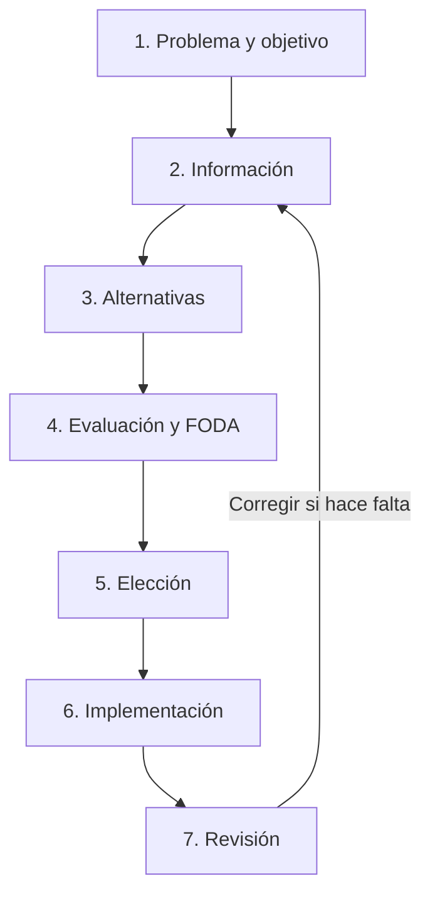

# Guía de estudio universitario — Microeconomía, semanas 9 y 10

> **Método:** bloques de atención de 10–30 minutos · explicación técnica + Feynman · trazado manual · 5 prácticas por tema · claves al final.
>
> **Base documental verificada:** `Semana 9 Microeconomía.md` y `Semana 10 Microeconomía.md`, aportados con los materiales del curso. **Limitación:** los cuatro PDF adjuntos (incluidas las presentaciones «OFERTA DE MERCADO» y «LICDA ASTRID CAYAX») no estuvieron disponibles para extracción en esta sesión, por lo que su contenido específico no se supone ni se atribuye aquí. Los ejemplos y ciertas precisiones técnicas adicionales están creados expresamente como apoyo didáctico y están señalados como tales.

## 0. Cómo utilizar esta guía

**Regla de oro:** intenta el ejercicio sin mirar la clave. Después revisa qué concepto falló, no solo el resultado.

| Atención disponible | Ciclo recomendado | Resultado obligatorio |
|---|---|---|
| 10 minutos | 2 min recordar sin notas + 5 min un concepto + 3 min microejercicio | Una definición en tus propias palabras |
| 20 minutos | 3 min repaso + 8 min concepto + 6 min gráfica/problema + 3 min corregir | Una gráfica o procedimiento reproducible |
| 30 minutos | 5 min recuperación + 10 min estudiar + 10 min 2 ejercicios + 5 min explicar en voz alta | Dos ejercicios justificados sin ver la clave |

**Semáforo del dominio:** 🔴 No puedo explicarlo; 🟡 lo explico con apuntes; 🟢 lo explico y resuelvo sin apuntes. Solo pasa de tema cuando puedas contestar dos preguntas sucesivas sin ayuda. Descansos sugeridos: 3–5 minutos entre bloques y uno más largo cada tres bloques.

### Plan de 10 sesiones, adaptable

| Sesión | Foco | Minutos | Evidencia de aprendizaje |
|---|---|---:|---|
| 1 | Ley de oferta; individual y mercado | 20 | Tablas y curva a mano |
| 2 | Determinantes; movimientos frente a desplazamientos | 20 | Tres gráficas etiquetadas |
| 3 | Elasticidad de oferta: fórmula y categorías | 30 | Dos cálculos y dos clasificaciones |
| 4 | Práctica mixta de semana 9 | 20 | Ejercicios sin claves |
| 5 | FPP: escasez, eficiencia, puntos | 20 | FPP dibujada a mano |
| 6 | Costo de oportunidad y cambios de la FPP | 30 | Tabla y gráfica justificadas |
| 7 | Costos de producción y clasificación | 20 | Tabla de CF/CV/CT |
| 8 | Restricción tecnológica y productividad | 20 | Diferenciar insumo y producto |
| 9 | Proceso de toma de decisiones | 20 | Aplicar los siete pasos a un caso |
| 10 | Simulacro acumulativo y corrección de errores | 30 | Lista de fortalezas y conceptos pendientes |

**Repaso espaciado:** antes de estudiar contenido nuevo, revisa el anterior al día siguiente, a los 3 días y a los 7 días. Puedes redistribuir las sesiones según tiempo real de concentración.

---

# 1. Oferta individual y oferta de mercado

### Conceptos y definiciones

**Oferta:** cantidades de un bien o servicio que los productores están dispuestos y pueden poner a la venta, a distintos precios, en un mercado y período determinados, manteniendo los demás factores constantes (*ceteris paribus*). Es el enfoque usado por la semana 9.

> **Feynman 👦**: imagina que tienes limonadas. Si pagan más por vaso, quizá quieras preparar más. La oferta cuenta cuántos vasos pondrías a la venta a cada precio.

**Ley de la oferta:** *ceteris paribus*, la cantidad ofrecida suele variar en el mismo sentido que el precio.

> **Feynman 👦**: si te pagan mejor por algo, normalmente te animas a vender más; si te pagan menos, menos.

**Oferta individual:** cantidades ofrecidas por un productor. **Oferta de mercado:** suma **horizontal** de las cantidades que todos los productores ofrecen a **un mismo precio**.

> **Feynman 👦**: para saber cuántas limonadas hay en el barrio, suma las de todos los puestos, pero compara siempre el mismo precio.

**⚠️ Diferencia difícil — oferta frente a cantidad ofrecida:** *cantidad ofrecida* = un punto de la curva a un precio; *oferta* = relación completa precio–cantidad, representada por toda la curva.

> **Feynman 👦**: elegir una porción de pizza no es lo mismo que cambiar la pizza entera.

**Ejemplo guiado de apoyo:**

| Precio P (Q) | Productor A | Productor B | Mercado A+B |
|---:|---:|---:|---:|
| 5 | 2 | 1 | 3 |
| 10 | 4 | 3 | 7 |
| 15 | 6 | 5 | 11 |
| 20 | 8 | 7 | 15 |

### Cómo hacer la gráfica a mano

1. Traza dos ejes perpendiculares; **X = cantidad Q**, **Y = precio P**.
2. Elige escala regular: X de 0 a 16 (pasos de 2), Y de 0 a 20 (pasos de 5).
3. Ubica (Q,P): (3,5), (7,10), (11,15), (15,20).
4. Une los puntos y escribe **S** sobre la línea ascendente.
5. Nunca pongas el precio en X si el curso usa la representación económica convencional.

```text
Precio P
 20 |                         ●
 15 |                  ●    / S
 10 |           ●     /
  5 |    ●     /
  0 +-------------------------------- Cantidad Q
      0   3      7      11     15
```

**Posibles preguntas de examen:** definición de oferta; ley; diferencia individual/mercado; suma horizontal; ejes correctos; significado de *ceteris paribus*.

### Práctica: 5 ejemplos (sin mirar la clave)

1. A ofrece 3, B 5 y C 2 unidades cuando P=Q8. ¿Cuál es la cantidad de mercado?
2. En P=Q4, A ofrece 2 y B 1; en P=Q8, A ofrece 4 y B 3. Construye la tabla de mercado y grafícala.
3. Cuando un precio sube de Q10 a Q15 y Q ofrecida de 9 a 14, ¿qué ley ilustra?
4. Un mercado ofrece 20 unidades a P=Q6. ¿«20» es la oferta completa o una cantidad ofrecida?
5. Tres empresas ofrecen 6, 0 y 9 unidades a P=Q12. ¿Se incluye la empresa que ofrece cero en la suma? Calcula Q de mercado.

---

# 2. Determinantes de la oferta: desplazamiento o movimiento

### Conceptos

**Movimiento sobre la curva:** cambio en la **cantidad ofrecida** causado por un cambio del **precio propio**, con los demás factores constantes.

> **Feynman 👦**: sigues caminando por el mismo tobogán: solo cambió el precio.

**Desplazamiento de la curva:** cambio de **la oferta** debido a otra variable (insumos, tecnología, expectativas, cantidad de empresas, clima, transporte, política, disponibilidad, etc.).

> **Feynman 👦**: ahora movieron todo el tobogán. Al mismo precio, las tiendas venden una cantidad diferente.

La semana 9 distingue determinantes **objetivas** (precio, costos de factores, demanda/mercado, disponibilidad, competencia, perecibilidad, inventarios, sustitutos, liquidez), **subjetivas** (expectativas, aspiraciones, voluntad de vender) y circunstancias adicionales (ubicación, transporte, ambiente, tecnología y política). Esta clasificación se conserva como organización del curso, aunque en un análisis gráfico estándar separamos precio propio del resto.

**⚠️ Difícil — direcciones:** aumento de oferta → curva a la **derecha**; disminución → **izquierda**. Una mejora tecnológica suele mover la oferta a la derecha; un aumento de costos suele moverla a la izquierda, si lo demás permanece igual.

> **Feynman 👦**: con una máquina que produce más rápido puedes vender más sin subir el precio.

### Guía para graficar a mano

1. Ejes Q horizontal y P vertical.
2. Dibuja una curva S₀ ascendente.
3. Si cambió el precio propio: marca dos puntos distintos **en S₀**; añade flecha entre ellos.
4. Si cambió otra condición: copia una curva S₁ **paralela aproximadamente a la derecha** si aumenta, o **a la izquierda** si disminuye; señala precio P₀ constante y las dos cantidades.
5. Debajo de la gráfica, escribe **causa** y **efecto** en palabras.

```text
MOVIMIENTO (misma S)                 DESPLAZAMIENTO (S0 -> S1)
P                                     P
|        ● B                         |     S0       S1
|      /                             |    /       /
|   ● A                              |   /       /
|  / S                               |  /       /
+--------------- Q                   +---------------- Q
```

**Trampa habitual:** «sube la demanda» no equivale automáticamente a «se desplaza la curva de oferta». Puede cambiar el precio de equilibrio y producir un movimiento **a lo largo** de la oferta; depende del modelo y de qué cambió realmente.

### Práctica: 5 ejemplos

1. Subió el precio propio y el productor entrega más. ¿Movimiento o desplazamiento?
2. Una tecnología reduce costos y aumenta lo ofrecido a todo precio. Clasifica y dibuja.
3. Un huracán destruye cosechas. Clasifica el cambio y dibuja.
4. Los productores esperan un precio mayor mañana y retienen inventarios hoy. ¿En qué dirección puede cambiar la oferta actual?
5. El combustible encarece el transporte de tomates. Explica el efecto esperado sobre la curva de oferta, suponiendo los demás factores constantes.

---

# 3. Elasticidad-precio de la oferta

### Conceptos y fórmula

**Elasticidad-precio de la oferta (Eₛ):** porcentaje en que cambia la cantidad ofrecida ante un cambio porcentual del precio, manteniendo los demás factores constantes.

> **Feynman 👦**: mide qué tanto reacciona un vendedor cuando cambia el precio. Algunos reaccionan poquito; otros muchísimo.

**⚠️ Difícil — fórmula de punto medio (arco):** la semana 9 presenta una expresión de variaciones entre cantidad y precio. Su versión legible y simétrica es:

\[
E_s=\frac{\frac{Q_2-Q_1}{(Q_1+Q_2)/2}}{\frac{P_2-P_1}{(P_1+P_2)/2}}
=\frac{Q_2-Q_1}{Q_1+Q_2}\cdot\frac{P_1+P_2}{P_2-P_1}
\]

Se usa el **valor absoluto** para clasificar la magnitud cuando se trabaja con valores de variación de sentido normal; verifica que Q y P correspondan al mismo intervalo. Si no cambia el precio (denominador cero), esta fórmula no da una elasticidad finita y no debe dividirse entre cero.

> **Feynman 👦**: comparamos cuánto cambió la cantidad *en porcentaje* contra cuánto cambió el precio *en porcentaje*. Si lo primero cambia más, es elástica.

| Categoría | Valor | Interpretación |
|---|---:|---|
| Perfectamente inelástica | Eₛ = 0 | Q no cambia cuando cambia P |
| Inelástica | 0 < Eₛ < 1 | Q cambia proporcionalmente menos que P |
| Unitaria | Eₛ = 1 | Q y P cambian igual porcentualmente |
| Elástica | Eₛ > 1, finita | Q cambia proporcionalmente más que P |
| Perfectamente elástica | Eₛ → ∞ | Precio constante para diferentes Q en el caso ideal |

**Matiz importante:** *perfectamente elástica* describe, bajo el modelo ideal, una **curva horizontal**, no cualquier cambio enorme en producción. *Perfectamente inelástica* es **vertical**. La elasticidad de arco depende del segmento comparado; una pendiente inclinada no permite clasificar sin datos adicionales.

### Cálculo modelo (creado para esta guía)

De P₁=10, Q₁=20 a P₂=12, Q₂=30:

- Cambio proporcional Q = (30−20)/25 = 0.40.
- Cambio proporcional P = (12−10)/11 ≈ 0.1818.
- Eₛ ≈ 2.20 → **elástica**.

### Gráficas manuales por categoría

1. Conserva X=Q, Y=P en todas las gráficas.
2. Dibuja una línea vertical para Eₛ=0 y horizontal para Eₛ→∞.
3. Para los otros grados usa datos numéricos y calcula Eₛ en un tramo: la forma visual por sí sola no siempre basta.

```text
E=0              E→∞
P |  S           P |-------- S
  |  |             |
  |  |             |
  +------ Q        +--------- Q
```

### Práctica: 5 ejemplos

Para los ejercicios 1–3 y 5 usa **punto medio** y clasifica.

1. P: 10→12; Q: 20→30.
2. P: 10→20; Q: 50→55.
3. P: 8→12; Q: 40→60.
4. El precio sube, pero se ofrecen exactamente 30 unidades antes y después. ¿Valor y curva?
5. P: 5→15; Q: 10→20.

---

# 4. Frontera de Posibilidades de Producción (FPP)

### Conceptos y supuestos

**FPP o curva de transformación:** conjunto de combinaciones **máximas factibles** de dos bienes que pueden producirse con recursos, tecnología y tiempo dados. Es el tema central de la semana 10.

> **Feynman 👦**: tienes harina para hacer pan y pasteles. Si usas más harina en pasteles, puede quedar menos para pan. La curva muestra las mejores combinaciones posibles.

**⚠️ Precisión importante sobre el texto de semana 10:** aparece la expresión «factores y tecnología ilimitados», pero los supuestos listados después dicen que **los factores están dados y la tecnología está dada**. Para que exista escasez y una frontera finita, el planteamiento económico coherente supone **recursos limitados y tecnología dada**, no ilimitados. Conviene conocer esta discrepancia y confirmarla con tu docente.

**Punto sobre la FPP:** eficiencia productiva (dado el modelo). **Punto interior:** producción factible pero ineficiente. **Punto exterior:** inalcanzable con la dotación y tecnología actuales.

> **Feynman 👦**: sobre la línea estás aprovechando lo que tienes; dentro te sobra capacidad; fuera querrías cocinar más de lo que tus ingredientes permiten.

**Costo de oportunidad:** cantidad del otro bien a la que se renuncia cuando se decide producir una unidad adicional del primero.

> **Feynman 👦**: el precio de hacer un pastel más puede ser dejar de hornear dos panes.

**⚠️ Difícil — costo de oportunidad creciente:** si los recursos no sirven igual para producir ambos bienes, obtener unidades adicionales de X exige sacrificar progresivamente más Y; la FPP suele ser **cóncava hacia el origen** (arqueada hacia afuera).

### Tabla y guía de dibujo

| Alternativa | Bien X | Bien Y |
|---|---:|---:|
| A | 0 | 20 |
| B | 2 | 19 |
| C | 4 | 16 |
| D | 6 | 11 |
| E | 8 | 0 |

1. Eje X = unidades del bien X; eje Y = unidades del bien Y.
2. Escala X: 0 a 8 cada 2. Escala Y: 0 a 20 cada 5.
3. Coloca A(0,20), B(2,19), C(4,16), D(6,11), E(8,0).
4. Únelos suavemente: verifica que al aumentar X disminuya Y.
5. Marca I(2,8) **adentro** y U(6,19) **afuera**; argumenta cuál es factible.

```text
Bien Y
20 |●A  ●B
15 |        ●C
10 |            ●D
 5 |      I
 0 +----------------●E------ Bien X
    0    2   4   6   8
```

**Cambio tecnológico:** si mejora la capacidad productiva de ambos bienes, la FPP suele desplazarse hacia afuera; si mejora solo X, puede girar hacia afuera del lado del eje X. **No confundas** un movimiento entre puntos de una FPP con un desplazamiento de toda la FPP.

### Práctica: 5 ejemplos

1. Con la tabla A–E, ¿cuánto Y se sacrifica al pasar B→C?
2. Con la misma tabla, ¿cuánto Y se sacrifica por unidad de X al pasar C→D?
3. Clasifica A(0,20), I(2,8), U(6,19) como eficiente, interior o inalcanzable.
4. Una nueva máquina mejora solamente la producción máxima de X. Dibuja cómo cambia la frontera y explica el giro.
5. Una sociedad sufre la destrucción de parte de sus fábricas. ¿Qué ocurriría, en general, con la FPP? Traza antes y después.

---

# 5. Producción, costos y rentabilidad

### Conceptos

**Costo de producción:** recursos monetarios necesarios para producir bienes o servicios; la semana 10 también los denomina costos de operación.

> **Feynman 👦**: todo lo que gastas para preparar las galletas antes de venderlas.

**Costo de venta:** término que puede referirse, según contexto contable, al costo de bienes vendidos o a gastos de comercialización. **Nota:** el documento del curso lo emplea genéricamente como «costo de vender»; conserva esa definición para preguntas textuales, pero distingue términos cuando hagas cálculos.

> **Feynman 👦**: producir la galleta y llevarla hasta quien la compra pueden generar gastos distintos.

**Costos directos:** atribuibles de manera relativamente clara a un producto, como materia prima o mano de obra directa. **Costos indirectos:** compartidos entre productos o actividades y necesitan un criterio de reparto, como parte del alquiler o seguros.

> **Feynman 👦**: la harina de tus galletas sabes cuánto costó para ellas; la luz de toda la cocina es más difícil repartirla.

**⚠️ Difícil — directo ≠ variable; indirecto ≠ fijo.** El material relaciona estos pares de forma simplificada; técnicamente son **clasificaciones diferentes**: «directo/indirecto» = posibilidad de atribuir al producto; «fijo/variable» = comportamiento ante el volumen de producción en un horizonte dado.

> **Feynman 👦**: una etiqueta dice *a quién pertenece el gasto*; la otra dice *si cambia cuando produces más*.

**Costo fijo (CF):** no cambia con la cantidad producida dentro del rango y plazo analizados. **Costo variable (CV):** cambia con Q. **Costo total (CT):** suma ambos. **Ingreso total (IT):** precio de venta por cantidad si el precio es uniforme. **Beneficio contable simplificado:** IT−CT.

### Fórmulas de apoyo didáctico (no desarrolladas explícitamente en las notas)

\[
CT=CF+CV,\quad CMe=\frac{CT}{Q},\quad CFMe=\frac{CF}{Q},\quad CVMe=\frac{CV}{Q}
\]
\[
CMg=\frac{\Delta CT}{\Delta Q},\quad IT=P\cdot Q,\quad \pi=IT-CT
\]

En Q=0, **no se calcula costo medio** dividiendo entre cero.

### Cómo dibujar curvas de costos a mano

1. Q (horizontal) y costo en quetzales (vertical).
2. Dibuja CF como línea horizontal.
3. Traza CV empezando en el origen para un caso simplificado de CV(0)=0.
4. Traza CT empezando a la altura de CF y sumando verticalmente CV a cada Q.
5. **No impongas una curva en U** de costo marginal sin datos que la justifiquen.

```text
Costo (Q)
  |                 / CT
  |            ____/
  |      _____/       / CV
CF|------------------/
  |                /
  +---------------------------- Cantidad
```

### Práctica: 5 ejemplos

1. CF=Q100 y CV=Q250. Calcula CT.
2. CF=Q120, CV=Q180, Q=10. Halla CT y CMe.
3. Q=10 tiene CT=Q300 y Q=15 tiene CT=Q400. Halla CMg en ese tramo.
4. Se venden 40 unidades a Q20 cada una, CT=Q650. Halla IT y beneficio simplificado.
5. Clasifica para una panadería: harina usada en panes, alquiler mensual y electricidad total de tienda, en **directo/indirecto** y **fijo/variable**; explica cualquier dependencia del contexto.

---

# 6. Restricción tecnológica y decisiones empresariales

### Conceptos

**Restricción tecnológica:** combinaciones de insumos y producto permitidas por la tecnología y los recursos disponibles. El curso presenta la pregunta central: ¿qué nivel de producción y combinación de insumos permitiría maximizar ganancias?

> **Feynman 👦**: aunque quieras preparar mil panes, tu horno, tiempo y harina ponen límites.

**Cambio tecnológico:** mejora en métodos o procesos que puede reducir desperdicios, elevar productividad o permitir nuevos productos.

> **Feynman 👦**: un horno más rápido te ayuda a hacer más pan con el mismo tiempo.

**Función de producción (ampliación didáctica):** relación entre factores productivos y cantidad de producto, por ejemplo Q=f(L,K), con L trabajo y K capital.

> **Feynman 👦**: es una receta matemática: cuántos trabajadores y máquinas necesitas para obtener cierto producto.

**Isocuanta (ampliación correctiva):** curva de combinaciones de dos insumos que producen la **misma cantidad de producto**. **No es una curva de oferta**: la semana 9 pone «curvas isocuantas» cerca de la explicación de curvas de oferta, pero técnicamente son gráficos distintos.

> **Feynman 👦**: 2 trabajadores con una máquina o 1 trabajador con dos máquinas podrían conseguir los mismos 100 panes: los dos puntos están en la misma isocuanta.

### Dibujo manual: isocuanta frente a curva de oferta

- **Isocuanta:** eje X = trabajo L, eje Y = capital K; une combinaciones (L,K) que producen una Q fija. Bajo sustitución de insumos habitual, curva descendente y convexa al origen.
- **Oferta:** eje X = producto Q, eje Y = precio P; representa cantidades a distintos precios y normalmente es ascendente.

```text
ISOCUANTA (Q constante)        OFERTA (precios y cantidades)
K |●                           P |              / S
  |  ●                           |           /
  |     ●                        |        /
  |        ●                     |     /
  +-------------- L             +---------------- Q
```

### Práctica: 5 ejemplos

1. Una empresa hace 100 unidades con (L=2,K=4) o con (L=4,K=2). ¿Qué gráfica reúne esas combinaciones?
2. Una máquina permite hacer 150 productos donde antes se hacían 100 usando los mismos insumos. ¿Qué cambio ocurrió?
3. ¿Qué ejes corresponden a una isocuanta y cuáles a una oferta?
4. Una fábrica tiene capacidad máxima de 500 artículos diarios pero recibe pedidos de 700. ¿Qué restricción aparece?
5. Con una producción de 60 unidades, compara (L=3,K=3) y (L=4,K=2): si ambas generan lo mismo, ¿qué se mantiene constante en la isocuanta?

---

# 7. Tiempo y toma de decisiones

### Conceptos

**Toma de decisiones:** selección de una alternativa de acción con base en un problema, un objetivo, información, tiempo disponible y evaluación de consecuencias. La semana 10 destaca la importancia del contexto y del tiempo, sin imponer una duración universal.

> **Feynman 👦**: elegir el mejor camino para llegar a la escuela mirando qué tan lejos está y cuánto tiempo tienes.

**Árbol de decisiones:** representación ramificada de opciones y posibles resultados.

> **Feynman 👦**: dibujas «si hago A, podría pasar esto; si hago B, aquello».

**FODA:** fortalezas, oportunidades, debilidades y amenazas para comparar opciones.

> **Feynman 👦**: una lista de lo que haces bien, lo que te falta, las oportunidades que hay y lo que podría complicarse.

### Los siete pasos del material

1. **Identificar** la decisión y el objetivo.
2. **Reunir** información relevante.
3. **Identificar alternativas**, por ejemplo con un árbol.
4. **Sopesar** ventajas y desventajas, con FODA si ayuda.
5. **Elegir** una alternativa o combinación.
6. **Implementar** con plan de acción.
7. **Revisar** resultados y métricas de éxito.



**⚠️ Difícil — elegir no equivale a demostrar éxito:** el paso 7 comprueba resultados; una opción bien razonada aún puede fallar por riesgos o información incompleta.

> **Feynman 👦**: no basta escoger una receta: hay que probar cómo quedó el pastel.

### Práctica: 5 ejemplos

1. Una empresa tiene pérdidas pero no conoce sus causas. ¿Qué dos primeros pasos debería realizar?
2. Menciona una alternativa tecnológica y una administrativa para reducir costos en una panadería.
3. Una empresa identifica competencia agresiva. ¿En qué cuadrante FODA cae ese elemento externo desfavorable?
4. El equipo compra una máquina y jamás revisa producción real. ¿Qué paso omitió?
5. Propón una métrica concreta para evaluar una nueva máquina cuyo objetivo es reducir desperdicio.

---

# 8. Glosario exprés para examen

| Término | Definición técnica breve | Feynman, en palabras fáciles |
|---|---|---|
| Escasez | Recursos insuficientes para satisfacer todos los usos deseados | No alcanza para todo |
| Ceteris paribus | Mantener constantes los factores ajenos al estudiado | Cambia una cosa por vez |
| Oferta | Relación de precios y cantidades ofrecidas | Cuánto se vendería a cada precio |
| Cantidad ofrecida | Q asociada a un precio específico | Un punto de la línea |
| Oferta de mercado | Suma horizontal de ofertas individuales | Sumar puestos al mismo precio |
| Determinante | Variable que influye en la oferta | Algo que cambia cuánto venden |
| Elasticidad | Sensibilidad proporcional Q ante P | Qué tanto reacciona Q |
| Inelástica | E menor que 1 y mayor que 0 | Reacciona poquito |
| Unitaria | E igual a 1 | Reacciona en igual proporción |
| Elástica | E mayor que 1 | Reacciona mucho |
| FPP | Máximas combinaciones posibles de dos bienes | Tus mejores mezclas de producción |
| Eficiencia productiva | Uso pleno de los recursos dentro del modelo | Aprovechar lo disponible |
| Costo de oportunidad | Mejor alternativa sacrificada | Lo que dejas de hacer |
| Costo fijo | No depende de Q en rango/plazo dados | Pagas aunque hagas poco |
| Costo variable | Cambia con Q | Más producción, más insumos |
| Costo total | CF más CV | Todo lo que gastas |
| Costo marginal | Aumento de CT por unidad adicional | Cuánto cuesta uno más |
| Restricción tecnológica | Límite impuesto por insumos y tecnología | Lo que tu horno permite |
| Isocuanta | Insumos alternativos para la misma producción | Recetas distintas, igual cantidad |
| FODA | Diagnóstico de fortalezas, oportunidades, debilidades y amenazas | Lo bueno, lo mejorable, ayudas y peligros |

## Hoja de fórmulas

| Fórmula | Qué significa | Condición |
|---|---|---|
| `Qmercado(P) = Σ Qi(P)` | Suma cantidades individuales al mismo P | Mismo bien/período/precio |
| `Eₛ = [(Q₂−Q₁)/((Q₁+Q₂)/2)] / [(P₂−P₁)/((P₁+P₂)/2)]` | Elasticidad arco de oferta | P₁≠P₂, medias válidas |
| `Costo de oportunidad de X = |ΔY/ΔX|` | Y sacrificado por unidad X | Tramo de FPP, ΔX≠0 |
| `CT = CF + CV` | Costo total | Misma unidad de tiempo |
| `CMe = CT / Q` | Costo promedio | Q>0 |
| `CVMe = CV / Q` | Costo variable medio | Q>0 |
| `CFMe = CF / Q` | Costo fijo medio | Q>0 |
| `CMg = ΔCT / ΔQ` | Costo marginal discreto | ΔQ≠0 |
| `IT = P × Q` | Ingreso total | Precio único por unidad |
| `π = IT − CT` | Beneficio simplificado | Definición de costos consistente |

---

# 9. Claves de respuesta — consulta solo tras intentarlo

## Tema 1 — Oferta
1. **10 unidades** (3+5+2).
2. P4→Qmercado3; P8→Qmercado7. Graficar (3,4) y (7,8), ejes Q horizontal/P vertical.
3. Ley de oferta: cambio de Q ofrecida en el mismo sentido que P.
4. **Cantidad ofrecida** en ese precio; no define toda la función de oferta.
5. **Sí**, la empresa entra con 0; total **15**.

## Tema 2 — Determinantes
1. Movimiento ascendente **sobre** la curva.
2. Aumento de oferta: **desplazamiento a la derecha**.
3. Disminución de oferta: **izquierda**.
4. **Puede disminuir la oferta actual** (izquierda) al retener producto; depende de capacidad de almacenamiento y otros factores.
5. Mayor costo de transporte → normalmente **menor oferta** (izquierda).

## Tema 3 — Elasticidad
1. `[(30−20)/25] / [(12−10)/11] = 0.4/0.1818 ≈ 2.20` → **elástica**.
2. `(5/52.5)/(10/15) ≈ 0.1429` → **inelástica**.
3. `(20/50)/(4/10)=1` → **unitaria**.
4. `Eₛ=0`: **perfectamente inelástica**, línea vertical Q=30.
5. `(10/15)/(10/10)≈0.6667` → **inelástica**.

## Tema 4 — FPP
1. B→C: Y pasa de 19 a 16 → **sacrifica 3 Y** por ganar 2 X.
2. C→D: Y cae 16→11, X aumenta 4→6 → **5/2=2.5 unidades Y por X**.
3. A: **sobre frontera/eficiente**. I: **interior/ineficiente**. U: **exterior/inalcanzable** bajo condiciones dadas.
4. Giro hacia afuera del extremo de **X** manteniendo igual, en el ejemplo estilizado, el máximo de Y.
5. **Contracción hacia adentro** de la frontera, si se pierde capacidad relevante.

## Tema 5 — Costos
1. `CT=100+250=Q350`.
2. `CT=120+180=Q300`, `CMe=300/10=Q30 por unidad`.
3. `CMg=(400−300)/(15−10)=Q20 por unidad adicional`.
4. `IT=40×20=Q800`; beneficio simplificado `800−650=Q150`.
5. Harina: **directa y variable** normalmente; alquiler: **indirecto y fijo** normalmente; electricidad total: suele ser **indirecta**, con componente fijo y/o variable según medición, maquinaria y contrato. Justificar, no memorizar etiquetas absolutas.

## Tema 6 — Restricción tecnológica
1. **Isocuanta** de Q=100.
2. **Mejora tecnológica / productividad** si los insumos son iguales.
3. Isocuanta: X=L, Y=K; oferta: X=Q, Y=P.
4. **Restricción de capacidad productiva**: 500 máximo frente a 700 pedidos.
5. Se mantiene **Q=60**; cambian las combinaciones de L y K.

## Tema 7 — Decisiones
1. **1 identificar problema/objetivo; 2 reunir información** sobre causas y desempeño.
2. Ejemplos: horno eficiente (tecnológica); reorganizar turnos (administrativa). Se aceptan otras alternativas justificadas.
3. **Amenaza** (externa y desfavorable).
4. **Paso 7: revisar resultado e impacto**.
5. Ejemplo: **kilogramos desperdiciados por cada 100 productos**, antes y después; misma base de comparación.

---

# 10. Simulacro acumulativo y señales de alerta

Hazlo **sin apuntes, durante 20 minutos**. No hace falta memorizar párrafos: explica causas y dibuja ejes.

- [ ] Explico por qué el precio propio mueve un punto y el costo de insumos mueve la curva.
- [ ] Sumo tres ofertas horizontales a un mismo precio.
- [ ] Calculo Eₛ por punto medio y clasifico el resultado.
- [ ] Identifico una FPP interior, un punto de frontera y uno exterior.
- [ ] Calculo costo de oportunidad por tramo e interpreto unidades.
- [ ] Distingo directo/indirecto de fijo/variable con un contraejemplo.
- [ ] Explico por qué una isocuanta no representa oferta.
- [ ] Recito y aplico los siete pasos de toma de decisiones.

**Errores que suelen costar puntos:** confundir eje P con Q; sumar precios en vez de cantidades; atribuir desplazamiento a precio propio; usar diferencias absolutas en vez de porcentajes en elasticidad; perder el signo/sentido del sacrificio en la FPP; dividir entre cero; asumir que todo costo indirecto es fijo; dibujar una isocuanta como si fuera una curva de oferta.

### Método de corrección activa

1. Escribe el paso exacto donde te equivocaste.
2. Reescribe la regla en una frase de menos de 15 palabras.
3. Inventa un nuevo ejemplo cambiando cantidades/precios y resuélvelo.
4. Explícaselo a una persona imaginaria de 10 años sin términos técnicos.

### Fuentes y alcance

- **Contenido del curso consultado:** `Semana 9 Microeconomía.md`: oferta, factores que la determinan, variaciones, elasticidad de la oferta; menciona producción a largo plazo e isocuantas.
- **Contenido del curso consultado:** `Semana 10 Microeconomía.md`: curva de transformación/FPP, costos, tiempo y toma de decisiones, restricción y cambio tecnológicos.
- **Ampliaciones creadas para practicar:** modelos numéricos, fórmulas de costos y oportunidad, detalle sobre isocuantas, tablas, gráficas de texto, preguntas y claves. Son apoyos explicativos, **no citas textuales de las diapositivas**.
- **Material no inspeccionado:** `Semana 9 Microeconomía.pdf`, `Semana 10 Microeconomía.pdf`, `OFERTA DE MERCADO_20261025_225944_0000.pdf`, `LICDA ASTRID CAYAX_20261025_230118_0000.pdf` (no disponibles para lectura en esta sesión). Si contienen temas adicionales, esta guía no pretende cubrirlos.

**Mini-mnemotecnia:** `P mueve Punto; Otros mueven Oferta`. `FPP = Factible, Pleno, Posible límite`. `CT = Fijo + Variable`. `Decidir = Identificar → Investigar → Alternativas → Evaluar → Elegir → Ejecutar → Examinar`.
